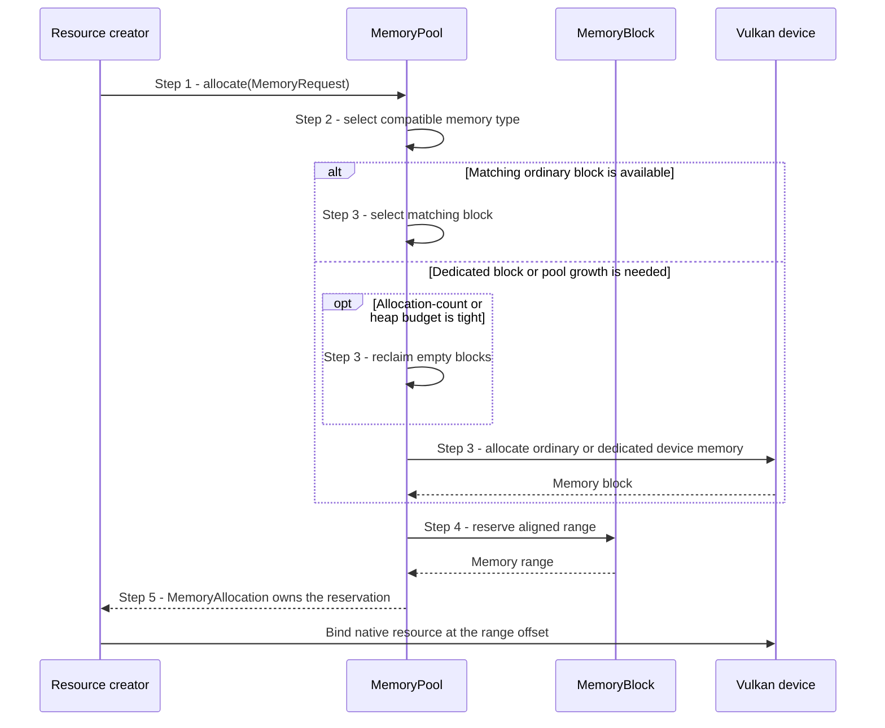
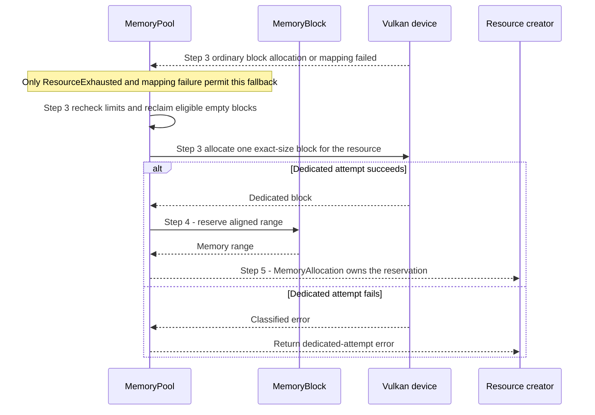

# Allocate a compatible device-memory range

## Goal and boundary

When an unbound buffer or optimal-tiled image needs backing memory,
`MemoryPool::allocate` returns a move-only `MemoryAllocation` reserving a range
that satisfies the resource's Vulkan requirements and the caller's memory
properties. The **resource creator** still owns the native object and binds it at
the returned offset. The **Context-owned pool** owns device-memory blocks. This
flow does not bind or initialize the resource, submit GPU work, wait for
completion or relocate live ranges.

| Boundary | Meaning |
| --- | --- |
| Trigger and input | A resource creator supplies Vulkan memory requirements, dedicated-allocation requirements, the native resource and required/preferred properties |
| Successful end | A move-only `MemoryAllocation` reserves a compatible aligned range for the caller to bind |
| Failure end | An `Error` is returned without publishing a new range; existing live allocations remain owned |
| Outside this flow | Native resource creation/binding, GPU-use retirement and returning the range after resource destruction |

## Preconditions

1. **Pool lifetime.** The `Context` and its device-backed `MemoryPool` are live;
   calls are serialized with other Context operations.
2. **Unbound resource.** The caller has created one native buffer or optimal-tiled
   image and queried its size, alignment, eligible memory types and dedicated
   requirements.

## Main flow

1. **Request.** The caller passes `MemoryRequest` with the native requirements,
   required and preferred memory properties, dedicated-allocation hints and
   exactly one resource handle.
2. **Select a memory type.** `MemoryPool` considers only types allowed by
   `memoryTypeBits`, requires every requested property, and skips memory features
   that Panda does not support. It prefers types matching more preferred
   properties, with an extra preference for coherent memory when host access is
   requested.
3. **Choose or create a block.** Unless Vulkan requires or prefers a dedicated
   allocation, and unless the request is larger than half an ordinary block, the
   pool selects an existing ordinary block with the same memory type and
   resource kind, or creates one if none is available. Buffer and image blocks
   are separate. Dedicated requests use an exact-size block. Before allocating
   new device memory, the pool checks heap, maximum-allocation-size and
   allocation-count limits. Under allocation-count or heap pressure it may first
   reclaim empty blocks; it never evicts a live range.
4. **Reserve the aligned range.** `MemoryBlock` reserves the requested size and
   alignment in the selected block. This is the same operation for a reused
   ordinary block and a newly created ordinary or dedicated block.
5. **Return the range.** `MemoryPool` records the allocation and returns a
   move-only `MemoryAllocation`. The caller binds the native resource at
   `getRange().offset`; successful allocation alone does not publish that
   resource to the application.

## Notes

**Resource partitions.** An ordinary block can be reused only for the same
memory type and the same buffer-or-image partition. The texture creator requests
device-local memory from the image partition. Mesh vertex and index storage
uses the buffer partition through `BufferResource`; buffer memory intent maps
to its own required/preferred properties in [Create a buffer](create-buffer.md).

**Block size and dedicated requests.** Ordinary blocks are nominally 8 MiB for
host-visible memory and 64 MiB otherwise, capped by the selected heap and the
device's maximum allocation size. Vulkan-required or preferred dedicated
requests, and requests larger than half that effective block size, use exact-size
dedicated allocations naming the resource. Smaller requests first reuse an
ordinary range or grow an ordinary block.

**Limited fallback.** If ordinary growth fails with `ResourceExhausted` or a
host-memory mapping failure, the pool makes one exact-size dedicated attempt.
Device loss is returned immediately. A failed request may reclaim empty cached
blocks, but it does not alter existing live allocations. At most one empty
ordinary block is retained for each memory-type/resource-kind partition; the
[memory-range subflow](release-memory-range.md) describes that policy after an
owner releases its range.

**Ownership.** `MemoryAllocation` borrows the pool and identifies its reserved
range; it does not own the Vulkan memory handle directly. The pool owns that
block, while the resource retains the range owner until the native resource is
destroyed. The allocation does not track GPU completion or perform a wait; the
caller must satisfy the [resource lifetime contract](../design/contracts/resources.md#frame-contexts-and-retirement).

## Variants and errors

|  | Point and condition | Response | Resulting state and next action |
| --- | --- | --- | --- |
| **Variant&nbsp;1** | Step 3: a compatible ordinary block is available | Select it without allocating another Vulkan memory block | The pool's committed bytes stay unchanged; Step 4 reserves the requested aligned range |
| **Variant&nbsp;2** | Step 3: Vulkan requires/prefers dedicated memory or the request exceeds half a block | Create an exact-size block dedicated to the named resource | Step 4 reserves its range at offset zero; normal binding remains the caller's responsibility |
| **Error&nbsp;1** | Step 1: malformed requirements or resource identity | Return `InvalidArgument` | No range is published; correct the internal request |
| **Error&nbsp;2** | Step 2: no eligible memory type satisfies the required properties | Return `Unsupported` | No range is published; choose a supported request or device |
| **Error&nbsp;3** | Step 3: budget remains exhausted after eligible empty blocks are reclaimed, or Vulkan allocation fails | Return `ResourceExhausted` or the classified native error | No new range is published; existing owners remain valid; retry only after resolving the cause |
| **Error&nbsp;4** | Step 3: ordinary block growth fails with `ResourceExhausted` or mapping failure | Make one exact-size dedicated attempt; on success continue with Step 4; otherwise return that attempt's error | Existing live ranges remain unchanged; device loss does not enter this retry path |

### Error 4 - Fallback after ordinary-block failure

**Entry state.** No existing matching ordinary block can satisfy the request.
The request did not already require or prefer dedicated memory. A new ordinary
block failed with `ResourceExhausted` or a host-memory mapping failure. Step 4
has not reserved a range and nothing has been returned to the caller.

## Outcomes

**Success.** The caller owns a move-only reservation satisfying the native
requirements and can bind the resource at its offset. Pool ownership keeps the
block alive; destroying the resource releases the range through the
[memory-range subflow](release-memory-range.md).

**Failure.** No new range owner escapes. Empty cached blocks may have been
released to meet a budget, but live allocations are not evicted or moved.

## Related information

- [Create a buffer](create-buffer.md), [Create a texture and its default view](create-texture.md)
  and [Create mesh storage with optional indices](create-mesh.md) show how
  resource-specific requirements use this shared allocation flow.
- [Return a resource memory range](release-memory-range.md) explains range
  release and empty-block retention after the resource's last owner is gone.
- [Allocation, uploads and descriptors](../design/contracts/resources.md#allocation-uploads-and-descriptors)
  owns the pool policy and the requirement that submitted work retain resources.
- The Vulkan [memory-allocation guide](https://docs.vulkan.org/guide/latest/memory_allocation.html)
  explains device-memory suballocation; the block sizes, partitions and fallback
  rules above are Panda policy.
