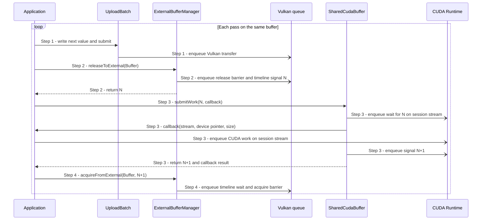

# Alternate Vulkan and CUDA work on a shared buffer

## Goal and boundary

The application repeatedly uses one shared buffer from Vulkan and CUDA. Each pass
queues Vulkan work, releases the buffer to CUDA, queues CUDA work between a timeline
wait and signal, then queues Vulkan reacquisition. This page uses a Vulkan upload
and a CUDA clear as a small example. It does not add a scheduler or wait between
passes. Destroying the final shared-buffer owner synchronizes the CUDA stream to
release its imported resources.

**The application** chooses the work for each pass and serializes submissions for
this buffer. **Panda Core** queues Vulkan work and ownership transfers.
**`Panda::Cuda`** orders the application's callback on its session stream.

| Boundary | Meaning |
| --- | --- |
| Trigger and input | Application has more Vulkan/CUDA work to perform on the shared buffer |
| Successful end | The last pass has queued a Vulkan acquire after the CUDA signal |
| Failure end | The operation reports an error; the buffer's state depends on the failing step |
| Outside this flow | Creating/importing the buffer, multi-step compute policy, GPU data proof |

## Preconditions

1. **Shared buffer.** [UC Create and import an external buffer](create-external-buffer.md)
   has produced a live `SharedCudaBuffer`. The `Context` outlives the buffer and
   its imported CUDA session.
2. **Ownership and ordering.** Vulkan owns the buffer when a pass starts. The
   application serializes passes for this buffer; each next Vulkan submission uses
   the same `Context` queue after the preceding acquire has been queued.

## Main flow

1. **Queue Vulkan work.** The application writes the next value to the same buffer
   through an `UploadBatch` and submits it. The upload is queued on the `Context`
   graphics/compute queue; the application does not wait for its completion.
2. **Release to CUDA.** The application calls
   `ExternalBufferManager::releaseToExternal`. Core queues the Vulkan ownership
   release and timeline signal, returning value `N`.
3. **Queue CUDA work.** The application calls
   `SharedCudaBuffer::submitWork(N, callback)`. CUDA waits for `N` on the session
   stream, then runs the callback with that stream, a borrowed mapped device
   pointer and the buffer size. In this example, the callback queues a clear.
   Panda queues the next timeline signal at `N+1`.
4. **Reacquire for Vulkan.** The application passes `N+1` to
   `ExternalBufferManager::acquireFromExternal`. Core queues the wait and Vulkan
   ownership acquire. If another pass remains, its upload is submitted afterward
   on the same queue.

## Notes

**Ordering across passes.** Each release follows that pass's Vulkan upload on the
Context queue. CUDA's wait and signal order its callback on the session stream.
The next upload follows the queued Vulkan acquire on the same Context queue. These
queue dependencies let the application alternate APIs without a CPU wait.

**Submission is not completion.** Each API call returning means its work was queued,
not finished. The callback's device pointer is borrowed and must not escape; its
CUDA operations must use the supplied stream.

**Timeline values require the semaphore.** `N` comes from a successful
`releaseToExternal`, which queues Vulkan's semaphore signal. Without an exported
semaphore that call returns `Unsupported` before submission, so there is no `N`.
Calling `submitWork` on a memory-only import also returns `Unsupported` at its CUDA
wait; the callback is not invoked. This API has no alternate synchronization path.

**Callback errors.** If the callback reports an enqueue error or throws,
`submitWork` still queues the timeline signal and returns the callback error
separately. Queue Vulkan reacquisition with the returned signal value before
handling that error. The example stops after reporting it, but the buffer has
returned to Vulkan ownership.

|  | Point and condition | Response | Resulting state and next action |
| --- | --- | --- | --- |
| **Variant&nbsp;1** | Step 2: the buffer has no paired timeline semaphore | `releaseToExternal` returns `Unsupported` before submitting a release | No timeline value `N` exists; keep Vulkan ownership and use memory-sharing only |
| **Error&nbsp;1** | Step 1: upload write or submission fails | Return the upload error before releasing the buffer | Vulkan still owns the buffer; resolve the cause before retrying |
| **Error&nbsp;2** | Step 2: the buffer is invalid or already released | Return the error before this release is submitted | Vulkan still owns the buffer; correct the state before retrying |
| **Error&nbsp;3** | Step 3: CUDA cannot enqueue its wait | Return a CUDA error without invoking the callback or queuing a signal | The earlier Vulkan release remains submitted; no acquire value is available for automatic recovery |
| **Error&nbsp;4** | Step 3: the callback reports an enqueue error or throws | Return the callback error alongside the queued signal value | Queue Step 4 before handling the callback error; already-enqueued work may have run |
| **Error&nbsp;5** | Step 3: CUDA cannot enqueue its signal | Return a CUDA error and fault this imported handoff | No successful signal value is available; the application has no automatic recovery path |
| **Error&nbsp;6** | Step 4: acquire uses an unexpected timeline value | Return `InvalidArgument` before submitting the acquire | Keep the externally owned state; use the value returned by `submitWork` |

**Success.** The application can queue another pass after Step 4; it need not wait
on the CPU between passes.

**Failure.** Recovery depends on the failing step. In particular, a failed CUDA
wait or signal does not restore Vulkan ownership automatically.

## Related information

- [UC Create and import an external buffer](create-external-buffer.md) prepares the
  buffer and session required by this flow.
- [Compute and external-buffer contract](../design/contracts/compute.md) defines
  the callback and timeline-value rules.
- [Vulkan and external backend handoff task](../development/tasks/gpu-handoff.md)
  tracks synchronization proof still required for acceptance.
- [CUDA connection example](../../examples/cuda_connection/README.md) shows three
  Vulkan-upload/CUDA passes on one buffer.
