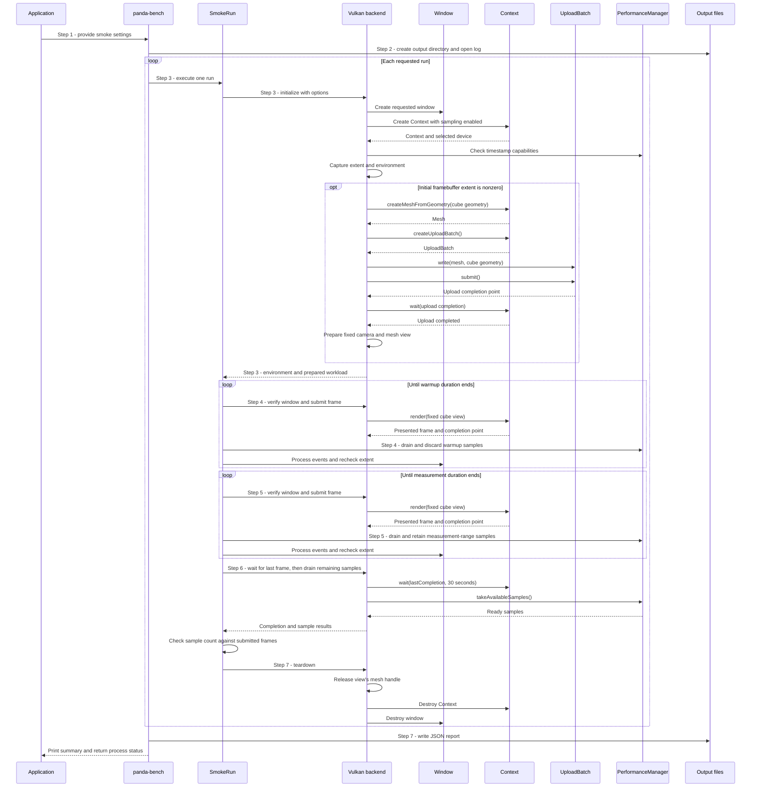
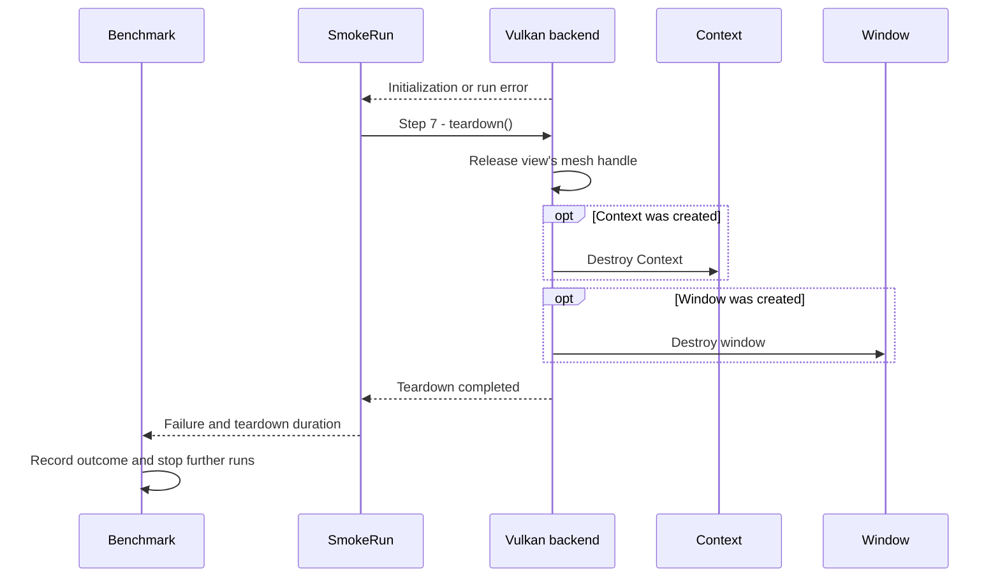

# Execute a controlled benchmark smoke run and save a report

## Goal and boundary

An application developer runs `panda-bench` to collect a short, repeatable sample
of Panda's public frame timings and save the run details. The flow starts with
command-line arguments and ends with a JSON report and process outcome. Only the
`smoke` profile is implemented; it uploads one standard cube before warmup and
measurement, then submits a fixed one-mesh view through `Context::render(view)`. It
exercises the live mesh renderer path, but is not a representative scene benchmark or
performance baseline.

**The benchmark** validates settings, drives the timed phases and checks that the
sample set is complete. **Panda** owns window/context creation and asynchronous
frame timing. Each requested run creates and tears down its own window and
`Context`.

## Main flow

1. **Parse the request.** `parseArguments()` accepts the smoke profile, output
   directory, requested window size, warmup and measurement durations, and run
   count. Defaults are `smoke`, `results`, 1280 by 720 pixels, 1 second warmup,
   3 seconds measurement and one run. It rejects other profiles, zero extents,
   warmup outside 0 to 3600 seconds, measurement outside 1 to 86400 seconds, and
   run counts outside 1 to 100 before creating output files.
2. **Prepare reporting.** `runBenchmark()` gathers code/build and host CPU metadata,
   creates the output directory and opens `panda-bench.log` as a logger sink. A
   setup error stops before any run starts.
3. **Initialize a run.** `SmokeRun` asks `VulkanSmokeRunBackend` to create a window
   at the requested size, then a windowed `Context` with validation disabled and
   frame sampling enabled. The backend requires GPU timestamp support and captures
   the effective framebuffer extent, GPU, driver and Vulkan API information. For a
   nonzero extent, it creates unit-cube geometry and a matching mesh, snapshots the
   geometry through an `UploadBatch`, waits for upload completion and prepares one
   fixed camera and mesh draw. A minimized initial framebuffer makes the run invalid.
4. **Warm up.** For the requested duration, `SmokeRun` checks that the window stays
   open and its nonzero framebuffer extent stays unchanged, submits a frame, drains
   available samples and discards them, then processes window input. Every frame
   must be `Presented` with a valid completion point; warmup frames and their
   samples are excluded from measurement. A zero-second warmup skips this phase.
5. **Measure.** `SmokeRun` records the first measurement frame index, then repeats
   the same controlled frame loop for the requested measurement duration. It drains
   samples during the loop and keeps only samples whose frame indices fall in the
   measurement interval. This uses the public timing API described in
   [UC Collect paired CPU and GPU frame timings](collect-frame-timings.md).
6. **Finish and validate samples.** After the timed interval, the run records the
   end frame index, waits up to 30 seconds for the last submitted frame, drains the
   remaining ready samples and sorts them by frame index. It succeeds only when
   the number of retained samples equals the number of measured submitted frames.
7. **Tear down and report.** `SmokeRun::execute()` tears down the backend after
   success or failure; the Vulkan backend releases the view's mesh handle, destroys
   the `Context`, then destroys its borrowed window. `runBenchmark()` appends the run
   result, stops further runs after a failure, writes the JSON report when output
   setup succeeded, and prints the summary and report/log paths when the report was
   written.

## Notes

**Controlled workload.** Every attempted warmup or measurement frame must return
`Presented`, and the framebuffer must remain at its initial nonzero extent. A
detected resize, minimize, close request or other frame status invalidates the run
rather than mixing different workloads. The smoke profile reuses one uploaded cube and
fixed `RenderView`; it does not create geometry or submit uploads in the timed loop.
See [UC Render and present an application view](render-view.md) for the frame outcomes.

**Presentation pacing.** The current Context uses FIFO presentation. CPU frame samples
include acquisition and presentation waits, so they can track display refresh rather
than active CPU rendering. GPU samples measure the timestamped rendering work and
exclude presentation waits.

**Measurement interval.** The benchmark drains samples throughout both phases so
Panda's buffered samples stay bounded. It discards warmup samples and selects
measurement samples by the half-open frame-index range from the first measured
submission to the end of the timed phase. The final wait and drain collect delayed
GPU results after the measurement clock stops. A missing or extra sample invalidates
the run; slow valid samples remain included.

The report's `measurementWallDurationNanoseconds` measures the phase loop, including
frame submission, sample polling and event processing. It is not the sum of the
per-frame `cpuFrameDuration` values.

**Report contents.** `panda-bench-smoke.json` records schema version 3, smoke
profile version 2 (`renderStaticCube`), code revision, available environment details,
requested and effective extents, startup/warmup/measurement/wait/drain/teardown durations,
submitted-frame counts, paired per-frame samples, per-run CPU/GPU
count/mean/p50/p95/p99/min/max statistics and the outcome. The console summary
prints startup and teardown duration, sample count and CPU/GPU p50 and p95. Engine
diagnostics go to `panda-bench.log`.
Unavailable optional environment values are omitted. The report remains JSON; the
current smoke executable does not provide the planned reference profiles or CSV
output. The [benchmarking specification](../development/benchmarking.md) defines
the measurement method and the requirements for future reference runs.

**Statistics.** For `N > 0` samples sorted as `d[1] ≤ … ≤ d[N]`, the mean is
`sum(d[i]) / N`. Each percentile uses nearest rank: `p = d[ceil(q × N)]`, with
one-based indexing and `q` equal to `0.50`, `0.95` or `0.99`. Thus p50 is the
lower middle sample when `N` is even. Minimum and maximum are `d[1]` and `d[N]`;
an empty sample set has no statistics summary.

## Variants and errors

|  | Point and condition | Response | Resulting state and next action |
| --- | --- | --- | --- |
| **Variant&nbsp;1** | Step 1: `--help` is requested | Print the available options and exit successfully | No output directory, log or report is created |
| **Variant&nbsp;2** | Step 1: warmup is zero, or more than one run is requested | Skip warmup, or execute runs sequentially with a fresh backend for each | A zero-warmup run may include first-use renderer setup in its first sample; each run retains its own sample set and report entry |
| **Error&nbsp;1** | Step 1: arguments are malformed, out of range or select an unimplemented profile | Print the parser error and return `EXIT_FAILURE` | No benchmark run or report is started; correct the options and retry |
| **Error&nbsp;2** | Step 2: output directory creation or log sink setup fails | Report the setup error and return `EXIT_FAILURE` | No run starts and no JSON report is guaranteed; choose a writable output directory |
| **Error&nbsp;3** | Step 3: window/context, cube mesh or upload setup fails, or the selected queue lacks timestamp support | Stop initialization; use [failed-run teardown](#failed-run-teardown); preserve `unsupported` or `failed` as the run outcome | The benchmark still attempts to write a report if output setup succeeded; use a supported display/device or resolve the setup error |
| **Error&nbsp;4** | Steps 3 through 5: the initial or later framebuffer is minimized, the window closes, its extent changes, or a frame is not presented | Mark the run `invalid` and stop its timed phases; use [failed-run teardown](#failed-run-teardown) | Inspect the reported reason and repeat under a stable display configuration |
| **Error&nbsp;5** | Steps 4 through 6: a window/backend operation or sample retrieval fails, the final frame wait times out, or sample count differs from measured submissions | Stop with the returned error outcome, or mark it `invalid` for a count mismatch; use [failed-run teardown](#failed-run-teardown) | A report is attempted; fix the reported backend/query problem before comparing results |
| **Error&nbsp;6** | Step 7: report cannot be opened or fully written | Print the report error and return `EXIT_FAILURE` | A complete JSON report is not guaranteed; use a writable destination and rerun |

### Failed-run teardown

Initialization or run failure can leave a window, a `Context`, both, or neither
in the backend. `SmokeRun::execute()` always calls teardown after the run returns or
throws. Teardown releases the view's mesh handle before Context shutdown; Context
drains submitted upload and frame work before the backend releases the borrowed window.
See [UC Shut down a Context safely](shutdown-context.md). The benchmark then records
the outcome and stops later runs.

## Outcomes

**Complete.** All requested runs finish, every measured submitted frame has a
paired CPU/GPU sample, the JSON report is written and the process returns
`EXIT_SUCCESS`.

**Run failure.** The benchmark records `unsupported`, `invalid` or `failed` with a
message, tears down the current run and attempts to write the partial report. The
implemented smoke executable returns `EXIT_FAILURE` for these outcomes.

**Output failure.** A directory or log setup error stops the benchmark before the
run and report. A report-write error occurs after the run; the log may exist, but a
complete JSON report is not guaranteed. The process returns `EXIT_FAILURE`.

## Related information

- [Panda benchmark README](../../benchmarks/README.md) gives build commands and the
  smoke command line.
- [Automated benchmark specification](../development/benchmarking.md) defines
  timing boundaries, comparison rules and planned reference workloads.
- [UC Collect paired CPU and GPU frame timings](collect-frame-timings.md) explains
  how `PerformanceManager` buffers, pairs and exposes frame samples.
- [UC Render and present an application view](render-view.md) explains
  the `Presented`, skipped and recreation outcomes that the controlled run checks.
- [UC Shut down a Context safely](shutdown-context.md) explains the drain performed
  when the benchmark tears down a run with submitted work.
- [Frame rendering and benchmark smoke test](../development/tasks/frame-rendering.md)
  records the task scope and acceptance criteria for public timing collection and
  the smoke profile.
