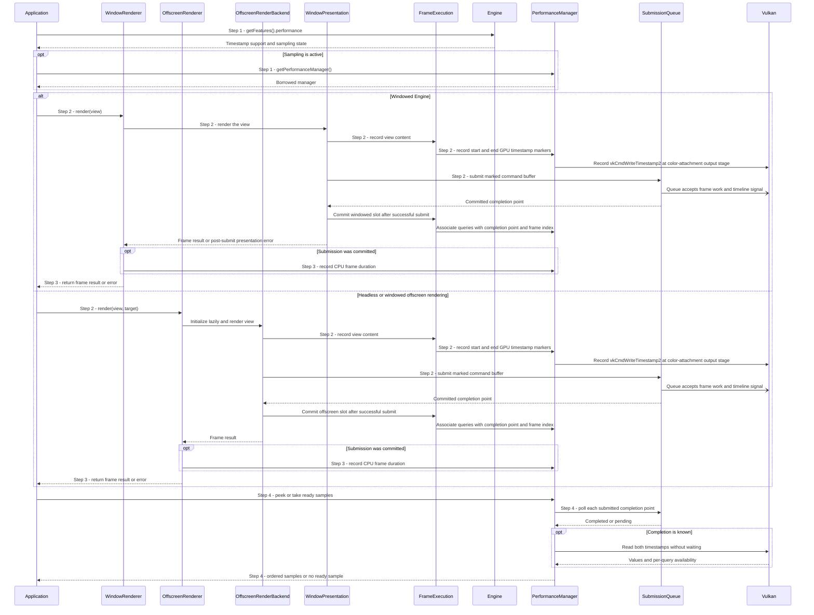

# Collect paired CPU and GPU frame timings

## Goal and boundary

An application opts into frame sampling when it creates a `Engine`, then reads
paired timings from that Engine's borrowed `PerformanceManager`. This flow starts
with a live Engine and ends when the application peeks at or removes ready samples.
The submitted-frame path is either `WindowRenderer::render(view)` or
`OffscreenRenderer::render(view, target)`. Timing markers cover the background clear
and any mesh draws in the submitted view.

**Panda** owns timestamp queries, their association with submitted frames and
nonblocking collection. **The application** chooses whether to request sampling,
checks `EngineFeatures` and drains samples regularly. The manager and its buffered
samples are owned by the Engine; it exists only while sampling is active and its
borrowed reference must not outlive Engine.

## Preconditions

1. A live headless or window-enabled `Engine` exists and calls on it are serialized.
   Sampling was requested at creation with
   `EngineOptions::enableFramePerformanceSampling` and is supported by the selected
   graphics queue. Check `Engine::getFeatures().performance` before borrowing the
   optional manager; it cannot be enabled later on that Engine.

## Main flow

1. **Check capabilities.** The application reads
   `Engine::getFeatures().performance`. It borrows the manager with
   `Engine::getPerformanceManager()` only when `isGpuTimestampSamplingEnabled` is
   true. `hasGpuTimestampQueries` separately reports support on the selected
   graphics queue.
2. **Submit a marked frame.** The application calls
   `WindowRenderer::render(view)` or `OffscreenRenderer::render(view, target)`.
   In the frame command buffer,
   `FrameExecution` records two `vkCmdWriteTimestamp2` queries at the
   `eColorAttachmentOutput` stage: the start immediately before view rendering and
   the end immediately after it. For an empty view this brackets the background clear;
   for a populated view it brackets the built-in mesh rendering commands. The GPU writes their device-clock tick values
   when it executes the submitted command buffer; recording these commands on the
   CPU does not itself measure GPU time. After the queue accepts the command buffer,
   `FrameExecution` then associates that slot's query pool with the committed
   `CompletionPoint` through the performance manager, which assigns a frame index.
3. **Pair the CPU duration.** After the rendering call returns,
   `WindowRenderer` or `OffscreenRenderer` records the elapsed wall duration for
   the submitted slot and returns the frame result.
   The duration covers the whole Panda call, including CPU waits and, for the
   windowed path, presentation. It excludes application work outside the call and
   display latency.
4. **Collect ready samples.** The application calls `getLatestSample()`,
   `takeNextSample()` or `takeAvailableSamples()`. The manager first polls each
   submitted slot's exact completion point. That point only gates a safe query read;
   it is not used as the GPU duration. The manager requests both 64-bit query values
   with per-query availability and without a wait. Once both are available, it
   subtracts the start tick from the end tick using the queue's valid counter bits (so counter wrap is handled),
   multiplies by the device's nanoseconds-per-tick
   `VkPhysicalDeviceLimits::timestampPeriod`, and rounds to nanoseconds. In terms
   of the returned timestamps:

    - `deltaTicks = (endTick - startTick) modulo 2^timestampValidBits`
    - `gpuExecutionDuration = round(deltaTicks * timestampPeriod)`

   For example, 40 ticks at 2 ns per tick produce 80 ns. Panda pairs that duration
   with the CPU measurement and orders ready samples by frame index.

## Notes

**Slot reuse.** The two frame slots each have their own query pool. Before a pool
is reset for another frame, the manager collects its previous sample. It checks
that sample's own timeline point before reading results, so availability left by an
older use of the pool cannot be mistaken for the new frame. If the completed
submission's queries still cannot be read when the slot must be reused, recording
fails instead of overwriting the pending sample.

**Shared queue.** Engine initializes the submission timeline before publishing
either renderer or the performance manager. Both windowed and offscreen submissions
therefore use the same required queue; failure to create its timeline semaphore
fails Engine creation.

**What the pair means.** `cpuFrameDuration` is elapsed host time across Panda's
frame call, not CPU execution time. In the current implementation,
`gpuExecutionDuration` covers rendering between its two GPU markers; for an empty
view this is the background clear, and for a populated view it includes mesh draws. It
does not cover CPU work, image acquisition or presentation/display latency. Both
are nanoseconds; they measure overlapping work and must not be added as sequential
frame time. The
[benchmarking specification](../development/benchmarking.md#public-performance-collection)
defines the measurement boundaries and Vulkan timestamp properties in more detail.

**Retention.** `getLatestSample()` returns a copy without removing it.
`takeNextSample()` removes the oldest ready sample, and `takeAvailableSamples()`
removes all ready samples in frame-index order. A take call is needed to free
buffered samples, so long-running applications should drain regularly.

**Submitted frame with a presentation error.** The manager associates timestamps
with the frame as soon as queue submission succeeds. `WindowRenderer` records that
frame's CPU duration even if presentation then returns an error, so the submitted
frame can still produce a sample. The error does not undo GPU work; see
[UC Render and present an application view](render-view.md) for frame
recovery outcomes.

## Variants and errors

|                    | Point and condition                                                                                                                     | Response                                                                                                                                                                                  | Resulting state and next action                                                                                        |
|--------------------|-----------------------------------------------------------------------------------------------------------------------------------------|-------------------------------------------------------------------------------------------------------------------------------------------------------------------------------------------|------------------------------------------------------------------------------------------------------------------------|
| **Variant&nbsp;1** | Step 1: sampling was not requested, or the graphics queue has no timestamp support                                                      | `EngineFeatures` reports sampling inactive; no manager or timestamp pools are created. Calling the manager getter aborts.                                                                  | Enable sampling when creating a new Engine; unsupported hardware needs a queue with timestamp support                 |
| **Variant&nbsp;2** | Step 2: the window is suspended, the frame is skipped, or rendering fails before queue submission                                      | No submitted slot is associated with a frame index and no paired sample is produced                                                                                                       | Resume window rendering when presentation can proceed, or submit a later offscreen frame                            |
| **Variant&nbsp;3** | Step 4: the submitted point is pending, or either query is not yet available                                                            | Return an empty optional/vector without waiting                                                                                                                                           | Keep running and query again later; the sample remains pending                                                         |
| **Error&nbsp;1**   | Step 2: the previous slot submission is complete, but a timestamp remains unavailable when `FrameExecution` tries to reuse its query pool | Frame recording returns `BackendFailure`; after image acquisition, presentation retires that image through [UC Retire an acquired image after frame work fails](retire-acquired-image.md) | The query pool is not reset over the pending result; inspect the error and Engine state before continuing             |
| **Error&nbsp;2**   | Step 4: completion polling, query readback or duration conversion fails                                                                 | Return the backend error rather than a fabricated timing                                                                                                                                  | No new sample is returned; device loss has no general recovery path                                                    |

## Outcomes

**Ready sample.** The returned `FramePerformanceSample` pairs CPU and GPU durations
for the same submitted frame and carries its Engine-local frame index. Query
availability establishes that Panda can read the sample; it does not indicate that
the image was displayed.

**No sample.** With an active manager, no frame may have been submitted or the
submitted GPU work may not have made both timestamps available yet. The manager
returns an empty result without waiting. Disabled or unsupported sampling has no
manager; `EngineFeatures` reports that state before access.

## Related information

- [UC Create an Engine](create-context.md) explains Engine initialization and
  partial cleanup if requested sampling resources cannot be initialized.
- [UC Render and present an application view](render-view.md) explains
  the windowed submitted frame, its completion point and presentation failure outcomes.
- [UC Render an offscreen view and read its pixels](render-offscreen-view.md) explains
  the headless-compatible submitted frame and target lifetime.
- [UC Observe or wait for submitted GPU work](observe-completion.md) explains the
  Engine timeline used to confirm GPU completion; sampling itself does not wait.
- [Frame and window state](../design/contracts/resources.md#frame-and-window-state)
  defines query collection before frame-slot reuse.
- [Frame rendering and benchmark smoke test](../development/tasks/frame-rendering.md)
  records the task's sample acceptance criteria and learning goal.
- [UC Execute a controlled benchmark smoke run and save a report](benchmark-smoke-run.md)
  shows how the public samples are filtered, validated and written by `panda-bench`.
