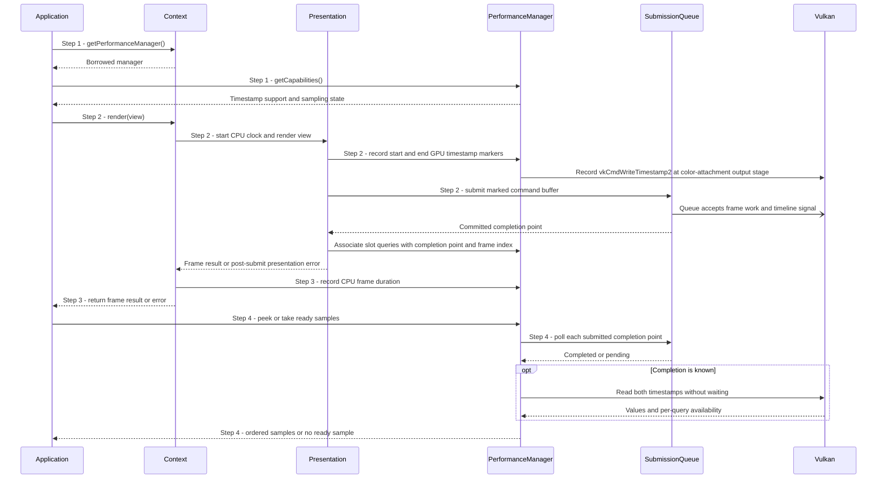

# Collect paired CPU and GPU frame timings

## Goal and boundary

An application opts into frame sampling when it creates a `Context`, then reads
paired timings from that Context's borrowed `PerformanceManager`. This flow starts
with a live Context and ends when the application peeks at or removes ready samples.
The submitted-frame path is `Context::render(view)`. Timing markers cover either an
empty background view or the mesh draws in a populated view.

**Panda** owns timestamp queries, their association with submitted frames and
nonblocking collection. **The application** chooses whether to request sampling,
checks device support and drains samples regularly. The manager and its buffered
samples are owned by the Context; the borrowed manager must not outlive it.

## Preconditions

1. A live windowed `Context` exists and calls on it are serialized. Sampling is
   requested at creation with `ContextOptions::enableFramePerformanceSampling`; it
   cannot be enabled later on that Context.

## Main flow

1. **Check capabilities.** The application gets the manager from
   `Context::getPerformanceManager()` and reads `getCapabilities()`. Sampling runs
   only when `isGpuTimestampSamplingEnabled` is true; `hasGpuTimestampQueries`
   separately reports support on the selected graphics queue.
2. **Submit a marked frame.** The application calls `Context::render(view)`.
   `Context` starts its CPU wall clock. In the frame command buffer,
   `Presentation` records two `vkCmdWriteTimestamp2` queries at the
   `eColorAttachmentOutput` stage: the start immediately before view rendering and
   the end immediately after it. For an empty view this brackets the background clear;
   for a populated view it brackets the built-in mesh rendering commands. The GPU writes their device-clock tick values
   when it executes the submitted command buffer; recording these commands on the
   CPU does not itself measure GPU time. After the queue accepts the command buffer,
   the manager associates that slot's query pool with the committed `CompletionPoint`
   and assigns a frame index.
3. **Pair the CPU duration.** After the presentation operation returns, `Context`
   records the elapsed wall duration for the submitted slot and returns the frame
   result. The duration covers the whole Panda frame call, including CPU waits and
   the presentation call; it excludes application work outside the call and display
   latency.
4. **Collect ready samples.** The application calls `getLatestSample()`,
   `takeNextSample()` or `takeAvailableSamples()`. The manager first polls each
   submitted slot's exact completion point. That point only gates a safe query read;
   it is not used as the GPU duration. The manager requests both 64-bit query values
   with per-query availability and without a wait. Once both are available, it
   subtracts the start tick from the end tick using the queue's valid counter bits
   (so counter wrap is handled), multiplies by the device's nanoseconds-per-tick
   `VkPhysicalDeviceLimits::timestampPeriod`, and rounds to nanoseconds. In terms
   of the returned timestamps:

   - `deltaTicks = (endTick - startTick) modulo 2^timestampValidBits`
   - `gpuExecutionDuration = round(deltaTicks * timestampPeriod)`

   For example, 40 ticks at 2 ns per tick produce 80 ns. Panda pairs that duration
   with the CPU measurement and orders ready samples by frame index.

## Notes

**Slot reuse.** The two frame slots each have their own query pool. Before a pool
is reset for another frame, the manager collects its previous sample. It checks
that sample's own timeline point before reading results, so availability left by an
older use of the pool cannot be mistaken for the new frame. If the completed
submission's queries still cannot be read when the slot must be reused, recording
fails instead of overwriting the pending sample.

**What the pair means.** `cpuFrameDuration` is elapsed host time across Panda's
frame call, not CPU execution time. In the current implementation,
`gpuExecutionDuration` covers rendering between its two GPU markers; for an empty
view this is the background clear, and for a populated view it includes mesh draws. It
does not cover CPU work, image acquisition or presentation/display latency. Both
are nanoseconds; they measure overlapping work and must not be added as sequential
frame time. The
[benchmarking specification](../development/benchmarking.md#public-performance-collection)
defines the measurement boundaries and Vulkan timestamp properties in more detail.

**Retention.** `getLatestSample()` returns a copy without removing it.
`takeNextSample()` removes the oldest ready sample, and `takeAvailableSamples()`
removes all ready samples in frame-index order. A take call is needed to free
buffered samples, so long-running applications should drain regularly.

**Submitted frame with a presentation error.** The manager associates timestamps
with the frame as soon as queue submission succeeds. `Context` records that frame's
CPU duration even if presentation then returns an error, so the submitted frame can
still produce a sample. The error does not undo GPU work; see
[UC Render and present an application view](render-view.md) for frame
recovery outcomes.

## Variants and errors

|  | Point and condition | Response | Resulting state and next action |
| --- | --- | --- | --- |
| **Variant&nbsp;1** | Step 1: sampling was not requested, or the graphics queue has no timestamp support | Capabilities report sampling disabled; no timestamp pools or paired samples are produced | Enable sampling when creating a new Context; unsupported hardware needs a queue with timestamp support |
| **Variant&nbsp;2** | Step 2: the frame is suspended, skipped or fails before queue submission | No submitted slot is associated with a frame index and no paired sample is produced | Follow [UC Render and present an application view](render-view.md); submit a later frame when presentation can proceed |
| **Variant&nbsp;3** | Step 4: the submitted point is pending, or either query is not yet available | Return an empty optional/vector without waiting | Keep running and query again later; the sample remains pending |
| **Error&nbsp;1** | Step 2: the previous slot submission is complete, but a timestamp remains unavailable when `Presentation` tries to reuse its query pool | Frame recording returns `BackendFailure`; after image acquisition, presentation retires that image through [UC Retire an acquired image after frame work fails](retire-acquired-image.md) | The query pool is not reset over the pending result; inspect the error and Context state before continuing |
| **Error&nbsp;2** | Step 4: completion polling, query readback or duration conversion fails | Return the backend error rather than a fabricated timing | No new sample is returned; device loss has no general recovery path |

## Outcomes

**Ready sample.** The returned `FramePerformanceSample` pairs CPU and GPU durations
for the same submitted frame and carries its Context-local frame index. Query
availability establishes that Panda can read the sample; it does not indicate that
the image was displayed.

**No sample.** Sampling may be disabled or unsupported, no frame may have been
submitted, or submitted GPU work may not have made both timestamps available yet.
These cases are not represented as zero-duration measurements.

## Related information

- [UC Create a Context](create-context.md) explains Context initialization and
  partial cleanup if requested sampling resources cannot be initialized.
- [UC Render and present an application view](render-view.md) explains
  the submitted frame, its completion point and presentation failure outcomes.
- [UC Observe or wait for submitted GPU work](observe-completion.md) explains the
  Context timeline used to confirm GPU completion; sampling itself does not wait.
- [Frame and window state](../design/contracts/resources.md#frame-and-window-state)
  defines query collection before frame-slot reuse.
- [Frame rendering and benchmark smoke test](../development/tasks/frame-rendering.md)
  records the task's sample acceptance criteria and learning goal.
- [UC Execute a controlled benchmark smoke run and save a report](benchmark-smoke-run.md)
  shows how the public samples are filtered, validated and written by `panda-bench`.
