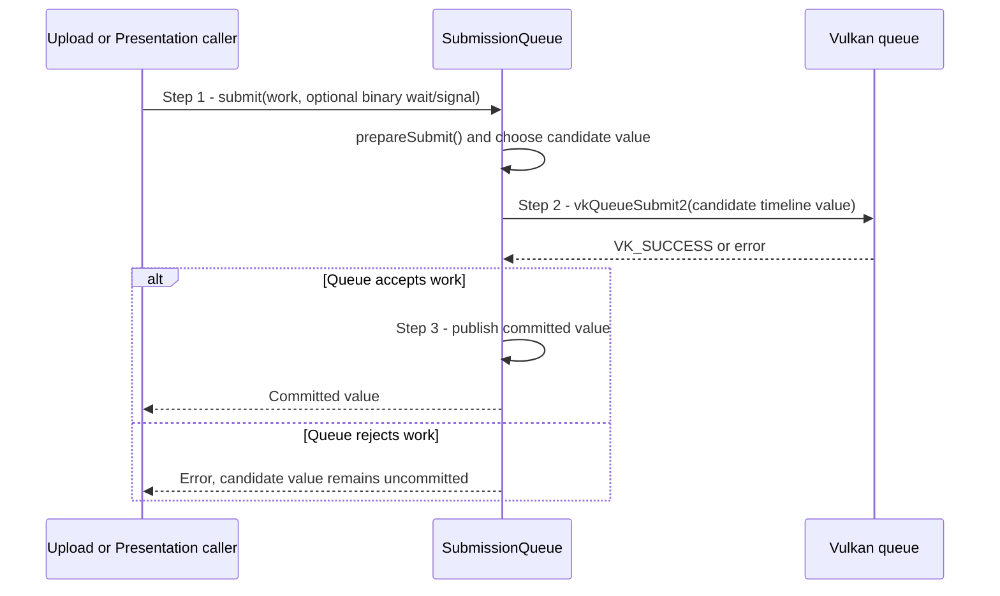

# Commit work to the Context submission timeline

## Goal and boundary

`SubmissionQueue` sends upload, frame and presentation-recovery work to one Vulkan
queue and signals its timeline semaphore on every accepted submission. Its
monotonically increasing counter orders those submissions in queue order. It does
not track presentation-engine use of swapchain images; per-image present fences
track that separately. The [CompletionPoint contract](../design/contracts/resources.md#handles-and-api-boundary)
defines when a counter value confirms completed queue work. This UC starts
when a caller has prepared queue work and ends when `vkQueueSubmit2` accepts it or
returns an error.

## Main flow

1. **Prepare the work.** `SubmissionQueue::submit()` calls
   `SubmissionQueue::prepareSubmit()` to reject device loss or exhausted values,
   refresh the completed counter when its outstanding-value limit is reached,
   and fail if capacity remains unavailable. Presentation also checks capacity
   before image acquire so it does not acquire an image it cannot retire.
2. **Build and enqueue.** `submit()` chooses the next candidate value and calls
   `vkQueueSubmit2`. It may include a command buffer, binary acquire wait and
   binary render-finished signal; upload submissions use their own work and
   retained owners. Every submission signals the shared timeline.
3. **Commit on acceptance.** Only
   `VK_SUCCESS` advances the committed value and returns it to the caller. The
   upload caller publishes a `CompletionPoint`; presentation stores the value on
   its frame slot and returns a point after present handling.

## Notes

**Publication guarantee.** The *commit point* is successful return from
`vkQueueSubmit2`. A failed submission does not consume the candidate value, so a
future accepted submission can use it. Callers must not publish or wait on an
uncommitted value.

**Completion is separate.** A committed value means the queue accepted work. Use
`Context::poll()` or `Context::wait()` to observe completion. Presentation also
uses a per-image present fence because the queue timeline alone does not retire
presentation-engine references.

## Variants and errors

|  | Point and condition | Response | Resulting state and next action |
| --- | --- | --- | --- |
| **Error&nbsp;1** | Step 1: timeline is lost, exhausted or has no available outstanding capacity | Return an error before queue submit | No new value or work is committed; caller may retry only if the reported condition is recoverable |
| **Error&nbsp;2** | Step 2: `vkQueueSubmit2` rejects work | Return the Vulkan error; mark the queue lost on device loss | Candidate value remains uncommitted; a binary acquire wait that did not commit needs the caller's failure policy, described by [UC Retire an acquired image after frame work fails](retire-acquired-image.md) |

## Related information

- [UC Upload bytes into a buffer](upload-buffer.md) shows upload work and retained
  owners crossing this commit boundary.
- [UC Upload texture contents or regions](upload-texture.md) and
  [UC Retire an acquired image after frame work fails](retire-acquired-image.md)
  use the same queue-acceptance rule for texture upload and acquire cleanup.
- [UC Render and present an application view](render-view.md) shows
  acquire waits, render-finished signals and presentation use.
- [UC Observe or wait for submitted GPU work](observe-completion.md) defines the
  public completion-token behavior.
- [Handles and API boundary](../design/contracts/resources.md#handles-and-api-boundary)
  defines `CompletionPoint` identity and the relationship between its value and
  completed queue work.
- [Frame and window state](../design/contracts/resources.md#frame-and-window-state)
  explains how frame completion protects reusable GPU resources.
