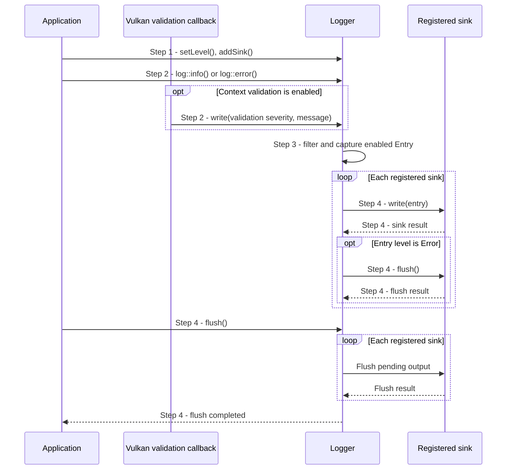

# Configure and receive application/backend diagnostics

## Goal and boundary

An application configures where Panda's synchronous log entries go and receives
diagnostics from its own calls or enabled backend callbacks. The flow starts when
the application configures the process logger and ends after an entry has been
delivered to its registered sinks. Panda API errors returned as `panda::Error`
remain caller-owned results; the application decides whether to log them.

**The application** selects the minimum severity and registers sinks.
**Panda** owns each registered sink and delivers entries from the logger and,
when Context validation is enabled, the Vulkan validation callback. Fatal
`expect`/`panic` diagnostics are a separate direct-to-stderr path.

## Main flow

1. **Configure destinations.** The application sets the process logger's minimum
   level and registers a `StreamSink`, `FileSink`, or another `Sink`. The logger
   starts at `Info` with no sinks. `addSink()` takes ownership; a
   `StreamSink` borrows a stream that must outlive it, while `FileSink::open()`
   owns an append-only file.
2. **Produce an entry.** An application calls a logging helper such as
   `log::info()` or `log::error()`. If Vulkan validation was enabled when the
   `Context` was created, its debug callback maps the Vulkan severity and writes
   the validation message through the same process logger.
3. **Filter and capture the entry.** The logger checks the current severity
   threshold. An enabled entry owns its formatted message, call-site location,
   timestamp and level. `writeWithStacktrace()` explicitly adds a best-effort
   trace; ordinary logging does not collect one.
4. **Deliver synchronously.** The logger calls each registered sink while holding
   its mutex. Sinks format and write the entry; an `Error` entry is flushed
   immediately. The caller can explicitly flush all sinks or remove one by its
   identifier; removal flushes that sink before destroying it.

## Notes

**Filtering.** Entries below the minimum level and entries at `Off` are not
formatted or delivered. C++ still evaluates the logging call's argument
expressions before entering its helper.

**Ownership and concurrency.** Logger calls are serialized and synchronous;
they can block while a sink writes. Sink methods run under the logger lock and
must not re-enter that logger. The lock does not synchronize other application
access to a borrowed stream.

**Backend boundary.** Vulkan validation severities map to the logger's
`Debug`, `Info`, `Warning` and `Error` levels. Other Panda errors are not
automatically copied to the logger. The validation callback catches exceptions
so none crosses the Vulkan C callback boundary.

**Fatal diagnostics.** `expect` and `panic` write and flush their context
directly to stderr, independently of logger filters and sinks, then terminate.
They do not become recoverable log entries. See the [resource error contract](../design/contracts/resources.md#errors).

## Variants and errors

|  | Point and condition | Response | Resulting state and next action |
| --- | --- | --- | --- |
| **Variant&nbsp;1** | Step 3: the entry is below the threshold or logging is `Off` | Discard the entry without formatting or sink delivery | No output is produced; lower the threshold if the message is needed |
| **Variant&nbsp;2** | Step 3: no sink is registered | The logger has no destination to receive the entry | The entry is not retained for later sinks; register a destination before emitting diagnostics |
| **Error&nbsp;1** | Step 1: `FileSink::open()` cannot append to the requested path | Return its path-bearing error without registering a sink | Existing sinks remain active; create the parent directory or choose a writable path, then retry |
| **Error&nbsp;2** | Step 4: a sink write or flush fails | Report the sink failure directly to stderr and continue with other sinks | The logging call does not return that sink error; repair or remove the failing sink |

## Outcomes

**Delivered.** Each enabled entry is synchronously offered to every registered
sink. `Logger::removeSink()` flushes and destroys the selected sink even if its
flush reports a failure; the failure is reported to stderr.

**Formatting failure.** Ordinary message formatting or allocation can throw.
The Vulkan validation callback contains such exceptions at its callback
boundary. A sink contains its own stream and formatting failures and reports
them through the logger's stderr fallback.

## Related information

- [Resource error contract](../design/contracts/resources.md#errors) defines
  returned errors, fatal diagnostics, stack traces and sink failure handling.
- [UC Create a Context](create-context.md) explains Context creation and the
  optional validation setup that routes Vulkan messages here.
- [Build foundation](../development/tasks/build-foundation.md) records the
  shared diagnostics component boundary and its current scope.
