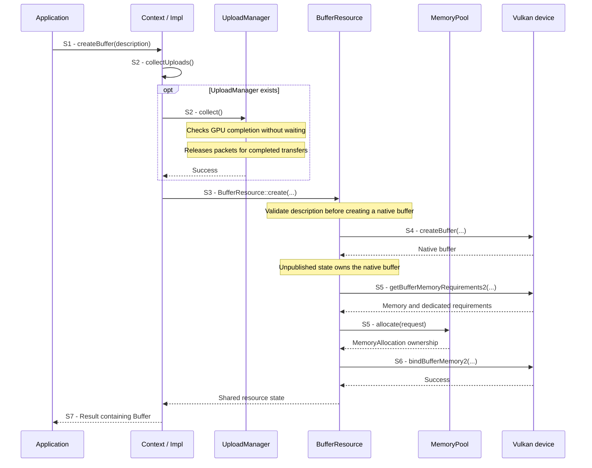
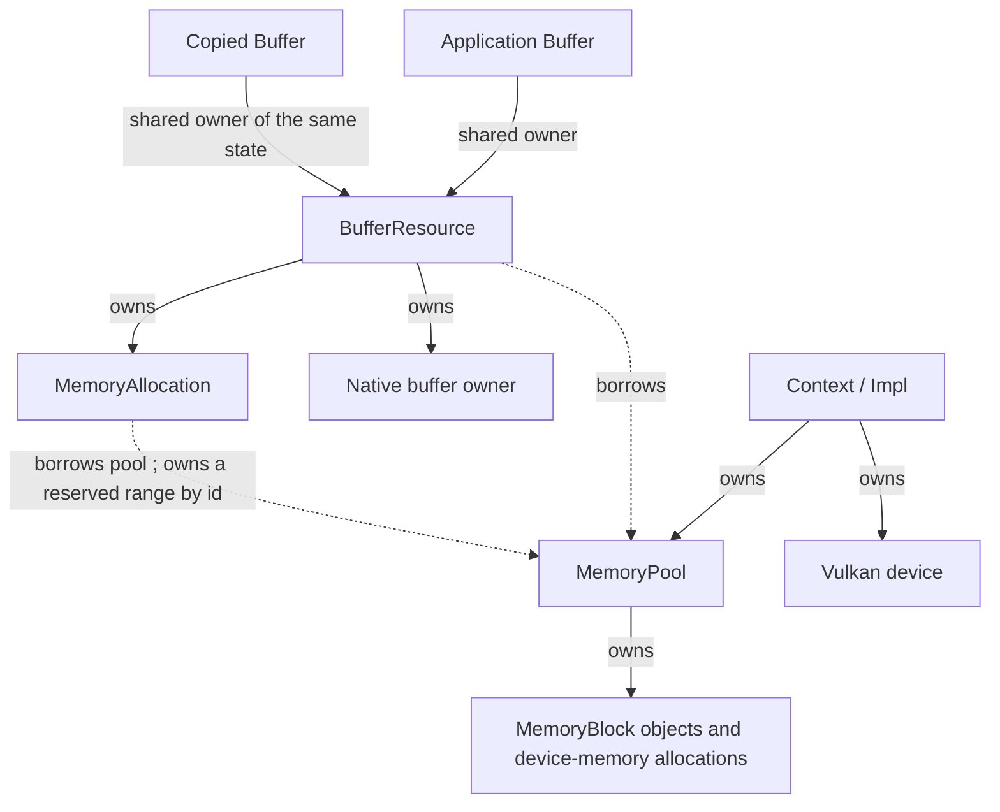
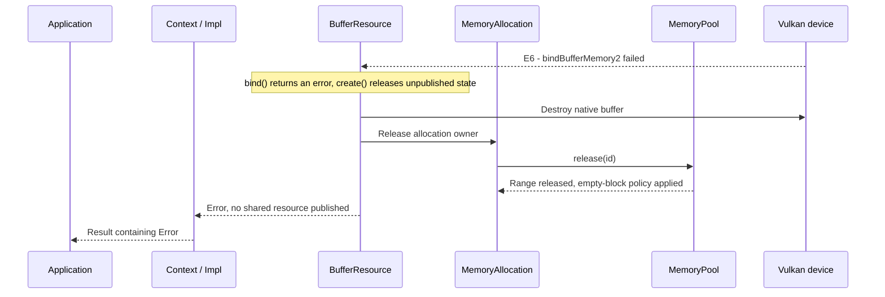

# Create a buffer

## Goal and boundary

An application requests fixed-size, ordinary GPU buffer storage by calling
`Context::createBuffer(BufferDesc)`. This implemented flow ends with a published
`Buffer` or an error. It may allocate host/device memory, but submits no GPU work
and does not wait for GPU completion. Initial bytes are **undefined**; uploading and
synchronizing future uses are separate operations.

**Panda** owns native creation, memory selection, binding and cleanup. **The application**
chooses size, usage and memory intent, and keeps `Context` alive for every buffer owner.
The implemented scope follows [Allocation, uploads and resource lifetimes](../development/tasks/resource-lifetimes.md).

| Boundary          | Meaning                                                                              |
|-------------------|--------------------------------------------------------------------------------------|
| Trigger and input | Application calls `Context::createBuffer` with a `BufferDesc`                        |
| Successful end    | A `Result<Buffer>` containing an owning, memory-bound `Buffer`                       |
| Failure end       | A returned `Error` with no new `Buffer`, or a fatal caller-contract violation        |
| Outside this flow | Uploading bytes, submitting GPU work, synchronization of later uses and CUDA sharing |

## Preconditions

- **Execution.** Use a valid `Context` and serialize creation with its other operations on the
  context execution thread. Moved-from `Context` use is a **fatal contract violation**.
- **Lifetime.** `Context` must outlive every copy of the returned handle. Copying a `Buffer` retains
  its resource; it neither extends `Context` lifetime nor synchronizes data access.
- **Checked inputs.** Size must be nonzero; usage must be nonempty and supported; memory intent must
  be `Device`, `Upload` or `Readback`. These inputs are checked and return errors
  rather than being unchecked caller assumptions.

No window, CUDA session or previously submitted work is required.

## Main participants

| Participant                   | Responsibility in this flow                                                                |
|-------------------------------|--------------------------------------------------------------------------------------------|
| Application                   | Supplies the description and owns the returned `Buffer`                                    |
| `Context` / `Context::Impl`   | Supplies stable device/pool services, collects uploads and publishes the public handle     |
| `UploadManager`, when present | Checks submitted uploads and releases confirmed completed packets                          |
| `BufferResource`              | Validates the description and owns unpublished native state through allocation and binding |
| `MemoryPool`                  | Chooses memory and returns an owning allocation for a compatible range                     |
| Vulkan device                 | Creates the native buffer, reports its requirements and binds memory                       |

## Main flow

1. **S1 - Request.** The application calls `Context::createBuffer(description)`.
   `Context` requires live internal state.
2. **S2 - Release completed upload resources.** `Context::Impl::createResource`
   first calls `collectUploads()`. If an `UploadManager` exists, its `collect()`
   checks GPU progress and removes completed upload packets from its pending list.
   Destroying those packets releases their command resources, staging-buffer owners
   and retained destination-resource owners. This lets `Context` reclaim resources
   from earlier transfers before allocating the new buffer. Pending GPU work is
   left intact, without waiting for it. Without a manager, this step does nothing.
3. **S3 - Validate.** `BufferResource::create` checks the description before native
   buffer creation. Supported usages are the ordinary transfer, vertex, index,
   indirect, uniform/storage and texel-buffer flags.
4. **S4 - Create native storage object.** A native Vulkan buffer is created and
   adopted into unpublished `BufferResource` state. It is not yet memory-bound.
5. **S5 - Allocate.** `BufferResource::bind` queries ordinary and dedicated memory
   requirements, translates memory intent to required/preferred properties and
   calls `MemoryPool::allocate`. The returned `MemoryAllocation` is moved into
   the resource. Pool selection, range placement and growth are summarized here;
   their policy is in the [allocation contract](../design/contracts/resources.md#allocation-uploads-and-descriptors).
6. **S6 - Bind.** `bindBufferMemory2` binds the buffer at the allocation's offset.
7. **S7 - Publish.** Only after successful binding does `Context` wrap the shared
   resource state in a public `Buffer` and return it.

## Notes

**Publication guarantee.** The *publication point* is S7: no application handle escapes
before allocation and binding succeed. Earlier native success does not imply operation success.

**Lazy initialization.** `Context` creates its `UploadManager` on the first successful
`createUploadBatch()` request through `Context::Impl::ensureUploads()`. Creating a
buffer alone does not create that service. Before the first batch, S2 succeeds
without collection; afterwards it uses the existing manager to reclaim finished
uploads. The manager remains owned by `Context` even when no batches are pending.

**What collection releases.** A submitted upload must keep its staging bytes,
destination resources and command resources alive while the GPU can still use
them. `UploadManager` retains them in `UploadCommand` packets on behalf of `Context`.
Here, `collect()` means reclaiming those retained resources after confirmed GPU
completion, not gathering bytes for the new buffer. It checks the submission
timeline through `SubmissionQueue` and removes only the completed prefix of its
pending list. A destination resource stays alive if the application or another
submitted packet still owns it. Completion permits releasing the upload's owners;
it does not authorize deleting resources that other owners still need.

**Memory selection.** `BufferDesc::memory` tells Panda which memory properties to
require and prefer. `Upload` and `Readback` require memory that Vulkan allows the
CPU to access. The returned `Buffer` is still an owning handle, not a CPU pointer;
Panda's current public API writes buffer data through `UploadBatch`.

**Safe updates.** If the GPU is still reading a buffer, overwriting its bytes can
change the data underneath that work. Updates must be ordered after the earlier
GPU reads. Choosing `Upload` or `Readback` does not establish that ordering; the
[resource synchronization contract](../design/contracts/resources.md#lifetime-is-not-synchronization)
defines this separate obligation.

| Memory intent | Required property | Preferred property          |
|---------------|-------------------|-----------------------------|
| `Device`      | Device-local      | None beyond the requirement |
| `Upload`      | Host-visible      | Host-coherent               |
| `Readback`    | Host-visible      | Host-cached                 |

A preferred property helps select memory; it is not an additional mandatory
capability. The actual type must also satisfy the native buffer's requirements.

## Ownership after success

Copying a `Buffer` retains the same state rather than allocating or copying buffer bytes.
`MemoryAllocation` owns a range reservation, not the whole pool block. It releases
that reservation through its borrowed pool when destroyed.

**Lifetime requirement.** No owning edge links `Buffer` to `Context`. `Context` must outlive all these handles;
moving `Context` preserves its stable internal services. Releasing one `Buffer` only
drops one shared owner. Once no owner remains, `BufferResource` destroys the native
buffer before releasing its range. Submitted uses can retain additional owners;
their retention is outside this creation flow and follows the
[resource lifetime contract](../design/contracts/resources.md#frame-contexts-and-retirement).

## Variants and failures

| ID     | Point and condition                          | Response                                                                                                           | Resulting state and next action                                                                                                         |
|--------|----------------------------------------------|--------------------------------------------------------------------------------------------------------------------|-----------------------------------------------------------------------------------------------------------------------------------------|
| **E1** | S1: moved-from `Context`                     | Checked fatal diagnostic                                                                                           | No recoverable return; use a live `Context`                                                                                             |
| **E2** | S2: upload collection fails                  | Propagate its error before attempting resource creation                                                            | No new buffer; follow the error's recovery category, not unconditional retry                                                            |
| **E3** | S3: invalid description or unsupported usage | Return `InvalidArgument` or `Unsupported`                                                                          | No new native buffer; correct size, usage or intent                                                                                     |
| **E4** | S4: native creation fails                    | Convert native status to Panda `Error`; do not adopt failed output                                                 | No published resource; inspect error category and native diagnostics                                                                    |
| **E5** | S5: allocation fails                         | Destroy the unpublished native buffer and propagate allocation error                                               | No new handle or retained range for this request; existing resources remain owned; retry only if the cause is resolved                  |
| **E6** | S6: binding fails                            | [Destroy the buffer, then release its allocation](#e6---cleanup-after-binding-failure); propagate the native error | No published handle; memory-pool cache/accounting need not return to their exact starting values; further use depends on error category |

**E2-E6** return errors through `Result`; that does not mean every category permits
recovery on the same `Context`. **E1 is fatal.** Catastrophic host allocation failure
follows the [shared error policy](../design/contracts/resources.md#errors).

### E6 - Cleanup after binding failure

**Entry state.** S1-S5 completed. The unpublished `BufferResource` owns a native buffer and a
`MemoryAllocation`. The bind call at S6 failed. No work was submitted by this operation
and no public `Buffer` exists. This path needs no GPU completion wait.

Returning a range does not always free a whole device
allocation: the pool may retain an empty ordinary block; dedicated blocks are
released when empty. The native error category/status survives propagation.

## Outcomes

**Success.** A copyable `Buffer` owns fixed-size, memory-bound storage with **undefined contents**. No completion token
is needed for creation because no work was
submitted. The application must initialize contents before reads and release every
owner before `Context` destruction.

**Failure.** Recoverable creation failure publishes no handle and releases temporary resource
owners. It does not roll back unrelated completed-upload collection or promise
byte-for-byte restoration of pool caches, nor recover a lost device.

## Related information

- [Ownership](../design/contracts/resources.md#ownership),
  [lifetime versus synchronization](../design/contracts/resources.md#lifetime-is-not-synchronization),
  and [handle boundary](../design/contracts/resources.md#handles-and-api-boundary)
  define the shared guarantees.
- [Vulkan memory allocation](https://docs.vulkan.org/guide/latest/memory_allocation.html)
  explains device-memory allocation and why resources can share larger allocations.
- [vkBindBufferMemory2](https://docs.vulkan.org/refpages/latest/refpages/source/vkBindBufferMemory2.html)
  specifies native memory binding, including compatible memory types, size and offset
  requirements. Panda's S5 must obtain a range satisfying those requirements before S6.
- [vkDestroyBuffer](https://docs.vulkan.org/refpages/latest/refpages/source/vkDestroyBuffer.html)
  specifies native destruction and the requirement to finish submitted uses first.
  This creation flow submits no work; later users must satisfy that lifetime rule.
