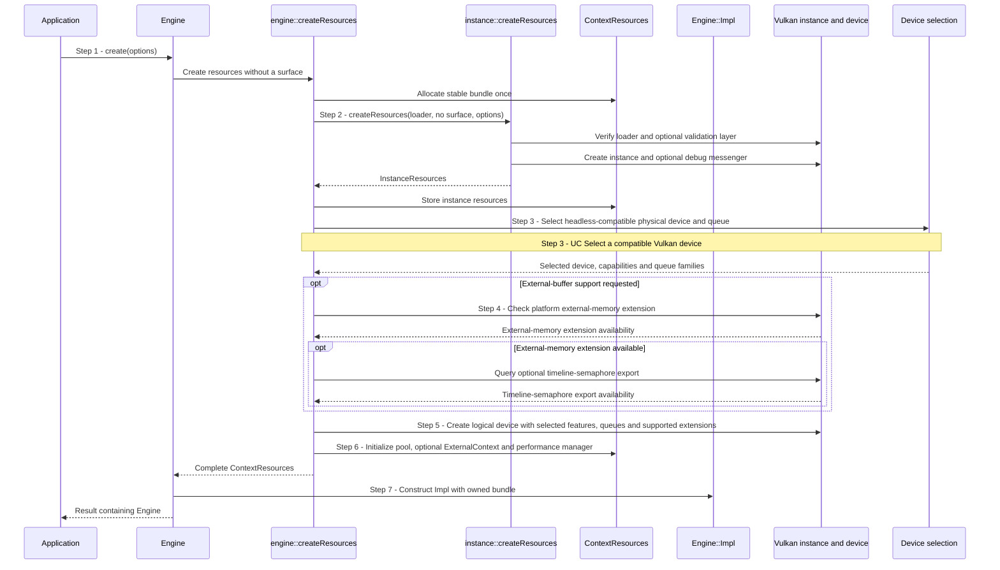
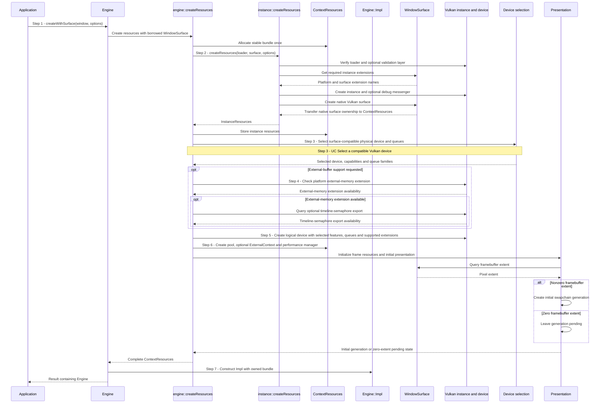
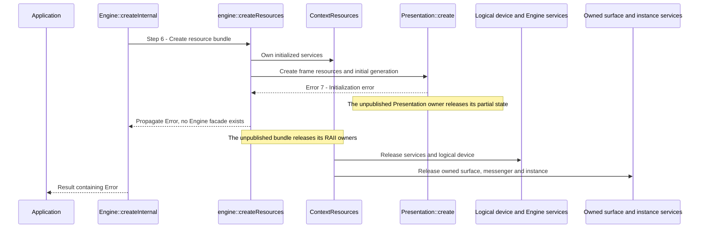

# Create an Engine

## Goal and boundary

An application creates a Vulkan `Engine` by calling `Engine::create()` for a
headless context or `Engine::createWithSurface()` for a windowed context. This
implemented flow runs synchronously, may allocate or block, and ends when Panda
publishes a fully initialized, move-only owner or returns an error. The windowed
path also initializes presentation resources and an initial swapchain generation
when the framebuffer has a nonzero extent; a zero extent leaves presentation
pending while the Engine itself can still succeed.

**Panda** owns the Vulkan instance, device, native surface and Engine services. **The application** owns the
`WindowSurface` and native window and keeps both alive
for the full lifetime of an Engine created from them. The flow submits no frame or
upload work.

## Preconditions

1. **Windowed path.** When using `Engine::createWithSurface()`, provide a live
   `WindowSurface`; calls to its methods follow its thread requirements and happen
   outside its callbacks.

## Main flow

1. **Choose the Engine path.** The application supplies options and, for the
   windowed path, a live `WindowSurface` whose required instance extensions include
   `VK_KHR_surface` and the platform surface extension.
2. **Build instance services.** `instance::createResources()` verifies Vulkan
   1.3 support from the loader, checks the validation layer when requested,
   resolves the required instance extensions, and creates the Vulkan instance.
   It also creates the optional debug messenger and, for a windowed Engine, owns
   the native `VkSurfaceKHR` returned by `WindowSurface`.
3. **Select a compatible device.** Panda calls the
   [UC Select a compatible Vulkan device](select-vulkan-device.md), which returns a physical
   device, queue families and the capabilities needed by this Engine.
4. **Check external-buffer support.** When
   `EngineOptions::externalBufferSupport` is not `Disabled`, Panda checks whether
   the selected device exposes the platform external-memory extension. `Required`
   support fails if it is unavailable; `Optional` support continues without
   external-buffer services. If the memory extension is available, Panda also
   checks whether the device can export a timeline-semaphore handle. Missing
   semaphore support still permits external-memory buffers, but not a safe
   cross-API GPU handoff.
5. **Create the logical device.** Panda enables the queried Vulkan 1.3
   features and creates the selected graphics/compute queue. A windowed Engine
   also enables the selected present queue and swapchain-maintenance extension.
   When the platform external-memory extension is available, it enables that
   extension and enables the external-semaphore extension only if timeline-semaphore
   export is supported.
6. **Initialize the resource bundle.** `engine::createResources()` initializes
   one stable `ContextResources` owner in place. It creates the memory pool and
   performance manager, creates `ExternalContext` when external-memory export is
   available, and initializes presentation for a windowed Engine. A nonzero
   framebuffer extent creates the initial swapchain generation; a zero extent
   records that presentation must be prepared later.
7. **Publish the owner.** Only after the complete bundle is returned does
   `createInternal()` construct `Engine::Impl` to own it and return the public
   `Engine`.

The paths share the same creation steps but differ in instance and presentation
setup, so each entry point has its own sequence.

### Headless path

### Windowed path

## Notes

**Capability checks.** Requesting Vulkan 1.3 at instance creation does not prove
that a physical device exposes every feature Panda needs. Device selection queries
and enables dynamic rendering, synchronization2 and timeline semaphores explicitly.
Windowed contexts additionally require compatible surface support and swapchain
maintenance1. External-buffer support is resolved after core device selection and
before logical-device creation. Engine setup checks the platform memory extension,
then checks optional timeline-semaphore export when memory export is available;
the requested buffer usage is checked later when the buffer is created. The full
core-device rules live in [UC Select a compatible Vulkan device](select-vulkan-device.md).

**Ownership.** `WindowSurface` is borrowed, while the native surface it creates is
owned by `ContextResources`. The factory allocates this bundle once; `Engine::Impl`
owns it after successful initialization. If any stage fails, the local bundle
unwinds its RAII owners in reverse declaration order. No `Impl` exists yet, so the
failure path does not call the successful-Engine drain. The caller still owns the
window and must keep it alive until Engine teardown. `ExternalContext` borrows the
optional uploads member itself, so the bundle stays at a stable address through
lazy upload creation and Engine moves.

**Windowed readiness.** A successful windowed Engine has presentation frame
resources. If the framebuffer is minimized and reports zero pixels, creation
succeeds with presentation pending and no zero-sized swapchain generation. Later
window-frame preparation handles that state; see the
[window lifecycle contract](../design/contracts/resources.md#frame-and-window-state).

**Headless creation.** `Engine::create()` follows the same loader, device and
service setup without querying window extensions, creating a surface or initializing
presentation. Upload support is initialized when an upload batch is first requested.

**Borrowed operations.** Both Engine paths expose `ResourceManager`,
`SubmissionManager` and `OffscreenRenderer` through Engine getters. Only a windowed
Engine exposes `WindowRenderer`; a headless Engine has no window-rendering entry
point. These facades borrow their Engine and cannot outlive it.

## Variants and errors

|                    | Point and condition                                                                                                      | Response                                                                                                                                                    | Resulting state and next action                                                                               |
|--------------------|--------------------------------------------------------------------------------------------------------------------------|-------------------------------------------------------------------------------------------------------------------------------------------------------------|---------------------------------------------------------------------------------------------------------------|
| **Error&nbsp;1**   | Step 2: loader is below Vulkan 1.3, or a requested validation layer/extension is unavailable                             | Return `Unsupported`; extension enumeration and provider errors keep their reported error                                                                   | No Engine is published; install or select a compatible Vulkan runtime, or disable optional validation        |
| **Error&nbsp;2**   | Step 2: required window extensions are malformed or unavailable, or instance, messenger or native-surface creation fails | Return `InvalidArgument`, `Unsupported` or the originating native/provider error; release any instance services already created                             | No Engine is published; correct the provider/configuration or resolve the reported failure                   |
| **Error&nbsp;3**   | Step 3: no compatible physical device is found, or device inspection cannot complete                                     | Propagate the selection result; see [UC Select a compatible Vulkan device](select-vulkan-device.md#variants-and-errors)                                     | No logical device or Engine is published; respond to the reported capability or backend failure              |
| **Variant&nbsp;1** | Step 4: optional external-memory support is unavailable                                                                  | Continue Engine creation without `ExternalContext`; device info reports external-buffer export as disabled                                                 | Use the application's fallback path; see [UC Create and import an external buffer](create-external-buffer.md) |
| **Variant&nbsp;2** | Step 4: external-memory export is available but timeline-semaphore export is not                                         | Continue Engine creation and enable external-memory export only                                                                                            | Memory sharing remains available; cross-API GPU handoff is unsupported                                        |
| **Error&nbsp;4**   | Step 4: required external-memory support is unavailable, or device-extension inspection fails                            | Return `Unsupported` for unavailable required support or propagate the inspection error                                                                     | No logical device or Engine is published; choose a compatible device or resolve the reported backend failure |
| **Error&nbsp;5**   | Step 5: logical-device creation fails                                                                                    | Return the mapped Vulkan error without adopting a failed native output                                                                                      | No Engine is published; retry only after resolving the reported cause                                        |
| **Error&nbsp;6**   | Step 6: performance-manager initialization fails                                                                         | Return its error and release the local manager and other Engine owners already created                                                                     | No Engine is published; investigate the reported device/backend failure before retry                         |
| **Error&nbsp;7**   | Step 6: windowed presentation initialization fails                                                                       | Return the originating error and release partial presentation state and Vulkan owners; see [Error 7 cleanup](#error-7---release-partial-presentation-state) | No Engine is published; no application Engine is available                                                  |

### Error 7 - Release partial presentation state

**Entry state.** Steps 1-5 completed. The local `ContextResources` bundle owns
instance resources, the selected physical-device wrapper, the logical device,
memory pool and initialized performance manager. Presentation setup may have
created frame resources or attempted the initial swapchain generation. No
`Engine::Impl` or public `Engine` has been published, and this flow has submitted
no GPU work.

The error does not promise byte-for-byte rollback of driver or window-system
state. It guarantees that Panda returns no partially usable `Engine` and releases
the Vulkan owners created by this attempt.

## Outcomes

On success, the application owns one valid `Engine` and may move it while no
operation is in progress. A windowed Engine also borrows its `WindowSurface` and
native window for the entire Engine lifetime. Engine destruction drains its
owned work and requires the application to release resource handles and unsubmitted
upload batches first; see the [ownership contract](../design/contracts/resources.md#ownership).

On failure, the caller receives an `Error` and no Engine owner. Error categories
describe the failure and recovery direction; they do not guarantee that retrying
against the same runtime or surface will succeed.

## Related information

- [UC Create and release a native window](create-window.md) explains the GLFW
  lifetime and the `WindowSurface` owner borrowed by this flow.
- [UC Select a compatible Vulkan device](select-vulkan-device.md) explains the
  capability and queue-family decision used at Step 3.
- [UC Create and import an external buffer](create-external-buffer.md) explains
  how the optional export capabilities are used after Engine creation.
- [Resource ownership](../design/contracts/resources.md#ownership) defines the
  required Engine, resource and window lifetimes.
- [Frame and window state](../design/contracts/resources.md#frame-and-window-state)
  explains windowed readiness and the later presentation lifecycle.
- [Vulkan context and window lifecycle](../development/tasks/vulkan-context.md)
  records the accepted Engine scope and its implementation evidence.
- The Vulkan Guide's [version and feature rules](https://docs.vulkan.org/guide/latest/versions.html)
  explain why version requests and queried feature bits are separate checks; its
  [WSI guide](https://docs.vulkan.org/guide/latest/wsi.html) describes the native
  surface boundary.
