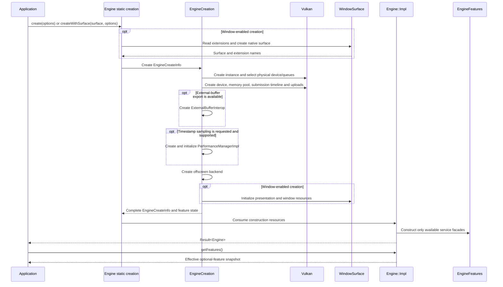

# Create an Engine

## Goal and boundary

An application creates a headless Engine with `Engine::create(options)` or a
window-enabled Engine with `Engine::createWithSurface(surface, options)`. Both
functions return `Result<Engine>`. Creation is synchronous, may allocate or block,
and publishes an Engine only after all required initialization succeeds.

The Engine owns its Vulkan device and services. For window creation, the
application owns the `WindowSurface` and native window and keeps both alive until
Engine destruction. Creation submits no frame or upload work. A window-enabled
Engine can succeed while its framebuffer extent is zero; presentation then creates
its first swapchain generation when a nonzero extent becomes available.

`Engine::getFeatures()` reports the negotiated optional facilities on every live
Engine. A window renderer exists only for window-enabled creation. A performance
manager exists only when timestamp sampling was requested and the selected device
supports it. Calling either unavailable service getter is a fatal contract error;
applications check `EngineFeatures` first.

## Preconditions

For `Engine::createWithSurface`, provide a live `WindowSurface` whose required
instance extensions include `VK_KHR_surface` and the platform surface extension.
Calls to the surface provider follow its thread requirements and happen outside
its callbacks.

## Main flow

1. **Choose a creation function.** The application selects headless or
   window-enabled creation and supplies `EngineOptions`.
2. **Create instance resources.** Panda verifies Vulkan 1.3 loader support,
   checks the validation layer when requested, resolves required instance
   extensions, and creates the instance. Window-enabled creation also creates a
   native `VkSurfaceKHR`; requested validation creates a debug messenger.
3. **Select a device.** Panda selects a compatible physical device and its private
   graphics/compute and optional present queue families. It copies device
   identity and driver diagnostics into `DeviceInfo`.
4. **Resolve external-buffer support.** When requested, Panda checks platform
   external-memory support and optional timeline-semaphore export. Required
   memory support fails creation when unavailable; optional support leaves the
   external-buffer service unavailable. Missing semaphore export still permits
   memory export but disables safe cross-API GPU handoff.
5. **Create the logical device and common owners.** Panda enables required Vulkan
   features and selected queues. It creates the memory pool, initializes the
   submission timeline, constructs an empty upload manager, and creates optional
   interop state. Timestamp sampling creates `PerformanceManagerImpl` only when
   requested and supported; unsupported or disabled sampling leaves it absent.
6. **Initialize rendering.** Panda creates the lightweight offscreen backend.
   Window-enabled creation also initializes presentation and window frame
   resources. A zero framebuffer extent defers swapchain-generation creation.
7. **Publish the Engine.** `Engine::Impl` takes the completed `EngineCreateInfo`,
   constructs common service facades, and constructs only the available optional
   facades. The Engine stores one stable `Impl` owner. `EngineFeatures` records
   the resulting effective state.

The headless and window-enabled paths share device and service initialization.
The surface path adds required instance extensions, surface-compatible device
selection and window presentation.

## Ownership and readiness

`WindowSurface` is borrowed; its native Vulkan surface is owned by the Engine.
`EngineCreateInfo` is temporary construction data. After publication, `Engine::Impl`
owns native state and service facades. Runtime services borrow their concrete
dependencies. If a creation stage fails, local owners release partial state; the
successful-Engine drain path does not run.

Every successful Engine owns an initialized submission timeline and an empty
upload manager. The upload manager allocates no staging memory by itself. The
offscreen backend defers execution resources until rendering needs them.

For a window-enabled Engine, nonzero framebuffer dimensions create the initial
swapchain generation. A zero extent leaves presentation pending without creating
a zero-sized swapchain. See [frame and window state](../design/contracts/resources.md#frame-and-window-state).

## Variants and errors

| Condition | Result and next action |
|---|---|
| Loader is below Vulkan 1.3, required features are missing, or no compatible device exists | Return `Unsupported`; choose a compatible runtime/device or adjust optional requests. |
| Requested validation layer or debug-utils extension is unavailable | Return `Unsupported`; install validation support or disable validation. |
| Surface extensions are malformed/unavailable, or the provider fails | Return `InvalidArgument`, `Unsupported`, or the provider's error; fix or recreate the surface provider. |
| Required external-memory support is unavailable | Return `Unsupported`; choose a compatible device or make support optional/disabled. |
| Optional external-memory support is unavailable | Continue without external-buffer export; `getFeatures()` reports it disabled. |
| External memory works but timeline-semaphore export does not | Continue with memory export; `getFeatures()` reports semaphore export disabled and handoff remains unsupported. |
| Timestamp sampling is requested but the selected queue has no timestamp support | Continue without `PerformanceManager`; `getFeatures().performance` reports unsupported queries and inactive sampling. |
| Timeline, device, performance-query, or presentation initialization fails | Return the mapped error and release partial construction state; publish no Engine. |

## Outcomes

On success, the application owns one valid, move-only `Engine`. Borrowed service
addresses remain stable when Engine moves and those references remain usable while
the moved-to Engine owns the state. `getFeatures()` remains available on every live
Engine. Unavailable optional service getters fail through `expect`.

Engine destruction drains owned work and requires resource handles and unsubmitted
upload batches to be released first; see the [ownership contract](../design/contracts/resources.md#ownership).
On failure, the caller receives an `Error` and no partially usable Engine.

## Related information

- [Create and release a native window](create-window.md) explains the `WindowSurface` lifetime.
- [Select a compatible Vulkan device](select-vulkan-device.md) explains capability and private queue-family selection.
- [Create and import an external buffer](create-external-buffer.md) explains optional export facilities.
- [Collect paired CPU and GPU frame timings](collect-frame-timings.md) explains performance sampling.
- [Resource ownership](../design/contracts/resources.md#ownership) defines Engine and resource lifetimes.
