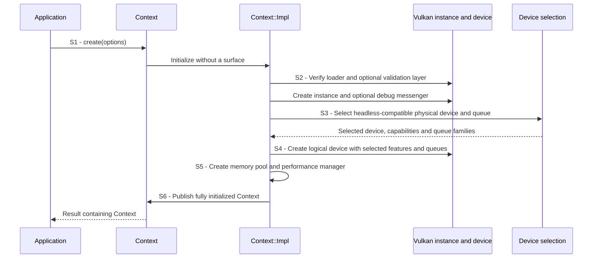
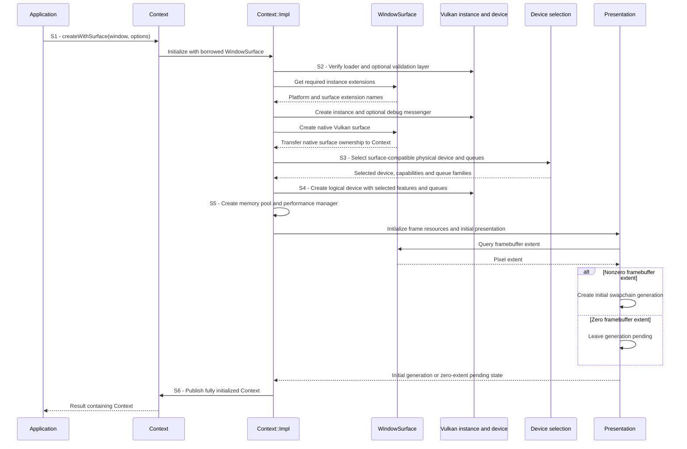
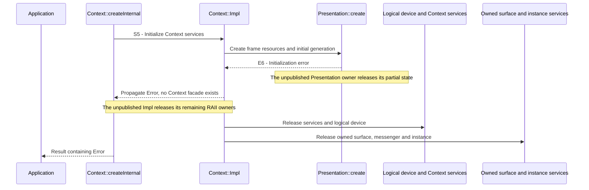

# Create a Context

## Goal and boundary

An application creates a Vulkan `Context` by calling `Context::create()` for a
headless context or `Context::createWithSurface()` for a windowed context. This
implemented flow ends when Panda publishes a fully initialized, move-only owner or
returns an error. The windowed path also initializes presentation resources and an
initial swapchain generation when the framebuffer has a nonzero extent; a zero
extent leaves presentation pending while the Context itself can still succeed.

**Panda** owns the Vulkan instance, device, native surface and Context services.
**The application** owns the `WindowSurface` and native window and keeps both alive
for the full lifetime of a Context created from them. The flow submits no frame or
upload work.

## Preconditions

Creation is synchronous and may allocate or block. Calls that use one Context are
serialized. For a windowed Context, calls to the borrowed `WindowSurface` must obey
its thread requirements and happen outside its callbacks. The surface provider and
its native window must remain valid until the Context is destroyed.

Panda checks these runtime requirements during creation:

| Path | Required extensions and capabilities |
| --- | --- |
| Both paths | The Vulkan loader and selected physical device report Vulkan 1.3. The device supports `timelineSemaphore`, `dynamicRendering` and `synchronization2`, and has a queue family supporting both graphics and compute. |
| Windowed only | `WindowSurface` supplies `VK_KHR_surface` and the platform surface extension. The instance exposes those names, `VK_KHR_get_surface_capabilities2` and at least one of `VK_KHR_surface_maintenance1` or `VK_EXT_surface_maintenance1`. The physical device supports `VK_KHR_swapchain`, the matching KHR or EXT swapchain-maintenance extension and feature, a graphics/compute queue, a present-capable queue, and nonempty surface-format and present-mode lists. |
| Validation requested | `VK_LAYER_KHRONOS_validation` and `VK_EXT_debug_utils` are available, and the loader exposes the debug-messenger entry points. |

The [device-selection subflow](select-vulkan-device.md) explains how Panda queries
device capabilities and chooses the queue families.

## Main flow

1. **S1 - Choose the Context path.** The application supplies options and, for the
   windowed path, a live `WindowSurface` whose required instance extensions include
   `VK_KHR_surface` and the platform surface extension.
2. **S2 - Build instance services.** Panda verifies Vulkan 1.3 support from the
   loader, checks the validation layer when requested, resolves the required
   instance extensions, and creates the Vulkan instance. It then creates the
   optional debug messenger and, for a windowed Context, creates and owns the
   native `VkSurfaceKHR` returned by `WindowSurface`.
3. **S3 - Select a compatible device.** Panda calls the
   [device-selection subflow](select-vulkan-device.md), which returns a physical
   device, queue families and the capabilities needed by this Context.
4. **S4 - Create the logical device.** Panda enables the queried Vulkan 1.3
   features and creates the selected graphics/compute queue. A windowed Context
   also enables the selected present queue and swapchain-maintenance extension.
5. **S5 - Initialize Context services.** Panda creates the memory pool and
   performance manager. For a windowed Context it also initializes presentation
   frame resources and reads the framebuffer extent. A nonzero extent creates the
   initial swapchain generation; a zero extent records that presentation must be
   prepared later.
6. **S6 - Publish the owner.** Only after initialization succeeds does
   `createInternal()` construct and return the public `Context`.

The paths share the same creation steps but differ in instance and presentation
setup, so each entry point has its own sequence.

### Headless path

### Windowed path

## Notes

**Capability checks.** Requesting Vulkan 1.3 at instance creation does not prove
that a physical device exposes every feature Panda needs. Device selection queries
and enables dynamic rendering, synchronization2 and timeline semaphores explicitly.
Windowed contexts additionally require compatible surface support and swapchain
maintenance1. The full rules live in the [selection subflow](select-vulkan-device.md).

**Ownership.** `WindowSurface` is borrowed, while the native surface it creates is
owned by the Context. Partial initialization never publishes a facade: if a later
step fails, the local implementation and its already-created RAII owners unwind,
releasing device-side objects before the surface and instance. The caller still
owns the window and must keep it alive until Context teardown.

**Windowed readiness.** A successful windowed Context has presentation frame
resources. If the framebuffer is minimized and reports zero pixels, creation
succeeds with presentation pending and no zero-sized swapchain generation. Later
window-frame preparation handles that state; see the
[window lifecycle contract](../design/contracts/resources.md#frame-and-window-state).

**Headless creation.** `Context::create()` follows the same loader, device and
service setup without querying window extensions, creating a surface or initializing
presentation. Upload support is initialized when an upload batch is first requested.

## Variants and failures

| ID | Point and condition | Response | Resulting state and next action |
| --- | --- | --- | --- |
| **E1** | S2: loader is below Vulkan 1.3, or a requested validation layer/extension is unavailable | Return `Unsupported`; extension enumeration and provider errors keep their reported error | No Context is published; install or select a compatible Vulkan runtime, or disable optional validation |
| **E2** | S2: required window extensions are malformed or unavailable, or instance, messenger or native-surface creation fails | Return `InvalidArgument`, `Unsupported` or the originating native/provider error; release any instance services already created | No Context is published; correct the provider/configuration or resolve the reported failure |
| **E3** | S3: no compatible physical device is found, or device inspection cannot complete | Propagate the selection result; see [device-selection outcomes](select-vulkan-device.md#variants-and-failures) | No logical device or Context is published; respond to the reported capability or backend failure |
| **E4** | S4: logical-device creation fails | Return the mapped Vulkan error without adopting a failed native output | No Context is published; retry only after resolving the reported cause |
| **E5** | S5: performance-manager initialization fails | Return its error and release the local manager and other Context owners already created | No Context is published; investigate the reported device/backend failure before retry |
| **E6** | S5: windowed presentation initialization fails | Return the originating error and release partial presentation state and Vulkan owners; see [E6 cleanup](#e6---release-partial-presentation-state) | No Context is published; no application Context is available |

### E6 - Release partial presentation state

**Entry state.** S1-S4 completed. The private implementation owns instance services,
the selected physical device wrapper, the logical device, memory pool and initialized
performance manager. Presentation setup may have created frame resources or attempted
the initial swapchain generation. No public Context has been published and this
flow has submitted no GPU work.

The error does not promise byte-for-byte rollback of driver or window-system
state. It guarantees that Panda returns no partially usable `Context` and releases
the Vulkan owners created by this attempt.

## Outcomes

On success, the application owns one valid `Context` and may move it while no
operation is in progress. A windowed Context also borrows its `WindowSurface` and
native window for the entire Context lifetime. Context destruction drains its
owned work and requires the application to release resource handles and unsubmitted
upload batches first; see the [ownership contract](../design/contracts/resources.md#ownership).

On failure, the caller receives an `Error` and no Context owner. Error categories
describe the failure and recovery direction; they do not guarantee that retrying
against the same runtime or surface will succeed.

## Related information

- [Create and release a native window](create-window.md) explains the GLFW
  lifetime and the `WindowSurface` owner borrowed by this flow.
- [Select a compatible Vulkan device](select-vulkan-device.md) explains the
  capability and queue-family decision used at S3.
- [Resource ownership](../design/contracts/resources.md#ownership) defines the
  required Context, resource and window lifetimes.
- [Frame and window state](../design/contracts/resources.md#frame-and-window-state)
  explains windowed readiness and the later presentation lifecycle.
- [Vulkan context and window lifecycle](../development/tasks/vulkan-context.md)
  records the accepted Context scope and its implementation evidence.
- The Vulkan Guide's [version and feature rules](https://docs.vulkan.org/guide/latest/versions.html)
  explain why version requests and queried feature bits are separate checks; its
  [WSI guide](https://docs.vulkan.org/guide/latest/wsi.html) describes the native
  surface boundary.
