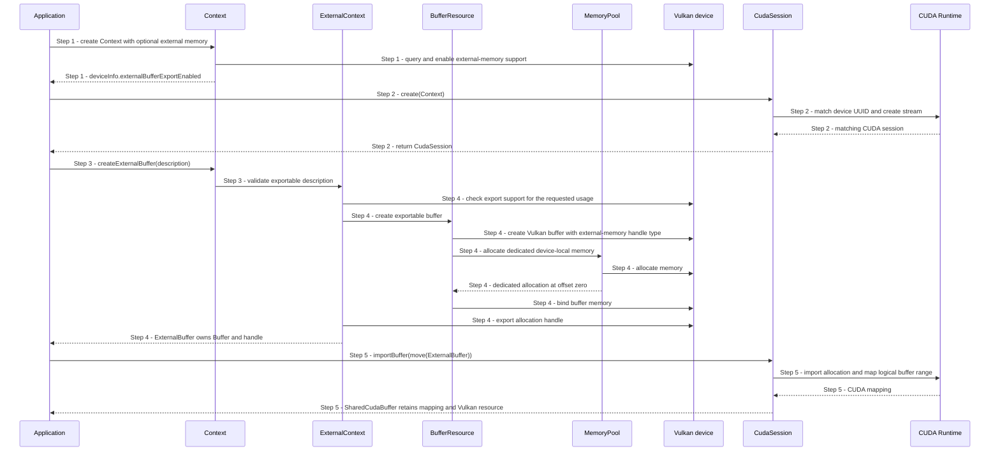

# Create and import an external buffer

## Goal and boundary

An application asks Vulkan to create a shareable buffer and may import its memory
into `Panda::Cuda`. It checks device capabilities before creating the buffer so it
can choose its fallback path during startup. The flow ends with an `ExternalBuffer`
or a `SharedCudaBuffer`.
It creates and maps memory only; it does not submit compute work or synchronize
external GPU use. Follow the [shared-buffer task](../development/tasks/cuda-shared-buffers.md)
and [compute contract](../design/contracts/compute.md).

**The application** chooses the buffer's size and usage and keeps `Context` alive.
**Panda Core** creates a Vulkan buffer and exports an OS memory handle without
depending on CUDA. **`Panda::Cuda`**, when used, matches the Vulkan device and
imports that allocation once.

| Boundary | Meaning |
| --- | --- |
| Trigger and input | Application creates a Context with external-memory support and requests a `BufferDesc` |
| Successful end | An owning `ExternalBuffer`, optionally consumed into a `SharedCudaBuffer` |
| Failure end | A returned `Error`; unpublished Vulkan/CUDA state is released |
| Outside this flow | Compute submission and Vulkan/external-API synchronization |

## Main flow

1. **Check Vulkan capability.** The application creates `Context` with
   `ContextOptions::ExternalBufferSupport::Optional`. During device setup,
   `ExternalContext` tries to enable the platform external-memory extension. The
   application immediately reads `Context::getDeviceInfo().externalBufferExportEnabled`;
   `false` selects its fallback path before allocating the buffer.
2. **Match the CUDA device.** If external export is enabled and the application
   chooses CUDA, it calls `CudaSession::create` before allocating a buffer. The
   add-on searches CUDA devices for the Context's UUID, selects the match and creates
   one non-blocking stream. No match selects the application's fallback path.
3. **Request a buffer.** The application calls `Context::createExternalBuffer`.
   `BufferResource::validateExportableDescription` checks size, usage and device-local
   memory intent before Vulkan is queried.
4. **Create and export.** `ExternalContext` checks export support for the requested
   usage. `BufferResource` creates a device-local Vulkan buffer and asks the
   `MemoryPool` for one dedicated allocation. Vulkan binds it at offset zero and
   exports the allocation handle. Panda publishes an `ExternalBuffer` containing
   the Vulkan buffer, handle, logical size, allocation size and device UUID.
5. **Import and retain.** The application moves the `ExternalBuffer` into
   `CudaSession::importBuffer`. The adapter imports the dedicated allocation and
   maps one view spanning the logical buffer size. `SharedCudaBuffer` retains the
   Vulkan resource, CUDA mapping and session.

## Notes

**Ownership.** `Context` outlives the `ExternalBuffer` and every copied `Buffer` it
returns. A `SharedCudaBuffer` also retains its CUDA session; `CudaSession::close()`
returns `ResourcesInUse` while shared-buffer owners remain. Linux transfers an FD
to CUDA on successful memory import. Windows keeps the exported HANDLE under Panda's
RAII wrapper until the `SharedCudaBuffer` releases it.

**Memory is not ordering.** The OS handle identifies the same allocation to both
APIs. It does not signal completion, transfer Vulkan queue-family ownership or make
writes visible. The current public API does not expose compute submission or a safe
cross-API handoff, so import success is not permission to use the mapping for GPU
work. The [handoff task](../development/tasks/gpu-handoff.md) owns that next boundary.

|  | Point and condition | Response | Resulting state and next action |
| --- | --- | --- | --- |
| **Variant&nbsp;1** | Step 1: optional external-memory support is unavailable | Context creation succeeds and device info reports `false` | Choose the application's fallback path before creating a shared buffer |
| **Error&nbsp;1** | Step 1: required platform/device external-memory support is unavailable | Return `Unsupported` during Context creation | No Context is published; use a compatible device or request optional support |
| **Error&nbsp;2** | Step 2: CUDA has no UUID matching the Vulkan device | Return `Unsupported` | No CUDA session is published; select the application's fallback before allocating |
| **Error&nbsp;3** | Step 3: size, usage or memory intent is invalid | Return the validation error before creating a Vulkan buffer | No native resource is published; correct the description |
| **Error&nbsp;4** | Step 4: the device cannot export the requested usage/handle | Return `Unsupported`; release unpublished state | No `ExternalBuffer` is published; choose a supported usage/device |
| **Error&nbsp;5** | Step 5: CUDA import or mapping fails | Return the CUDA error and release any imported allocation/mapping | No `SharedCudaBuffer` is published; retry only after correcting the reported cause |
| **Error&nbsp;6** | Closing the session while a shared buffer remains alive | Return `ResourcesInUse` | Session stays usable; release all `SharedCudaBuffer` copies before closing again |

**Success.** The allocation can be identified by another API and its ownership is
tracked. **Failure.** No partially initialized wrapper escapes; cleanup failures are
reported with the originating backend status where available.

## Related information

- [UC Create a buffer](create-buffer.md) explains the ordinary Vulkan-buffer path.
- [Resource ownership](../design/contracts/resources.md#ownership) explains Context
  and buffer lifetime requirements.
- [Compute and external-buffer contract](../design/contracts/compute.md) separates
  memory import from the later synchronization and submission APIs.
- [CUDA external resources](https://docs.nvidia.com/cuda/cuda-runtime-api/group__CUDART__EXTRES__INTEROP.html)
  explains CUDA handle-import ownership and mapping requirements.
- [CUDA connection example](../../examples/cuda_connection/README.md) demonstrates
  optional import and the current boundary before cross-API GPU use.
