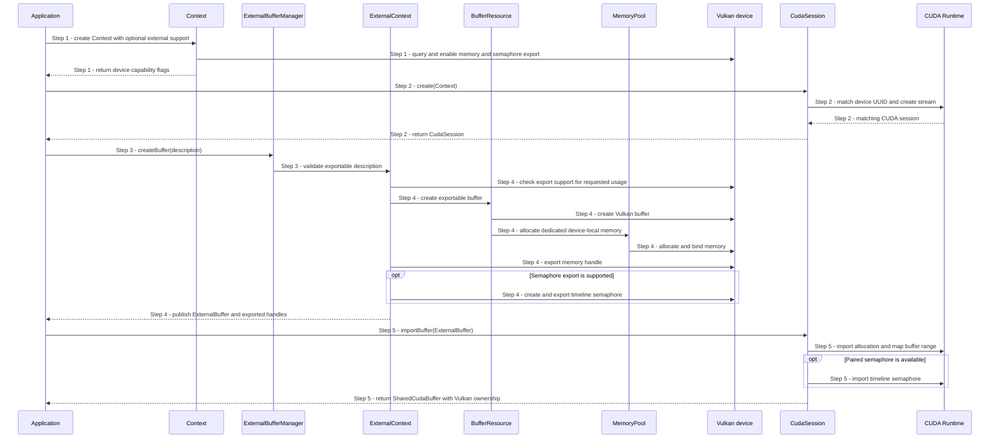

# Create and import an external buffer

## Goal and boundary

The application creates a device-local Vulkan buffer that can be shared with
another GPU API and, when it chooses CUDA, imports the allocation into a matching
CUDA session. This flow ends when the application has a live `SharedCudaBuffer`.
It does not submit work to either API. Repeated use is covered by
[UC Alternate Vulkan and CUDA work on a shared buffer](alternate-shared-buffer-work.md).

**The application** chooses the buffer description and whether to use CUDA.
**Panda Core** creates the Vulkan resource and exports platform handles without
depending on CUDA. **`Panda::Cuda`** matches the Vulkan device and imports the
allocation and, when available, its paired timeline semaphore.

| Boundary | Meaning |
| --- | --- |
| Trigger and input | Application has a live Context and requests a shareable buffer |
| Successful end | A SharedCudaBuffer retains the Vulkan resource and CUDA mapping; Vulkan owns the buffer |
| Failure end | An error is returned and no partially initialized wrapper escapes |
| Outside this flow | GPU work, ownership transfers, application compute policy |

## Main flow

1. **Check capabilities.** The application creates `Context` with
   `ContextOptions::ExternalBufferSupport::Optional` and checks
   `externalBufferExportEnabled` and `externalSemaphoreExportEnabled`. Without
   external-memory export it uses its fallback. Semaphore support is checked
   separately because memory can be shared without a safe cross-API handoff.
2. **Match CUDA.** For the CUDA path, the application calls
   `CudaSession::create` before allocating. The session selects the CUDA device
   with the Context's UUID and creates its stream.
3. **Request a buffer.** The application calls
   `ExternalBufferManager::createBuffer`. Core validates size, usage and
   device-local memory intent before creating native resources.
4. **Create and export.** Vulkan creates a buffer with a dedicated allocation and
   exports its memory handle. When supported, Core also exports a paired timeline
   semaphore handle.
5. **Import and retain.** The application moves the `ExternalBuffer` into
   `CudaSession::importBuffer`. CUDA imports and maps the allocation; when present,
   it also imports the paired semaphore. The resulting `SharedCudaBuffer` retains
   the resource, mapping and session. Vulkan still owns the buffer, and no GPU work
   has been queued.

## Notes

**Ownership.** `Context` must outlive the `ExternalBuffer` and every copied
`Buffer` it returns. `SharedCudaBuffer` retains the imported allocation, optional
semaphore and CUDA session. `CudaSession::close()` returns `ResourcesInUse` while
a shared-buffer owner remains. Linux transfers imported allocation and semaphore
FDs to CUDA on successful import; Windows retains exported HANDLEs under Panda's
RAII owners.

**Semaphore support.** An allocation can be imported even when no paired semaphore
was exported. Such a buffer cannot use
[UC Alternate Vulkan and CUDA work on a shared buffer](alternate-shared-buffer-work.md);
that flow requires the timeline semaphore.

|  | Point and condition | Response | Resulting state and next action |
| --- | --- | --- | --- |
| **Variant&nbsp;1** | Step 1: optional external-memory support is unavailable | Context creation succeeds and reports export disabled | Use the application's fallback before requesting a shared buffer |
| **Variant&nbsp;2** | Step 1: memory export is available but semaphore export is not | Buffer creation and memory import remain available, but no timeline handoff value can be produced | Use memory-sharing only; do not submit cross-API work |
| **Error&nbsp;1** | Step 1: required Context/device initialization fails | Return the initialization error | No Context or external buffer is published; choose a compatible runtime/device |
| **Error&nbsp;2** | Step 2: no CUDA device matches the Vulkan UUID | Return `Unsupported` | No CUDA session is published; use the application's fallback |
| **Error&nbsp;3** | Step 3: size, usage or memory intent is invalid | Return the validation error before native buffer creation | No native resource is published; correct the description |
| **Error&nbsp;4** | Step 4: requested memory usage or handle cannot be exported | Return `Unsupported` and release unpublished state | No ExternalBuffer is published; choose a supported usage/device |
| **Error&nbsp;5** | Step 4: timeline semaphore creation or export fails | Return the Vulkan error and release unpublished resources | No ExternalBuffer is published; inspect the native failure before retrying |
| **Error&nbsp;6** | Step 5: CUDA import or mapping fails | Return the CUDA error and release partial imports | No SharedCudaBuffer is published; correct the reported cause |
| **Error&nbsp;7** | Closing the CUDA session while a SharedCudaBuffer owner remains | Return `ResourcesInUse` | Session stays usable; release all shared-buffer owners before closing |

**Success.** The application owns a SharedCudaBuffer ready for a later handoff.
Its creation and import do not imply GPU work or completion.

**Failure.** Partial native resources are released before an error is returned.
Cleanup failures preserve the originating backend status where available.

## Related information

- [UC Alternate Vulkan and CUDA work on a shared buffer](alternate-shared-buffer-work.md)
  describes repeated Vulkan/CUDA use after this setup.
- [UC Create a buffer](create-buffer.md) covers ordinary Vulkan buffer creation.
- [Resource ownership](../design/contracts/resources.md#ownership) defines the
  Context and resource lifetime requirements.
- [Compute and external-buffer contract](../design/contracts/compute.md) defines
  the API boundary for later CUDA work.
- [CUDA external resources](https://docs.nvidia.com/cuda/cuda-runtime-api/group__CUDART__EXTRES__INTEROP.html)
  explains CUDA handle-import ownership and mapping.
