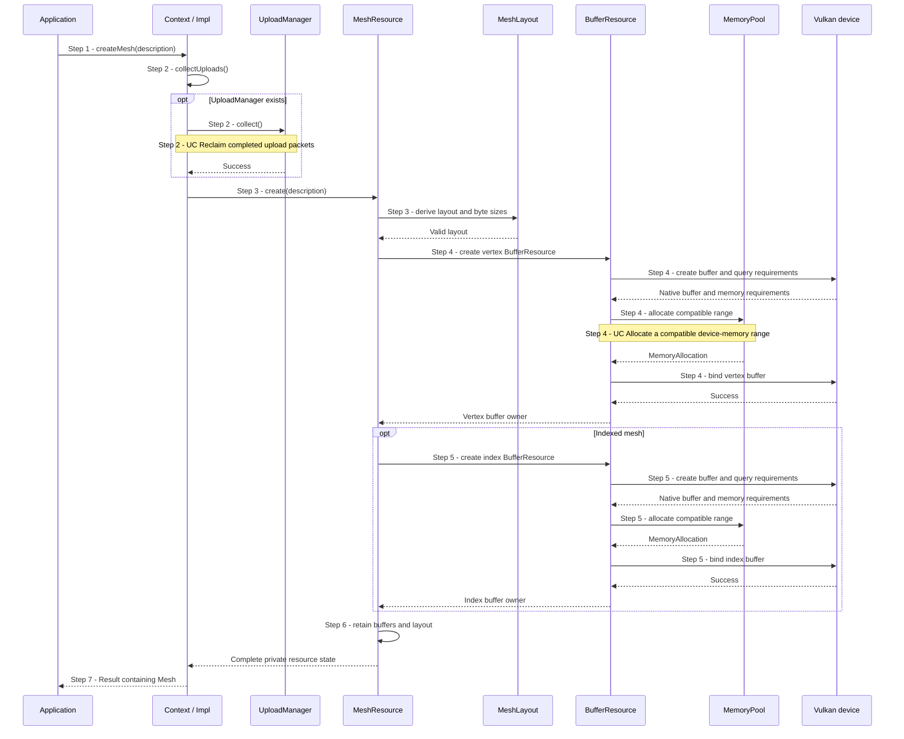
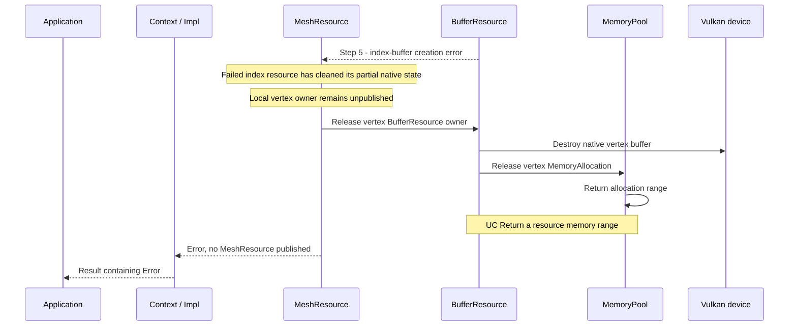

# Create mesh storage with optional indices

## Goal and boundary

An application requests fixed vertex storage and optional index storage through
`Context::createMesh(MeshDesc)`. Panda derives the byte sizes and creates
device-local buffers for the requested layout. A copyable `Mesh` is returned
only after every required buffer is ready. Initial bytes are **undefined**;
creation submits no GPU work and does not upload a mesh payload.

This flow creates storage, not a renderable scene object. The application
defines vertex attributes and supplies valid index values when it later uploads
data. The implemented scope follows
[Allocation, uploads and resource lifetimes](../development/tasks/resource-lifetimes.md).

| Boundary | Meaning |
| --- | --- |
| Trigger and input | Application calls `Context::createMesh` with vertex count/stride and optional index count/type |
| Successful end | `Result<Mesh>` owns fixed vertex storage and, when requested, index storage |
| Failure end | An `Error` is returned with no published `Mesh`, or a fatal caller-contract violation |
| Outside this flow | Vertex/index bytes, attribute interpretation, index-value validation, drawing and GPU synchronization |

## Preconditions

1. **Context.** Use a live `Context` and serialize creation with its other
   operations on the context execution thread.

## Main flow

1. **Request.** The application calls `Context::createMesh(description)`.
   `Context` requires live internal state.
2. **Release completed upload resources.** `Context::Impl::createResource`
   calls `collectUploads()`. [UC Reclaim completed upload packets](reclaim-completed-uploads.md)
   explains which packets can be released; without an `UploadManager`, this is a no-op.
3. **Validate and derive storage sizes.** `MeshLayout::create` requires a
   nonzero vertex count and stride. If indices are present, their count must be
   nonzero and their type must be `UInt16` or `UInt32`. It derives vertex bytes
   from count and stride, and index bytes from count and element width. Omitting
   the index description creates a non-indexed mesh.
4. **Create vertex storage.** `MeshResource` creates an unpublished
   `BufferResource` sized for all vertices, with transfer-destination and
   vertex-buffer usage. The allocation and binding path in
   [UC Create a buffer](create-buffer.md) is reused for these mesh buffers.
5. **Create optional index storage.** When the description includes indices,
   `MeshResource` creates a second `BufferResource` with transfer-destination
   and index-buffer usage. It uses two bytes per `UInt16` index or four bytes
   per `UInt32` index. Without indices, no index buffer is created.
6. **Assemble private state.** `MeshResource` retains the vertex buffer, the
   optional index buffer and the derived layout. It is constructed only after
   all requested buffer creation succeeds.
7. **Publish.** `Context` wraps the complete `MeshResource` in the public
   `Mesh` handle and returns it. The handle exposes counts, stride and storage
   sizes, not native Vulkan buffers.

## Notes

**Storage contract.** Vertex storage is `vertexCount * vertexStride` bytes.
Index storage is `indexCount * 2` or `indexCount * 4` bytes according to the
index type. These sizes describe storage only; Panda does not infer vertex
attributes or inspect index values.

**Shared buffer path.** Each mesh buffer is a device-local `BufferResource`.
The buffer-creation flow owns native creation, compatible memory selection and
binding. [UC Allocate a compatible device-memory range](allocate-memory-range.md)
explains range allocation; the vertex and index ranges may use the same ordinary
memory block.

**Publication and cleanup.** The application never receives a mesh with only
one of its requested buffers. If index-buffer creation fails, the unpublished
vertex buffer owner is released, destroying that buffer before returning its
memory range. No GPU wait is needed because mesh creation submits no work.

**Ownership after success.** Copies of `Mesh` retain the same private resource
state rather than copying bytes. `Context` must outlive every copy, and
submitted operations retain the component buffer owners they use until
completion. A `Mesh` copy does not synchronize GPU access. Later payload upload
is a separate operation described by the
[resource contract](../design/contracts/resources.md#allocation-uploads-and-descriptors).

## Variants and errors

|  | Point and condition | Response | Resulting state and next action |
| --- | --- | --- | --- |
| **Variant&nbsp;1** | Step 3: index description is absent | Create only vertex storage | The returned mesh reports zero index count and size, with no index type |
| **Variant&nbsp;2** | Step 3: index type is `UInt16` or `UInt32` | Derive the corresponding index-buffer size | The caller supplies matching bytes when uploading the payload |
| **Error&nbsp;1** | Step 1: moved-from `Context` | Checked fatal diagnostic | No recoverable result; use a live `Context` |
| **Error&nbsp;2** | Step 2: completed-upload collection fails | Propagate its error before layout validation or buffer creation | No new mesh buffers; follow the error category rather than retrying unconditionally |
| **Error&nbsp;3** | Step 3: vertex count/stride is zero, index count is zero or index type is invalid | Return `InvalidArgument` | No native buffers are created; correct the description |
| **Error&nbsp;4** | Step 4: vertex-buffer creation, allocation or binding fails | Propagate the buffer error | No index buffer or `Mesh` is published |
| **Error&nbsp;5** | Step 5: optional index-buffer creation, allocation or binding fails | [Release the unpublished vertex buffer](#error-5---cleanup-after-index-buffer-failure); propagate the index error | No partial `Mesh` escapes; the vertex range returns to the pool |

**Errors 2–5** return `Result` errors, but not every category permits recovery
on the same `Context`. **Error 1 is fatal.** Host allocation failure follows
the [shared error policy](../design/contracts/resources.md#errors).

### Error 5 - Cleanup after index-buffer failure

**Entry state.** Steps 1–4 completed. The local `MeshResource::create` scope
owns the unpublished vertex `BufferResource`; index-buffer creation failed.
`BufferResource::create` has already cleaned any partial index-buffer state.
No `MeshResource` or public `Mesh` has been created, and this flow submitted no
GPU work.

[UC Return a resource memory range](release-memory-range.md) explains how the pool
coalesces and retains or frees the returned range.

## Outcomes

**Success.** A copyable `Mesh` owns fixed vertex storage and optional index
storage with the described counts, stride, type and byte sizes. Its contents
remain undefined until uploaded; creation produced no completion point.

**Failure.** No partial mesh handle is returned. A vertex buffer created before
an index failure is destroyed and its range released through ordinary RAII.

## Related information

- [UC Create a buffer](create-buffer.md) explains the native buffer creation,
  allocation and binding flow used for each mesh component.
- [UC Allocate a compatible device-memory range](allocate-memory-range.md)
  explains the shared pool policy used by those buffers.
- [UC Return a resource memory range](release-memory-range.md) explains cleanup
  after the final buffer owner is released.
- [Allocation, uploads and descriptors](../design/contracts/resources.md#allocation-uploads-and-descriptors)
  defines mesh storage and later payload-upload behavior.
