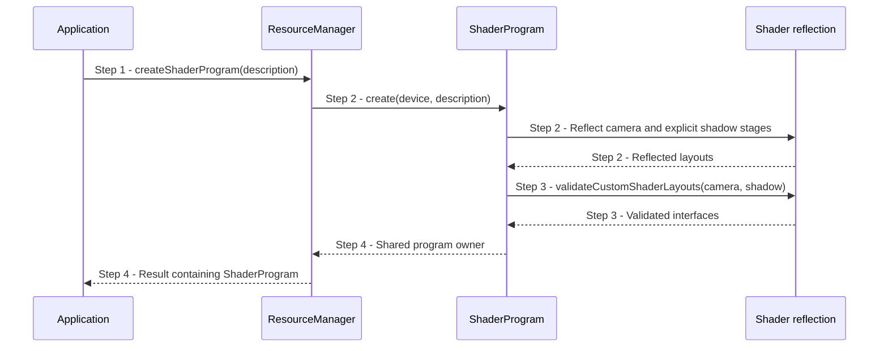

# Create a graphics shader program

## Goal and boundary

An application calls `ResourceManager::createShaderProgram` to create an owning
handle from validated SPIR-V. This flow ends with a `ShaderProgram` or an
`Error`. Pipeline creation and draw submission are outside this flow.

## Preconditions

1. The application uses a live `Engine` and serializes operations on it.
2. The SPIR-V words are valid through the call. Use build output validated by
   `spirv-val` for the Vulkan target environment.

## Main flow

1. **Describe the variants.** Pass the camera vertex and fragment `ShaderCode`,
   the vertex input contract, and the shadow selection in `ProgramDesc`.
2. **Reflect the stages.** `ResourceManager` delegates to `ShaderProgram`, which
   uses `reflectShader` and `buildShaderProgramLayout` for the camera and the
   explicit shadow variant, when supplied. Procedural vertex stages require no
   mesh attributes. The unpublished variants own copies of the code and labels.
3. **Check the interfaces.** `validateCustomShaderLayouts` checks the renderer's
   shared bindings and draw constants using its built-in shader schema. Each
   application binding used in the shadow variant must match the camera binding
   at the same set and binding number.
4. **Publish the owner.** Return the `ShaderProgram`. Copies retain the same
   Engine-bound state, and the application can release its input storage.

## Notes

**Application bindings.** Shadow stages often need geometric data alone. The
camera may read additional resources such as colors, while the shared bindings
retain a single layout for both variants. [Shader integration](../design/contracts/rendering.md#shader-integration)
defines the binding and ownership requirements.

## Variants

| Condition | Result |
|-----------|--------|
| Camera or shadow stage fails reflection or interface validation | Return an error and release unpublished state. |
| Explicit shadow fragment is absent | Validate the shadow vertex stage alone. |
| Shadow selection is StandardMesh | Record the built-in selection for a standard mesh program. A procedural program returns an error. |

**Related flow.** [Reload a graphics shader program](reload-shader-program.md)
describes replacing the shared revision after validating an ABI-compatible
candidate.
