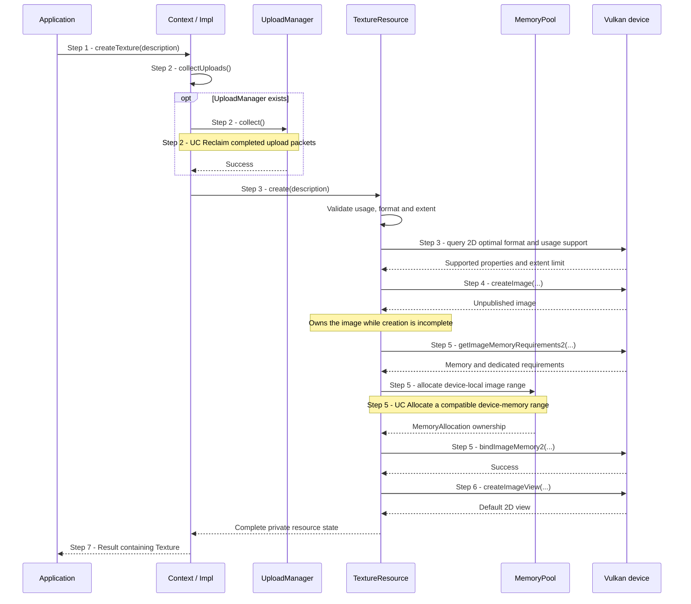
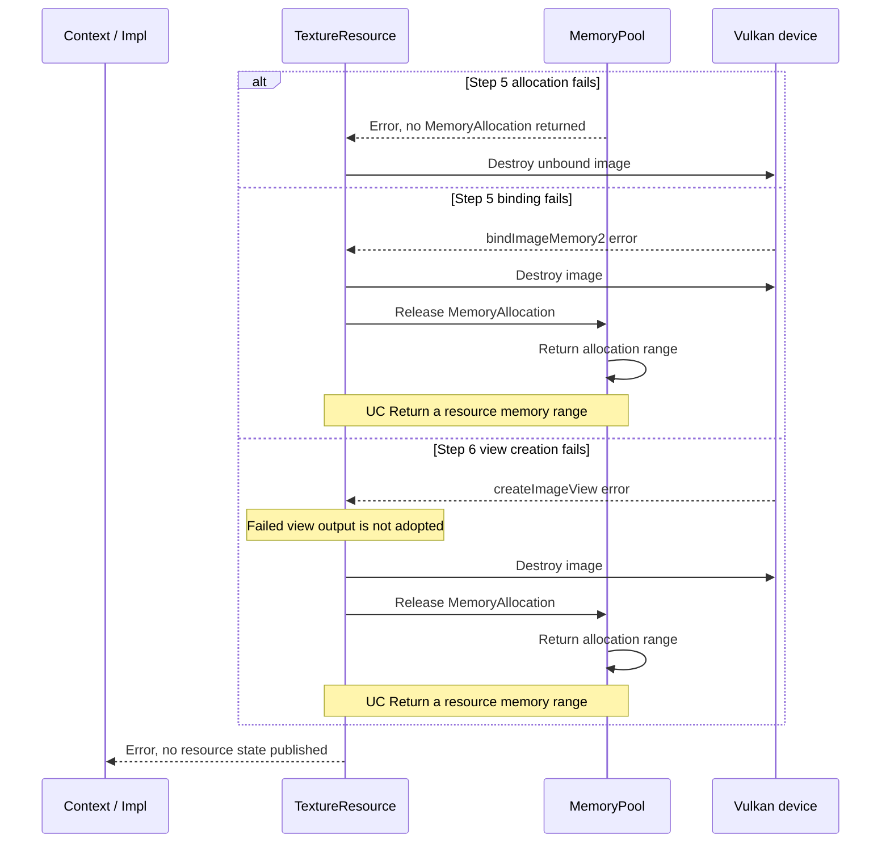

# Create a texture and its default view

## Goal and boundary

An application requests a fixed-size 2D GPU image through
`Context::createTexture(TextureDesc)`. The implemented flow returns a copyable
`Texture` only after Panda has validated the request, created and bound the image,
and created its internal default image view. Initial texels are **undefined**.
Creation submits no GPU work and does not upload or initialize contents.

**Panda** owns the native image, its memory range and the default view.
**The application** chooses extent, format and usage, and keeps `Context` alive
for every `Texture` owner. The implemented scope follows
[Allocation, uploads and resource lifetimes](../development/tasks/resource-lifetimes.md).

| Boundary | Meaning |
| --- | --- |
| Trigger and input | Application calls `Context::createTexture` with a `TextureDesc` |
| Successful end | `Result<Texture>` contains a shared owner of a bound 2D image and its internal default view |
| Failure end | An `Error` is returned with no published `Texture`, or a fatal caller-contract violation |
| Outside this flow | Uploading texels, submitting GPU work, later synchronization and texture sampling |

## Preconditions

1. **Context.** Use a live `Context` and serialize creation with its other
   operations on the context execution thread.

## Main flow

1. **Request.** The application calls `Context::createTexture(description)`.
   `Context` requires live internal state.
2. **Release completed upload resources.** `Context::Impl::createResource`
   calls `collectUploads()`. [UC Reclaim completed upload packets](reclaim-completed-uploads.md)
   explains which packets can be released; without an `UploadManager`, this is a no-op.
3. **Validate.** `TextureResource::create` requires nonzero dimensions, a
   concrete format and nonempty supported usage. Usage must include a
   view-capable use such as sampled, storage or attachment; transfer-only usage
   cannot create the required view. The physical device is queried for the
   requested format/usage with 2D optimal tiling, and the extent is checked
   against its limits before image creation.
4. **Create unpublished image.** Vulkan creates one optimal-tiled 2D image with
   one mip, one array layer, one sample and undefined initial layout. Its
   contents are not initialized.
5. **Allocate and bind.** `TextureResource` queries the image's ordinary and
   dedicated requirements and requests device-local memory from the image
   partition. [UC Allocate a compatible device-memory range](allocate-memory-range.md)
   returns an aligned range; the creator binds the image at its offset.
6. **Create the default view.** Vulkan creates an internal 2D image view over
   the sole mip and layer. Its aspect comes from the format: stencil for
   stencil-only, depth for depth and combined depth/stencil, otherwise color.
7. **Publish.** Only after the view succeeds does `TextureResource` return its
   complete state. `Context` wraps it in the public `Texture` and returns it to
   the application.

## Notes

**Publication guarantee.** Step 7 is the publication point. No `Texture` handle
escapes if validation, allocation, binding or view creation fails. An allocation
is not enough: the image must also be bound and have its default view.

**Default view.** `Texture` keeps the view private to the backend. The view
spans the single mip and layer; combined depth/stencil formats use a depth-only
aspect. The public handle reports extent, format and usage, but does not expose
the native image or view.

**Contents and lifetime.** Image creation does not initialize texels or enqueue
work. A copied `Texture` retains the same resource state; it does not copy image
contents. `Context` must outlive every copy. The final owner must not release the
image while submitted work still uses it; the [resource contract](../design/contracts/resources.md#frame-contexts-and-retirement)
and [UC Return a resource memory range](release-memory-range.md) define those boundaries.

## Variants and errors

|  | Point and condition | Response | Resulting state and next action |
| --- | --- | --- | --- |
| **Error&nbsp;1** | Step 1: moved-from `Context` | Checked fatal diagnostic | No recoverable result; use a live `Context` |
| **Error&nbsp;2** | Step 2: completed-upload collection fails | Propagate its error before validating or creating the image | No new image; follow the error category rather than retrying unconditionally |
| **Error&nbsp;3** | Step 3: zero extent, undefined format, empty usage or usage without a view-capable bit | Return `InvalidArgument` | No native image is created; correct the description |
| **Error&nbsp;4** | Step 3: unsupported usage bit or format/usage combination | Return `Unsupported` | No native image is created; choose a supported usage or format |
| **Error&nbsp;5** | Step 3: extent exceeds the device limit or the support query fails | Return `InvalidArgument` for an excessive extent, otherwise the classified Vulkan error | No native image is created; adjust the request or follow the reported error |
| **Error&nbsp;6** | Step 4: native image creation fails | Convert the Vulkan status without adopting its failed output | No resource state or public handle is created |
| **Error&nbsp;7** | Step 5: memory allocation fails | Destroy the unpublished image and propagate the allocation error | No range or public handle escapes; existing live allocations remain owned |
| **Error&nbsp;8** | Step 5: image binding fails | [Destroy the image, then release its range](#error-8---cleanup-before-publication); propagate the native error | No `Texture` is published; the pool applies its empty-block policy |
| **Error&nbsp;9** | Step 6: default view creation fails | [Destroy the image, then release its range](#error-8---cleanup-before-publication); do not adopt the failed view output | No `Texture` is published; the pool applies its empty-block policy |

**Errors 2–9** return `Result` errors, but not every category permits recovery
on the same `Context`. **Error 1 is fatal.** Host allocation failure follows
the [shared error policy](../design/contracts/resources.md#errors).

### Error 8 - Cleanup before publication

**Entry state.** Step 4 created an image held by unpublished `TextureResource`.
Depending on where creation failed, the pool may not have returned a range, or
the resource may already own a range that was bound to the image. No public
`Texture` exists and this operation submitted no GPU work.

[UC Return a resource memory range](release-memory-range.md) explains range release after
image destruction. The original allocation or Vulkan error is propagated.

## Outcomes

**Success.** A copyable `Texture` owns a fixed-size, bound 2D image and an
internal default view. Its texels remain undefined until an upload initializes
them. Creation produced no completion point because it submitted no GPU work.

**Failure.** No public handle is returned; temporary image and allocation
owners are released. Pool caches may change during cleanup or budget reclamation,
but existing live ranges are not evicted.

## Related information

- [UC Allocate a compatible device-memory range](allocate-memory-range.md) explains
  how the image obtains an aligned range from the Context pool.
- [UC Return a resource memory range](release-memory-range.md) explains destruction
  and range release after the last shared owner is gone.
- [UC Create a buffer](create-buffer.md) shows the corresponding resource-creation
  flow and caller-specific memory intent.
- [UC Upload texture contents or regions](upload-texture.md) explains how a caller
  initializes the image and how uncovered texels remain undefined.
- [Ownership](../design/contracts/resources.md#ownership),
  [allocation, uploads and descriptors](../design/contracts/resources.md#allocation-uploads-and-descriptors)
  and [frame contexts and retirement](../design/contracts/resources.md#frame-contexts-and-retirement)
  define shared lifetime and allocation guarantees.
- Vulkan's [resource creation chapter](https://docs.vulkan.org/spec/latest/chapters/resources.html)
  and [memory-allocation guide](https://docs.vulkan.org/guide/latest/memory_allocation.html)
  describe image creation and device-memory suballocation; the fixed 2D shape,
  view policy and pool behavior above are Panda choices.
