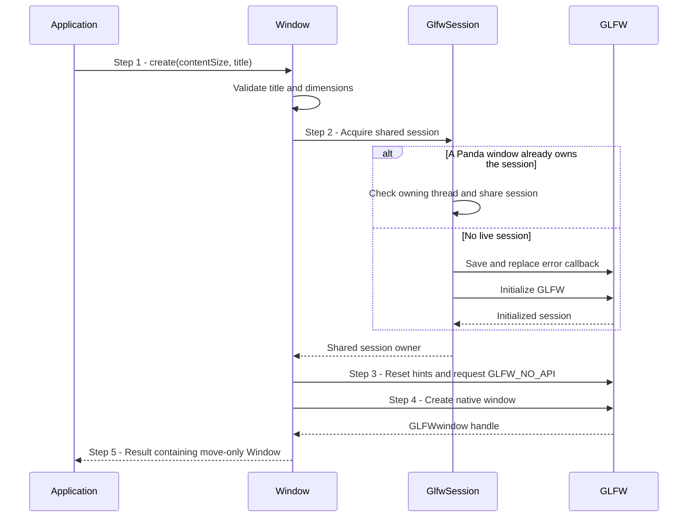
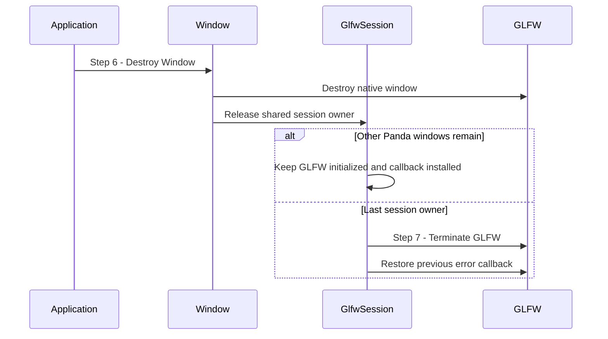

# Create and release a native window

## Goal and boundary

This scenario describes one optional application workflow: choosing Panda's
no-OpenGL GLFW wrapper, `panda::tools::Window`, to create and release a native
window through RAII. The flow includes the shared GLFW session because that
session owns GLFW initialization, termination and its process-wide error callback.
It ends when the native window is destroyed and, for the last live window, GLFW is
terminated and the previous callback is restored.

The application owns each `Window`. Panda owns one shared GLFW session while any
Panda window is alive. This scenario covers this wrapper's creation and release,
not the event loop or rendering. The general windowed Context API accepts any
application-defined `panda::WindowSurface`; it does not require `Panda::Tools` or
GLFW. That provider supplies required instance extensions, creates a Vulkan
surface and reports framebuffer extent. See the [Context scenario](create-context.md)
for the shared contract. A Context borrows its provider, so the application must
destroy the Context before releasing either this `Window` or its custom provider.

## Preconditions

1. **Execution.** Run window creation, use, moves and destruction on the
   GLFW-owning main thread, outside GLFW callbacks.

## Main flow

1. **Request a window.** The application calls `Window::create()` with a content
   size and a null-terminated UTF-8 title. The method validates the title and
   dimensions before making any GLFW call.
2. **Acquire the shared GLFW session.** `GlfwSession::acquire()` shares a
   live session on its owning thread. If none exists, it saves the current GLFW
   error callback, installs Panda's reporting callback and initializes GLFW.
3. **Set Panda's window hints.** Panda resets the global window hints and
   requests `GLFW_NO_API`, so GLFW does not create an OpenGL context.
4. **Create the native window.** GLFW returns a `GLFWwindow`; the `Window`
   stores that handle together with its shared session owner.
5. **Publish the owner.** The application receives a move-only `Window`.
   Moving transfers both owners and leaves the source valid only for destruction
   or `isValid()`.
6. **Destroy a window.** `Window::~Window()` destroys its native handle
   before releasing its shared session owner.
7. **Release the session when last.** If another Panda window still owns the
   session, GLFW remains active. When the last owner releases it,
   `GlfwSession::~GlfwSession()` terminates GLFW and restores the callback that
   preceded the session.

### Create the window

### Release the window and session

## Notes

**Shared lifetime.** The session cache is weak; each live `Window` holds the
strong owner that keeps GLFW initialized. A failed later window creation releases
only its temporary session owner, so it cannot terminate GLFW while an existing
window still owns the session. Destroying one of several windows destroys only
that native window; the last release performs process-wide cleanup. While any
Panda window is alive, the application must not independently initialize or
terminate GLFW or replace its error callback.

**Surface borrowing.** `Window::createSurface()` transfers the created Vulkan
surface to the caller, while `Context::createWithSurface()` borrows the
`WindowSurface`. Keep the `Window` alive until that Context is destroyed; the
[Context scenario](create-context.md) follows that ownership boundary.

**Dimensions.** The requested and queried window sizes use content coordinates.
Framebuffer extents use pixels and can differ on high-DPI displays. A zero
framebuffer extent means presentation is suspended; it is not a window-creation
failure.

**Close request.** A close flag reported by `Window::shouldClose()` does not
destroy the native window. The application decides when to leave its loop and
release the RAII owner.

## Variants and failures

|  | Point and condition | Response | Resulting state and next action |
| --- | --- | --- | --- |
| **Error&nbsp;1** | Step 1: title is null, or a dimension is zero or greater than `INT_MAX` | Return `InvalidArgument` before any GLFW call | No session or native window is acquired; correct the request and call again |
| **Error&nbsp;2** | Step 2: GLFW initialization fails | Return the mapped GLFW error with its message and native status when available; release the uninitialized session and restore the previous callback | No `Window` is published and `glfwTerminate()` is not called for a failed initialization; resolve the platform/runtime cause before retrying |
| **Error&nbsp;3** | Step 3: configuring window hints reports an error | Return the GLFW error; release this call's session owner | No native window is created; the session is terminated and its callback restored only if this was the last owner; correct the reported cause before retrying |
| **Error&nbsp;4** | Step 4: GLFW cannot create the native window | Return the GLFW error; release this call's session owner | No `Window` is published; existing windows keep their session alive, otherwise last-owner cleanup runs; resolve the reported cause before retrying |
| **Error&nbsp;5** | Steps 2–6: an operation, move or destruction occurs on the wrong thread, or inside a GLFW callback | This violates the lifetime contract and is a fatal check, not a recoverable `Result` | Keep all operations and release on the owning main thread, outside callbacks; a process that reached the fatal check cannot recover in place |

The error mapper categorizes GLFW's unavailable API, format, platform or version
as `Unsupported`, out-of-memory as `ResourceExhausted`, and other failures as
`BackendFailure`. The returned `Error::message`, optional `Error::native` and
`Error::source` provide the operation-specific diagnostics.

## Outcomes

On success, the application owns one valid, move-only `Window`. Multiple windows
on the owning thread share GLFW initialization, but each retains a distinct native
handle. Moving a `Window` transfers ownership without destroying the native handle.

On failure, no `Window` owner is returned. Any session owner acquired by that call
is released; an existing live window retains the shared session. Once the last
window is destroyed, Panda terminates GLFW and restores the prior error callback.

## Related information

- [Create a Context](create-context.md) explains how a windowed Context borrows a
  `WindowSurface`, including an application-defined implementation, and must be
  destroyed before its provider.
- [Window wrapper](../design/package-and-toolchain.md#window-wrapper) defines the
  optional Tools target, thread restrictions and GLFW ownership boundary.
- [GLFW window wrapper](../development/tasks/window-wrapper.md) records the
  accepted API and implementation evidence.
- [Resource ownership](../design/contracts/resources.md#ownership) defines Context
  and resource lifetimes.
- The [GLFW initialization guide](https://www.glfw.org/docs/latest/intro_guide.html#intro_init)
  describes GLFW initialization and termination requirements.
