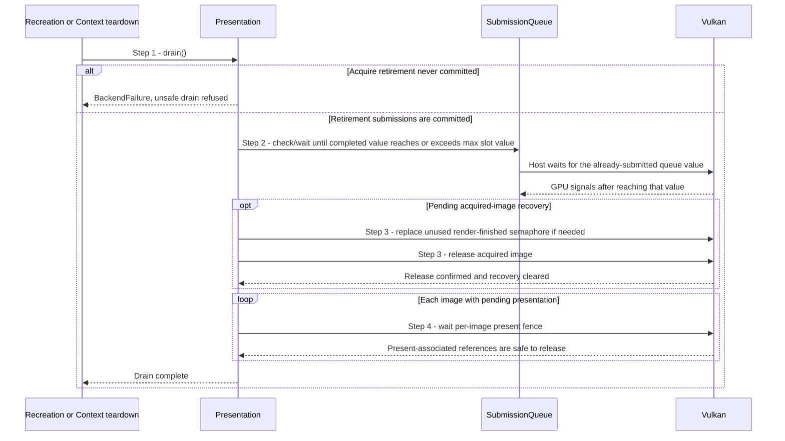

# Drain frame and presentation use

## Goal and boundary

Before replacing a swapchain generation or destroying a windowed Context,
`Presentation::drain()` waits for submitted frame work and outstanding present
operations. It starts with the current slots and generation and ends when both
queue work, acquired-image recovery and presentation references are drained or an
error prevents safe teardown.

## Main flow

1. **Reject an uncommitted acquire retirement.** If a cleanup submission after
   acquire never committed, `drain()` returns `BackendFailure`; it cannot prove
   that the binary acquire semaphore or image was retired.
2. **Wait for submitted GPU work.** Otherwise, `drain()` finds the maximum
   `lastCompletion` value stored in any frame slot. If the timeline's known
   completed value is at least that maximum, the wait returns immediately;
   otherwise, it waits for the maximum value.
3. **Finish acquired-image recovery.** If a cleanup submission or a non-enqueued
   present failure left pending recovery, `drain()` completes its remaining
   semaphore replacement and image release after the timeline wait.
4. **Wait for present references.** `waitPresentation()` waits on each image's
   pending presentation fence. After each successful wait it clears that image's
   pending flag.
5. **Continue the boundary.** Recreation may build and publish a replacement
   generation after drain succeeds. Context destruction requires drain success
   before its presentation resources are released.

## Notes

**Two sources of completion.** `SubmissionQueue` tracks Context submissions with
a Vulkan timeline semaphore that the GPU signals as queued work completes. A
presentation fence retires resources referenced by a present request. A queue
timeline value by itself does not make present wait semaphores safe to destroy.
See the [completion-point contract](../design/contracts/resources.md#handles-and-api-boundary).
The Vulkan present-fence guarantee permits destruction after the associated
fence signals, even though that signal does not promise that presentation has
finished on screen.

**Separate acquisition state.** Waiting for a committed queue value proves that
submitted GPU work is complete; it does not return an acquired swapchain image.
`Presentation` retains the image index and remaining cleanup action until release
succeeds. A release error leaves the acquisition unconfirmed, so `drain()` fails
instead of claiming the generation is safe or repeating an ambiguous release.
See [UC Retire an acquired image after frame work fails](retire-acquired-image.md#notes) and
[UC Recover from a presentation failure after GPU submission](recover-presentation-failure.md#notes).

**Fatal caller boundary.** `Context::Impl::drain()` uses `expect` for presentation
drain failure. Context teardown therefore treats an unprovable presentation drain
as fatal rather than destroying state under uncertain submitted work.

## Variants and errors

|  | Point and condition | Response | Resulting state and next action |
| --- | --- | --- | --- |
| **Variant&nbsp;1** | Step 2: the timeline's known completed value is greater than or equal to the maximum `lastCompletion` stored in any frame slot | Continue immediately without a GPU wait | Pending acquired-image recovery and present fences still need their own checks |
| **Error&nbsp;1** | Step 1: acquire retirement did not commit | Return `BackendFailure` before waiting | No safe retirement is claimed; Context teardown treats the failure as fatal |
| **Error&nbsp;2** | Step 2: timeline wait fails or times out | Return the wait error and preserve pending recovery | Do not release the generation; a later drain may retry the wait if the device remains usable |
| **Error&nbsp;3** | Step 3: acquired-image recovery or release fails | Return the cleanup error and preserve unresolved state | Do not claim successful drain; a release error is not repeated |
| **Error&nbsp;4** | Step 4: any pending present fence fails or times out | Return the Vulkan error and leave that image pending | The presentation resources remain unretired; do not claim successful drain |

## Related information

- [UC Render and present an application view](render-view.md) shows how
  normal submissions and present fences enter this drain.
- [UC Retire an acquired image after frame work fails](retire-acquired-image.md)
  describes the other acquire-related cleanup state.
- [UC Recover from a presentation failure after GPU submission](recover-presentation-failure.md)
  describes the submitted-work cleanup state. [UC Suspend presentation and recreate the swapchain](recreate-swapchain.md)
  and [UC Shut down a Context safely](shutdown-context.md) call this drain before
  releasing presentation resources.
- [Resources and frames](../design/contracts/resources.md#frame-and-window-state)
  defines the intended image-release and generation-drain rules.
- The [swapchain destruction specification](https://docs.vulkan.org/refpages/latest/refpages/source/vkDestroySwapchainKHR.html)
  requires acquired-image uses to have completed before the swapchain is destroyed.
