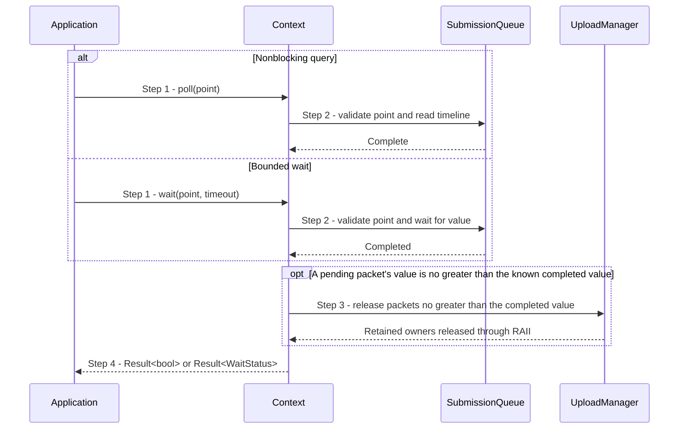

# Observe or wait for submitted GPU work

## Goal and boundary

After successful GPU work submission, an application uses its `CompletionPoint` to
check whether the GPU has finished or to wait for a bounded time. The point may
come from `UploadBatch::submit()` or from a submitted `FrameResult`. The flow starts
with that point and a live owning `Context`, and ends when `Context::poll()` or
`Context::wait()` returns a completion state or error.

**Panda** validates the point and observes the Context's shared submission timeline.
**The application** chooses whether to poll or wait and keeps the owning Context
alive. GPU completion does not establish that a frame has finished presenting or
appeared on screen.

## Main flow

1. **Choose an observation.** The application passes the point to
   `Context::poll()` for a nonblocking query or to `Context::wait()` with a
   nonnegative timeout for an explicit wait.
2. **Check the submitted value.** Context asks its `SubmissionQueue` to validate
   that the point belongs to this Context and identifies committed work. Polling
   reads the timeline without waiting; waiting returns immediately if the value is
   already known complete, otherwise it waits up to the requested duration.
3. **Retire known-complete uploads.** After a successful result, Context lets its
   `UploadManager` release pending packets whose completion values are no greater
   than the known completed value. The
   [completed-upload subflow](reclaim-completed-uploads.md) explains which owners
   this releases and why.
4. **Return the observation.** `poll()` returns `true` when the point is complete
   and `false` while it is pending. `wait()` returns `WaitStatus::Completed` or
   `WaitStatus::Timeout`.

## Notes

**Shared timeline.** The Context's `SubmissionQueue` owns a Vulkan timeline
semaphore, a GPU-updated integer counter. Each accepted queue submission signals
the next value, and a point is complete when the counter reaches or exceeds its
value. Upload and presentation submissions share this counter. Presentation
completion is tracked separately, so this result does not mean a frame is
displayed. See the [completion-point contract](../design/contracts/resources.md#handles-and-api-boundary).

**Token lifetime.** `CompletionPoint` is copyable but retains neither the Context
nor resources. The owning Context state must outlive its use, and moving a Context
preserves its issued points.

**Upload ownership.** A successful `poll()` result includes `false`, and a
successful `wait()` result includes `Timeout`. Context still checks for upload
packets whose completion values are no greater than the completed value it
already knows; packets with greater values remain retained. See the
[completed-upload subflow](reclaim-completed-uploads.md).

## Variants and errors

|  | Point and condition | Response | Resulting state and next action |
| --- | --- | --- | --- |
| **Variant&nbsp;1** | Step 2: the timeline's completed value is less than the value in the submitted `CompletionPoint` | Return `false` | The work may still be running; keep the point and poll again or wait |
| **Variant&nbsp;2** | Step 2: the wait deadline expires first | Return `WaitStatus::Timeout` as a successful result | The work may still be running; keep the point and poll or wait again |
| **Error&nbsp;1** | Step 1 or 2: negative timeout, empty or foreign point, or no owning submission queue | Return `InvalidArgument` | No completion is established; use the owning live Context and a valid point, or a nonnegative timeout |
| **Error&nbsp;2** | Step 2: timeline query or wait reports a backend failure, including device loss | Return the backend error | This call establishes no new completion; pending upload owners remain retained, and general device-loss recovery is not promised |

## Outcomes

**Completed.** The point's submitted GPU work has finished. The result says nothing
about completion of presentation or display.

**Pending or timeout.** The point remains valid, but the GPU may still be using the
submitted work and its retained upload owners.

## Related information

- [Upload bytes into a buffer](upload-buffer.md) shows how a successful upload
  submission produces a `CompletionPoint`.
- [Reclaim completed upload packets](reclaim-completed-uploads.md) explains the
  staging, destination and command owners released after completion is observed.
- [Handles and API boundary](../design/contracts/resources.md#handles-and-api-boundary)
  defines token identity, Context moves and the `poll()`/`wait()` result contract.
- [Frame and window state](../design/contracts/resources.md#frame-and-window-state)
  explains why GPU completion and presentation completion are separate.
- [Allocation, uploads and resource lifetimes](../development/tasks/resource-lifetimes.md)
  records the implemented lifetime and completion scope.
