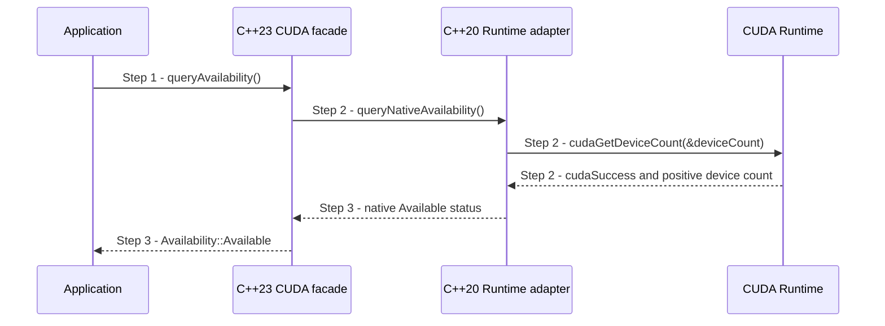

# Query CUDA Runtime availability

## Goal and boundary

An application checks whether the CUDA Runtime currently sees a device before
starting optional CUDA work. The flow starts at
`panda::cuda::queryAvailability()` and ends with an ordinary availability value
or an error carrying the native Runtime status. It does not choose a device for
Vulkan interoperation, create a CUDA session, share memory or guarantee that a
later kernel launch will succeed.

The `Panda::Cuda` module is optional. **The application** decides what to do
with an unavailable result. **Panda** keeps the C++23 public result type outside
the private C++20 CUDA Runtime adapter.

## Main flow

1. **Request availability.** The application calls
   `panda::cuda::queryAvailability()` from the optional CUDA module.
2. **Query the Runtime.** The facade calls its native adapter, which invokes
   `cudaGetDeviceCount()`. This may initialize the CUDA Runtime and block.
3. **Return the positive result.** When the Runtime succeeds and reports at
   least one device, the adapter returns plain status data and the facade
   publishes `Availability::Available`.

## Notes

**Compilation boundary.** The public facade exposes `std::expected` and
`panda::cuda::Error`; the native adapter uses plain status and integer fields.
CUDA headers and Runtime calls stay inside the adapter translation unit, so
the C++20 boundary does not include the C++23 engine-facing API.

**Meaning of available.** `Available` records the Runtime's device-count result
at query time. It does not validate a Vulkan/CUDA device match, an external
memory handle, later Runtime calls or a kernel.

## Variants and errors

|  | Point and condition | Response | Resulting state and next action |
| --- | --- | --- | --- |
| **Variant&nbsp;1** | Step 2: the Runtime returns `cudaErrorNoDevice`, or succeeds with a zero device count | Return `Availability::NoDevice` | CUDA work is unavailable for this query; continue without optional CUDA work or handle the absence |
| **Variant&nbsp;2** | Step 2: the Runtime returns `cudaErrorInsufficientDriver` or `cudaErrorSystemDriverMismatch` | Return `Availability::NoDriver` | The Runtime cannot use the installed driver; continue without optional CUDA work or resolve the driver mismatch |
| **Error&nbsp;1** | Step 2: the Runtime returns another non-success status | Return `std::unexpected` with the native status in `panda::cuda::Error::nativeCode` | The query failed for an unexpected reason; report or handle the native code before deciding whether to continue |

## Outcomes

**Available.** The Runtime reported one or more devices at query time. The
application may proceed to its next CUDA operation, which can still fail.

**Unavailable or error.** `NoDriver` and `NoDevice` are ordinary results;
other initialization failures preserve their native status in the error.

## Related information

- [Package and toolchain contract](../design/package-and-toolchain.md#c23-and-cuda20-with-one-host-toolchain)
  describes the optional module and C++23/C++20 adapter boundary.
- [Compute and CUDA contract](../design/contracts/compute.md#interoperability)
  separates Runtime availability from Vulkan/CUDA device matching and sharing.
- [CUDA connection example](../../examples/cuda_connection/README.md) shows an
  application checking availability before calling its own CUDA producer.
- [C++ and CUDA toolchain compatibility](../development/tasks/toolchain-compatibility.md)
  records the task scope and platform evidence for this facade.
