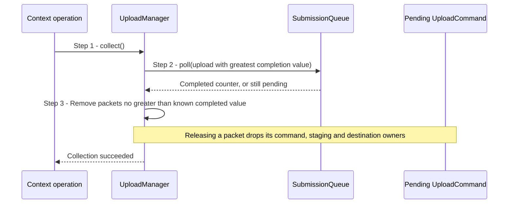

# Reclaim completed upload packets

## Goal and boundary

This shared subflow releases Context-owned upload packets after the GPU has
completed the work they retain. It is triggered when a Context operation
opportunistically collects uploads, when `Context::poll()` or `Context::wait()`
updates the shared completion counter, or when Context drains pending uploads
during shutdown. The subflow ends when completed packet owners are released or
when a query/wait error is returned with the relevant pending state preserved.

Each pending packet owns its recorded command resources, staging pages and
destination references. The returned `CompletionPoint` identifies queue work but
does not itself own those resources. This subflow explains buffer-upload
retirement used by [Upload bytes into a buffer](upload-buffer.md) and
[Create a buffer](create-buffer.md); resource creation, frame submission and
Context shutdown invoke the same manager behavior.

## Preconditions

1. **Upload service.** A live `Context` has initialized its `UploadManager` and
   `SubmissionQueue`; its operations are serialized on the Context execution
   thread.

## Main flow

1. **Request collection.** A Context operation that can allocate, stage or
   submit calls `UploadManager::collect()`. Empty manager state is a successful
   no-op; otherwise the manager selects the pending upload with the greatest
   committed completion value.
2. **Observe queue progress.** `SubmissionQueue::poll()` reads the shared Vulkan
   timeline semaphore's integer counter without waiting. A successful query
   updates the known completed value and shows whether it has reached the selected
   upload's completion value.
3. **Release completed packets.** `UploadManager::collectCompleted()`
   removes pending packets from the front while each packet's completion value
   is no greater than the known completed value. Destroying each `UploadCommand`
   releases its command resources, staging pages and retained destination
   references.

## Notes

**Release condition.** `collect()` never waits. Pending packets are ordered by
committed values on Context's shared queue timeline. If the known completed
value is C, every committed submission with a value no greater than C is
complete. If the pending upload with the greatest completion value has value N
and C<N, `collectCompleted()` releases packets with values no greater than C
and retains packets with values greater than C.

**Other completion paths.** `Context::poll()` and `Context::wait()` query or wait
for a caller-supplied point, then ask the manager to release packets whose
completion values are no greater than the updated counter. `UploadManager::drain()`
waits for the pending upload with the greatest completion value, then releases
all packets whose completion values are no greater than the updated counter;
Context uses this blocking path during shutdown after rejecting live unsubmitted
batches. These operations share the queue timeline with presentation rather than
forcing a device-wide idle.

**Ownership after release.** A packet's references are only one set of owners.
The destination remains alive while an application handle or another in-flight
packet still holds it. The resource's ordinary RAII cleanup then returns memory
to the pool after its final owner releases it; the [memory-range subflow](release-memory-range.md)
explains that release and the pool's empty-block policy. Context owns the `UploadManager`
and `SubmissionQueue`; their lifetimes are bounded by the device, pool and queue
services they borrow.

## Variants and errors

|  | Point and condition | Response | Resulting state and next action |
| --- | --- | --- | --- |
| **Variant&nbsp;1** | Step 1: no pending packets and the queue is not marked device-lost | Return success without querying the queue | No packet changes state |
| **Variant&nbsp;2** | Step 2: `Context::wait()` reaches its deadline without confirming that the completed value has reached the point's value | Return `WaitStatus::Timeout` as a successful result | Packets with completion values no greater than the known completed value may be released; all others stay retained, and the caller may poll or wait again |
| **Error&nbsp;1** | Step 2: timeline query fails or the device is lost | Propagate the error | Pending packets remain retained; follow the error category and do not assume safe release |
| **Error&nbsp;2** | `UploadManager::drain()` times out while waiting for the pending upload with the greatest completion value | Return `Timeout` | The pending list remains; no uncompleted owner is released, and a later drain may retry if the device remains usable |
| **Error&nbsp;3** | Shutdown cannot confirm a safe drain | Context emits a fatal diagnostic and stops teardown | No recoverable Context remains; pending packets are not treated as completed. See the [resource lifetime contract](../design/contracts/resources.md#frame-contexts-and-retirement) |

## Outcomes

**Success.** Only packets with completion values no greater than the observed
completed value are removed. Their retained owners are released through RAII,
while resources with other owners remain alive. Query-only collection does not
block.

**Failure or timeout.** Work whose completion is unknown remains retained. A
failed query or wait does not prove the GPU stopped using its resources, and
this flow does not promise general recovery from device loss.

## Related information

- [Upload bytes into a buffer](upload-buffer.md) and [Create a buffer](create-buffer.md)
  show callers that collect completed upload packets.
- [Ownership](../design/contracts/resources.md#ownership),
  [lifetime is not synchronization](../design/contracts/resources.md#lifetime-is-not-synchronization),
  and [allocation, uploads and descriptors](../design/contracts/resources.md#allocation-uploads-and-descriptors)
  define resource lifetime, completion and upload retention.
- [Allocation, uploads and resource lifetimes](../development/tasks/resource-lifetimes.md)
  records the accepted implementation scope and evidence.
