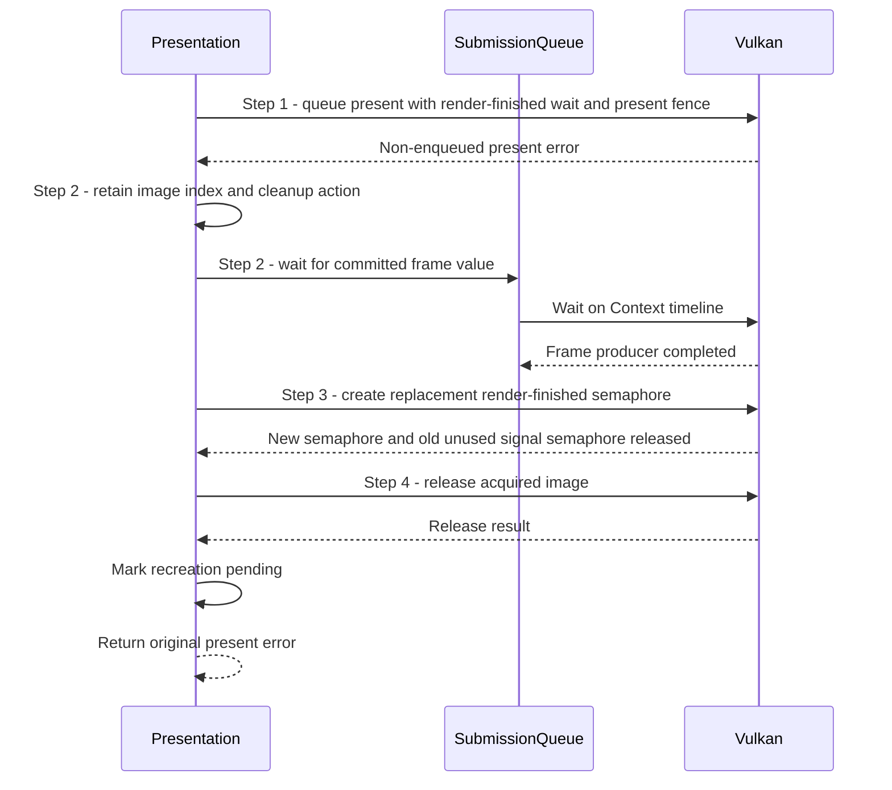

# Recover from a presentation failure after GPU submission

## Goal and boundary

After normal frame work is submitted, `Presentation::presentFrame()` queues the
swapchain image and associates a per-image present fence. If `vkQueuePresentKHR`
returns an error for which no presentation request was enqueued, Panda must
retire the GPU producer, replace its unconsumed render-finished semaphore, release
the acquired image and request swapchain recreation. The submitted rendering is
not rolled back.

## Main flow

1. **Classify the result.** `Presentation::presentFrame()` distinguishes success,
   suboptimal, out-of-date and surface-lost outcomes (which the implementation
   treats as enqueued) from other errors.
2. **Retain recovery and wait for the producer.** For a non-enqueued present
   failure, `recoverPresentFailure()` records the image index; its frame slot
   retains the committed value used to wait for the producer.
3. **Replace the unused signal semaphore.** After the producer completes,
   `recoverPresentFailure()` creates a new render-finished semaphore. Replacing
   the old owner retires the binary semaphore that rendering signaled but
   presentation never waited on.
4. **Release and request recreation.** Panda releases the acquired image through
   swapchain maintenance, clears pending recovery, sets recreation pending and
   returns the original present error to the caller.

## Notes

**Enqueue boundary.** For recognized success/suboptimal/out-of-date/surface-lost
results, code records `presentPending`; the per-image fence is later waited before
reuse or destruction. Surface loss faults the Context, but does not erase the
already submitted GPU completion point. Suboptimal and out-of-date results return
`RecreatePending` with that point.

The current swapchain uses FIFO mode without a full-screen-exclusive flag or
present-timing structure. If either extension-specific error becomes possible,
Vulkan still defines its presentation queue operations as enqueued; extend the
recognized-result path before enabling that configuration, since the recovery
below assumes no present wait was enqueued.

**No rollback.** The frame submission already committed before presentation was
attempted. The timeline wait only makes its producer complete; it cannot undo the
clear or recover a lost surface.

**Retained cleanup.** Pending recovery keeps the image index and next cleanup
action; the frame slot retains the completion value. If waiting or creating a
replacement semaphore fails, `drain()` resumes after the producer completes. If
image release returns an error, the result is unconfirmed; `drain()` reports
failure rather than repeating the release or claiming that the generation is safe
to destroy.

## Variants and errors

|  | Point and condition | Response | Resulting state and next action |
| --- | --- | --- | --- |
| **Variant&nbsp;1** | Step 1: present succeeds | Mark the image's present fence pending and return `Presented` with a valid completion point | Caller may observe GPU completion separately; the present fence governs resource reuse |
| **Variant&nbsp;2** | Step 1: present is suboptimal/out-of-date, or acquire was suboptimal | Keep the presentation record and return `RecreatePending` with a valid point | The next frame boundary drains before creating a replacement generation |
| **Error&nbsp;1** | Step 1: surface lost | Record pending presentation, fault the Context and return the Vulkan error | No automatic surface recovery; drain still waits recorded GPU/presentation work |
| **Error&nbsp;2** | Step 1: device lost | Fault the Context and return the Vulkan error | Stop window work; transparent device reconstruction is not promised |
| **Error&nbsp;3** | Step 2 through 4: timeline wait, semaphore creation or image release fails | Fault presentation and return that cleanup error | Pending recovery remains; `drain()` can resume a failed wait or semaphore creation, but refuses success after an unconfirmed release |
| **Error&nbsp;4** | Step 4: the original present request was not enqueued | Return the original present error after successful cleanup | Recreation is pending; caller can make another frame call if presentation remains usable |

## Related information

- [Render and present a diagnostic clear frame](render-clear-frame.md) shows the
  successful frame prefix and status returned by this subflow.
- [Drain frame and presentation use](drain-presentation.md) explains when present
  fences are waited.
- [Resources and frames](../design/contracts/resources.md#frame-and-window-state)
  defines the acquired-image and semaphore lifetime requirements.
- The [presentation-fence specification](https://docs.vulkan.org/refpages/latest/refpages/source/VkSwapchainPresentFenceInfoKHR.html)
  defines when present-associated resources can be destroyed; its fence need not
  wait for display completion.
