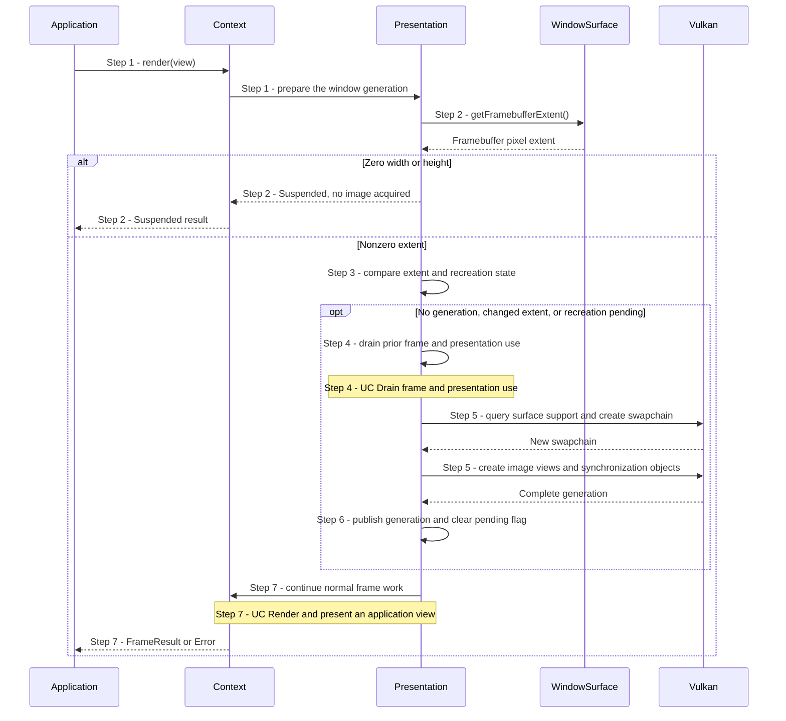
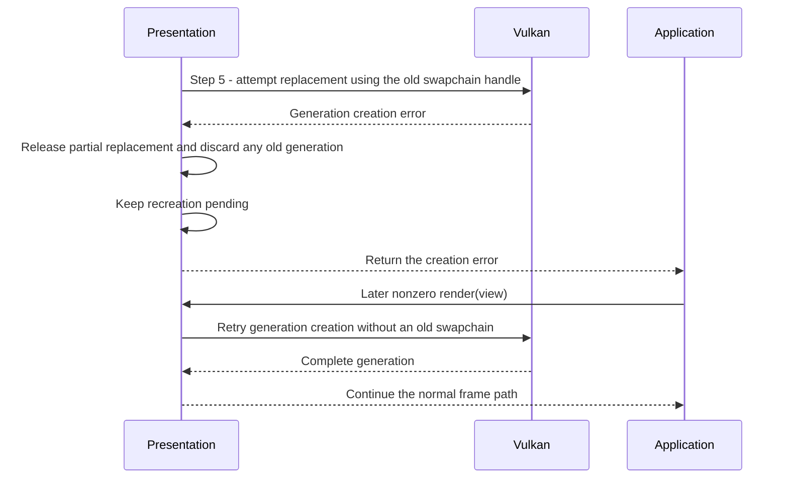

# Suspend presentation and recreate the swapchain

## Goal and boundary

An application with a windowed `Context` calls `Context::render(view)` as
it processes window changes. On each call, **Panda** checks the window's
framebuffer extent and either suspends frame work or ensures a matching
swapchain generation exists. The flow ends with a suspended result, a usable
generation that continues into the [UC Render and present an application view](render-view.md),
or an error. The application owns event processing and decides when to call
again; `Context` borrows the `WindowSurface` for its lifetime under the
[ownership contract](../design/contracts/resources.md#ownership).

`WindowSurface::getFramebufferExtent()` reports framebuffer pixels, not logical
window-content units. Panda samples it during the frame call rather than relying
on a resize callback.

## Preconditions

1. **Live windowed Context.** The `Context` has a usable presentation service and
   calls are serialized on its execution thread. A Context created while the
   framebuffer is zero-sized may not have a swapchain generation yet.

## Main flow

1. **Request presentation.** The application calls
   `Context::render(view)`; `Presentation` prepares the current window
   generation before acquiring an image.
2. **Read the framebuffer extent.** `Presentation::prepareWindowFrame()` asks the
   borrowed `WindowSurface` for the current pixel extent.
3. **Check the generation.** For a nonzero extent,
   `Presentation::ensureWindowGeneration()` reuses the current generation when
   its extent matches and recreation is not pending. Otherwise it starts a
   replacement.
4. **Drain prior presentation use.** `Presentation::recreate()` calls `drain()` so
   submitted frame work, acquired-image recovery and pending presentation fences
   are settled before generation resources are released. See the
   [UC Drain frame and presentation use](drain-presentation.md).
5. **Build a replacement.** `createSwapchainGeneration()` queries current
   surface support, creates a swapchain using the old handle when one exists,
   then creates the per-image views and synchronization objects.
6. **Publish the complete generation.** Only after all generation resources are
   created does `Presentation` replace its current owner and clear the pending
   flag.
7. **Continue the frame.** The same `render(view)` call proceeds to the
   acquire, clear, submit and present sequence in
   [UC Render and present an application view](render-view.md).

## Notes

**Suspension keeps the existing generation.** A zero framebuffer extent returns
`FrameResult::Status::Suspended` without acquiring an image or consuming a frame slot. If a
generation already exists, it remains owned while minimized. After restoration,
Panda recreates it only if the extent changed or recreation was already pending;
a Context created at zero extent has no generation, so its first nonzero frame
call creates one.

**A frame can request recreation without a size change.** An out-of-date acquire,
or an out-of-date/suboptimal present, can return `RecreatePending`. The next
`render(view)` retries generation preparation even if the sampled extent
matches; [UC Render and present an application view](render-view.md#variants-and-errors) explains
which outcomes already submitted GPU work.

**Publication follows complete preparation.** The current generation is replaced
only after the swapchain images and their views and synchronization objects are
ready. Draining first makes it safe to release old generation resources once a
replacement is published.

**Replacement failure has no rollback guarantee.** When generation creation
returns an error, `Presentation` discards any old generation and leaves
recreation pending. The Vulkan call may have retired the old swapchain even when
replacement creation fails, so Panda cannot promise to resume using it. Any partially built
replacement is released by its local RAII owners. A later nonzero frame call on a
still-usable Context retries without passing an old swapchain handle.

## Variants and errors

|  | Point and condition | Response | Resulting state and next action |
| --- | --- | --- | --- |
| **Variant&nbsp;1** | Step 2: framebuffer width or height is zero | Return `FrameResult::Status::Suspended` without acquire or frame submission | Keep processing window events; after restoration, call again and recreate if needed |
| **Variant&nbsp;2** | Step 3: the current generation matches and recreation is not pending | Reuse it and continue to the normal frame path | No drain or replacement is needed |
| **Variant&nbsp;3** | Step 3: no generation exists, the extent changed, or a prior frame requested recreation | Drain and build a complete generation before acquiring an image | On success, the same call continues through the normal frame path |
| **Error&nbsp;1** | Step 2: framebuffer extent query fails | Return that error without replacing the generation | Resolve the window-surface failure before retrying |
| **Error&nbsp;2** | Step 4: drain times out or cannot confirm acquired-image/presentation retirement | Return the drain error and do not create a replacement | Any existing generation remains owned; a later call can retry if presentation remains usable. See the [UC Drain frame and presentation use](drain-presentation.md) |
| **Error&nbsp;3** | Step 5: surface configuration or generation creation fails | Return the creation error, discard any old generation and keep recreation pending | A later nonzero call retries without an old swapchain; surface/device recovery is not promised |

### Error 3 - Failed generation replacement

Entry state: the previous generation has drained, but creating its replacement
returned an error.

## Outcomes

**Suspended.** No image was acquired and no frame work was submitted. The
application continues processing events and calls again when it wants to resume.

**Ready.** A complete generation matches the current window state, and the call
continues into ordinary frame processing. The frame result and its completion
meaning are described by the [UC Render and present an application view](render-view.md).

**Error.** The returned error identifies the failed query, drain or generation
creation. A drain failure leaves the current generation owned; a creation failure
leaves no current generation and a pending retry. Neither result promises that
already submitted work was undone.

## Related information

- [Resources and frames](../design/contracts/resources.md#frame-and-window-state)
  defines suspended state, safe recreation and the old-swapchain failure rule.
- [UC Render and present an application view](render-view.md) describes
  the frame path that resumes after generation preparation.
- [UC Drain frame and presentation use](drain-presentation.md) explains the queue
  completion, acquired-image recovery and present-fence boundaries.
- [Frame rendering and benchmark smoke test](../development/tasks/frame-rendering.md)
  records the implemented resize and frame-reuse scope.
