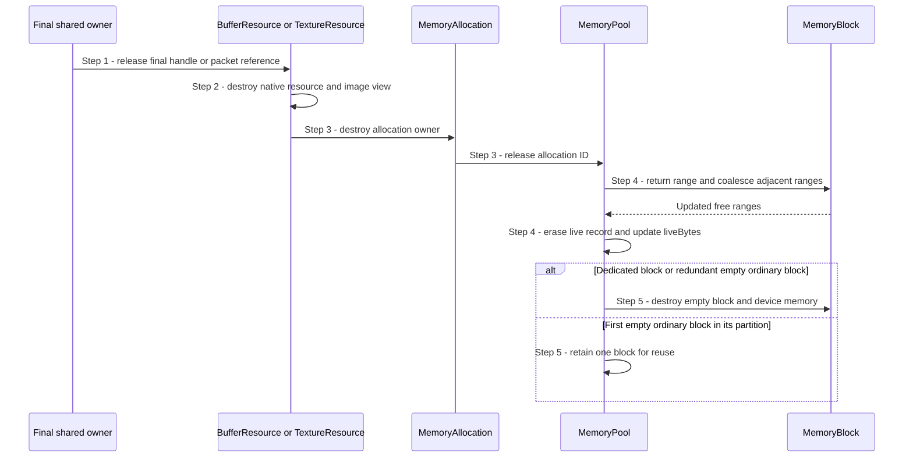

# Return a resource memory range

## Goal and boundary

When the final owner of a bound `BufferResource` or `TextureResource` is
released, Panda destroys the native resource and returns its reserved range to
the Context's `MemoryPool`. A mesh releases its owned buffer resources through
the same path. The flow ends with the range available for reuse and the pool's
empty-block policy applied; it does not wait for GPU work.

The caller must ensure the native resource is no longer in use. Submitted
uploads retain resource owners until completion through
[reclaim completed upload packets](reclaim-completed-uploads.md).

## Preconditions

1. **Pool lifetime.** The Context-owned `MemoryPool` outlives every
   `MemoryAllocation` that borrows it.
2. **Use is finished.** The native resource has no unfinished GPU use. An
   application handle or submitted packet may still be another shared owner.

## Main flow

1. **Release the final resource owner.** The last application handle or retained
   packet reference to a resource state is dropped. If another owner remains,
   the resource and its allocation stay live.
2. **Destroy the bound resource.** `BufferResource` destroys its native buffer;
   `TextureResource` destroys its view and image before releasing their bound
   memory. `MeshResource` releases its owned vertex and optional index buffers.
3. **Return the range.** The resource's `MemoryAllocation` destructor calls
   `reset()`, which delegates the allocation ID to `MemoryPool::release()`.
4. **Merge free space and update accounting.** `MemoryBlock::release()` returns
   the range to `RangeAllocator`, which coalesces adjacent free ranges. The pool
   removes the allocation record and subtracts the range from `liveBytes`.
5. **Apply the empty-block policy.** An empty dedicated block is destroyed. An
   ordinary block is retained only if it is the first empty block for its memory
   type and resource partition; redundant empty blocks are destroyed.

## Notes

**The allocator does not retire GPU work.** `MemoryAllocation` only returns a
range; it does not know when Vulkan stopped using the resource. Resource owners
retained by submitted packets keep it alive through completion. This flow starts
only after the final owner is released, following the [resource lifetime
contract](../design/contracts/resources.md#frame-contexts-and-retirement).

**Last owner means all shared owners.** Copying a `Buffer` or `Texture` handle
does not create another allocation. A mesh owns its vertex and optional index
buffer states, and an upload packet may retain a destination after the
application handle is gone. The range is returned only after each such owner is
released.

**An empty ordinary block is a cache, not a live range.** The pool keeps at most
one empty ordinary block for each `(memory type, buffer-or-image)` partition.
Its reserved `liveBytes` are zero while its memory remains committed. If a new
allocation is blocked by the heap budget or Vulkan allocation-count limit,
`MemoryPool::checkBudget()` reclaims empty blocks before reporting exhaustion.
Context teardown destroys any remaining cached blocks after its live-range
check.

## Variants and errors

|  | Point and condition | Response | Resulting state and next action |
| --- | --- | --- | --- |
| **Variant&nbsp;1** | Step 1: another handle or retained packet still owns the resource | Do not destroy the resource or return its range | Keep the Context and pool alive until the final owner is released |
| **Variant&nbsp;2** | Step 5: an ordinary block becomes empty and no peer empty block exists in its partition | Retain that block for a later allocation | Its committed bytes remain until reuse, budget reclamation or pool destruction |
| **Variant&nbsp;3** | Step 5: a dedicated block or a duplicate empty ordinary block becomes empty | Destroy the block and release its device-memory allocation | Pool committed-byte and allocation-count totals decrease |
| **Error&nbsp;1** | Step 3 or 4: the allocation ID or range is missing from the pool | `expect` emits a fatal diagnostic | This is a broken ownership/accounting invariant; no recoverable release result exists |

## Outcomes

**Success.** The exact live range is returned and adjacent free ranges are
coalesced. Empty device-memory blocks are cached or destroyed according to the
pool policy.

**No final owner yet.** No native resource or range is released. Other handles
and pending packets retain ownership independently.

## Related information

- [Create a buffer](create-buffer.md) shows allocation cleanup when native
  binding fails and the application's lifetime obligation after success.
- [Upload bytes into a buffer](upload-buffer.md) shows how batch cancellation
  releases unsubmitted owners.
- [Reclaim completed upload packets](reclaim-completed-uploads.md) shows when
  submitted staging and destination owners are released.
- [Shut down a Context safely](shutdown-context.md) checks that all live ranges
  are gone before destroying the pool and device.
- [Allocation, uploads and descriptors](../design/contracts/resources.md#allocation-uploads-and-descriptors)
  owns the allocator and upload-retention rules.
