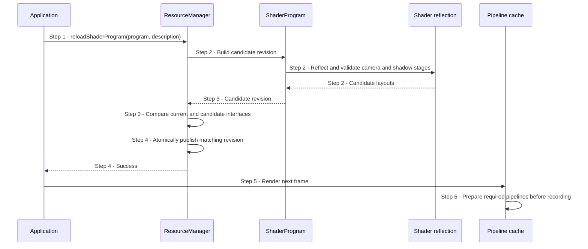

# Reload a graphics shader program

## Goal and boundary

An application replaces the current revision shared by copies of a
`ShaderProgram`. Panda validates and reflects the candidate and accepts it only
when its camera and shadow interfaces match. Renderer-specific pipelines are
prepared later, before a frame is recorded.

## Preconditions

1. The application owns a valid program and uses its live Engine.
2. Engine operations are serialized, and reload runs at an application update
   boundary.
3. Candidate SPIR-V words remain valid through the call and were validated for
   the Vulkan target environment.

## Main flow

1. **Describe the candidate.** The application supplies camera and shadow
   stages, vertex input contract, and shadow selection through `ProgramDesc`.
2. **Build and validate a private revision.** `ResourceManager` delegates to
   `ShaderProgram` to copy the SPIR-V, reflect the stages, and check renderer and
   shared application layouts. The current revision remains published during
   this work.
3. **Compare the interface.** Panda compares the vertex contract and reflected
   camera and shadow interfaces, including descriptor and block layouts,
   vertex inputs, push constants, and specialization constants.
4. **Publish atomically.** If the interface matches, `ResourceManager` swaps
   the shared program identity to the new immutable revision. Existing handle
   copies observe it.
5. **Prepare renderer pipelines.** On the next render, each renderer prepares
   the required pipelines during frame update, before command recording. The
   cache reuses variants already prepared for that revision.

## Notes

Pipeline creation depends on the renderer's output format and sample count, so
the resource manager does not prepare it during reload. A pipeline creation
error is returned by the render call and leaves the newly published shader
revision in place. The renderer keeps old pipeline objects in its cache until
teardown so submitted work can finish safely.

## Variants

| Condition | Result |
|-----------|--------|
| **Error&nbsp;1** | Candidate fails SPIR-V reflection or shared-layout validation | Return an error; keep the current revision. |
| **Error&nbsp;2** | Candidate changes camera or shadow ABI | Return `InvalidArgument`; keep the current revision. |
| **Error&nbsp;3** | Renderer cannot create a pipeline for the published revision | Return the pipeline error from render; the program revision remains published. |
| **Variant&nbsp;1** | Candidate is compatible | Publish it; copied handles observe the same revision. |

## Related information

- [Shader integration](../design/contracts/rendering.md#shader-integration)
  defines shader handles, bindings, pipeline creation and reload compatibility.
- [Create a graphics shader program](create-shader-program.md) explains the
  initial validation and publication path.
