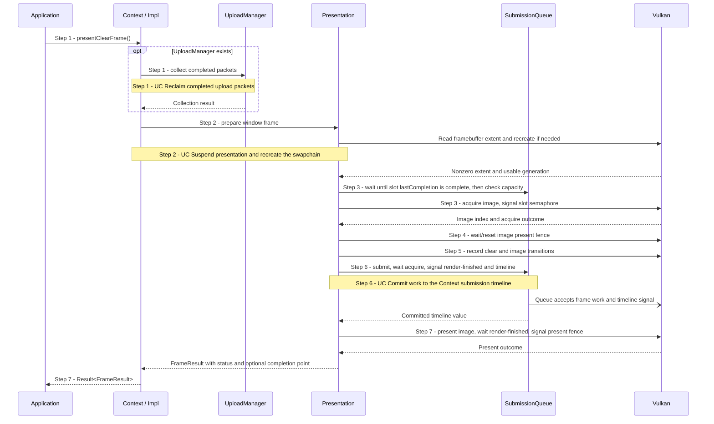

# Render and present a diagnostic clear frame

## Goal and boundary

An application with a windowed `Context` calls `Context::presentClearFrame()` to
clear one acquired swapchain image and queue it for presentation. The flow begins
with the call and ends with a `FrameResult` or an `Error`. It describes Panda's
diagnostic clear path; scene rendering is outside the implemented scope.

**Panda** owns frame-slot synchronization, swapchain-image synchronization,
command recording, queue submission and presentation. The application processes
window events and handles the returned status. A returned `CompletionPoint`
identifies submitted GPU work; it does not say that the image has been displayed.

## Preconditions

1. **Windowed Context.** The `Context` has a live window surface and calls are
   serialized on its execution thread.
2. **Usable presentation state.** The Context is not faulted. A zero-sized
   framebuffer is allowed and produces a suspended result.

## Main flow

1. **Request a frame.** The application calls `Context::presentClearFrame()`.
   `Context::Impl` collects completed uploads before delegating to `Presentation`;
   [UC Reclaim completed upload packets](reclaim-completed-uploads.md) explains that collection.
2. **Prepare the window generation.** `Presentation::prepareWindowFrame()` checks
   the framebuffer extent and returns `Suspended` when either dimension is zero.
   [UC Suspend presentation and recreate the swapchain](recreate-swapchain.md)
   explains generation reuse, draining and replacement.
3. **Acquire an image.** `Presentation::acquireFrame()` waits for the selected
   frame slot's `lastCompletion` value before reusing the slot. If the timeline's
   known completed value is already at least `lastCompletion`, this check returns
   immediately; otherwise it waits for that value. It then checks submission
   capacity and calls `vkAcquireNextImageKHR` with that slot's binary acquire
   semaphore. The [acquire outcomes](#variants-and-errors) determine whether
   work continues.
4. **Wait for image reuse.** `Presentation::waitImage()` waits for and resets the
   acquired image's pending presentation fence before reusing that image's
   render-finished semaphore.
5. **Record the clear.** `Presentation::recordClear()` resets and begins the slot's
   command buffer, transitions the image from `UNDEFINED` on first use or from
   `PRESENT_SRC_KHR` on later use, clears it with dynamic rendering, and transitions
   it back to `PRESENT_SRC_KHR`.
6. **Submit GPU work.** `SubmissionQueue` submits the command buffer, waiting on
   the acquire semaphore and signaling the image's render-finished semaphore plus
   the Context timeline. Only a successful queue submission commits its timeline
   value. Panda stores that value on the frame slot, marks the image initialized
   and advances the slot. See [UC Commit work to the Context submission timeline](commit-context-submission.md).
7. **Queue presentation.** `Presentation::presentFrame()` queues the image with a
   per-image presentation fence. A normal result returns `Presented` with a valid
   point for Step 6. A suboptimal/out-of-date present, or a suboptimal acquire
   followed by a successfully enqueued present, returns `RecreatePending` with
   that same valid point; recreation happens at the next safe boundary. See
   [UC Recover from a presentation failure after GPU submission](recover-presentation-failure.md) for other
   queue-present errors.

## Notes

**Two independent indices.** Panda has two reusable frame slots, while the
swapchain supplies its own image count. Acquire semaphores and command buffers
belong to frame slots; render-finished semaphores and presentation fences belong
to swapchain images. These counts are not interchangeable.

**Completion meanings.** A successful timeline submission establishes GPU-work
completion through its value once the timeline's completed counter reaches or
exceeds that value. The per-image present fence separately tracks when resources
associated with the queued present may be recycled. The Vulkan
presentation fence does not promise that display has finished; see the
[presentation-fence reference](https://docs.vulkan.org/refpages/latest/refpages/source/VkSwapchainPresentFenceInfoKHR.html).

**Failure before submit.** Once acquire succeeds, any later record or enqueue
failure must consume the acquire semaphore and retire the acquired image. The
[UC Retire an acquired image after frame work fails](retire-acquired-image.md) explains how committed cleanup
is retained across a timeout and why an unconfirmed release prevents a successful
drain.

**Drain boundary.** Resize/recreation drains queue timeline work and outstanding
presentation fences before replacing the generation. [UC Drain frame and presentation use](drain-presentation.md)
distinguishes these two completion sources. [UC Suspend presentation and recreate the swapchain](recreate-swapchain.md)
explains when a frame call detects a window change and what remains after
replacement fails.

## Variants and errors

|  | Point and condition | Response | Resulting state and next action |
| --- | --- | --- | --- |
| **Variant&nbsp;1** | Step 2: framebuffer width or height is zero | Return `Suspended` without acquire or completion point | No frame slot is consumed; process events and call again after restoration |
| **Variant&nbsp;2** | Step 3: acquire returns timeout or not-ready | Return `Skipped` without a completion point | No image is acquired and no frame slot is advanced; call again later |
| **Variant&nbsp;3** | Step 3: acquire reports out-of-date | Set recreation pending and return `RecreatePending` without a completion point | No acquired image is assumed; the next frame call attempts recreation |
| **Variant&nbsp;4** | Step 3 or 7: acquire is suboptimal and present is successfully enqueued, or present is suboptimal/out-of-date | Finish the submitted work and return `RecreatePending` | The result retains the submitted completion point; the next frame call recreates |
| **Error&nbsp;1** | Step 1: Context has no window presentation service | Return `Unsupported` | No frame work starts; use a windowed Context |
| **Error&nbsp;2** | Step 2 through 6: extent query, acquire, recording, submit or cleanup fails | Return the relevant error; pre-submit failures follow the [UC Retire an acquired image after frame work fails](retire-acquired-image.md) | Device loss or failed retirement faults presentation; `drain()` succeeds only after committed cleanup is confirmed, and refuses an uncommitted retirement |
| **Error&nbsp;3** | Step 7: surface is lost or device is lost | Return the Vulkan error and fault presentation | No automatic surface/device reconstruction is promised; Context teardown still attempts its drain |
| **Error&nbsp;4** | Step 7: another present error means the request was not enqueued | Wait for the submitted GPU producer, replace its unconsumed render-finished semaphore, release the image and mark recreation pending | Return the original present error; cleanup failures fault presentation. See [UC Recover from a presentation failure after GPU submission](recover-presentation-failure.md) |

## Outcomes

**Presented.** The rendering submission was accepted and presentation was queued.
The returned point identifies the GPU submission; the image's present fence tracks
separate presentation-resource retirement.

**Skipped or suspended.** This call did not submit frame work and returns no
completion point.

**Recreate pending.** An acquire-side out-of-date result has no image or point. A
present-side suboptimal/out-of-date result follows an accepted submission and
retains its valid completion point.

**Error.** The returned error identifies the failing operation or cleanup. A frame
error does not imply that already submitted work was rolled back.

## Related information

- [Resources and frames](../design/contracts/resources.md#frame-and-window-state)
  defines frame results, recreation and presentation state.
- [Allocation, uploads and resource lifetimes](../development/tasks/resource-lifetimes.md)
  describes the shared Context timeline and the separation between GPU completion
  and presentation completion.
- [UC Observe or wait for submitted GPU work](observe-completion.md) explains how an
  application observes a returned `CompletionPoint`.
- [UC Commit work to the Context submission timeline](commit-context-submission.md),
  [UC Retire an acquired image after frame work fails](retire-acquired-image.md),
  [UC Recover from a presentation failure after GPU submission](recover-presentation-failure.md) and
  [UC Drain frame and presentation use](drain-presentation.md) explain the separate
  synchronization and recovery boundaries.
