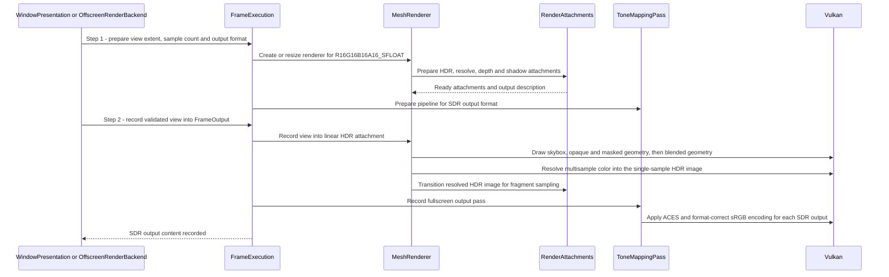

# Render a view through the shared HDR path

## Goal and boundary

`FrameExecution` records a validated `RenderView` into the window or offscreen
output supplied by its caller. Scene colors remain linear HDR through skybox
composition, lighting, transparent blending and MSAA resolve. The flow ends with
an SDR image recorded for presentation, capture or readback; its caller submits
the frame.

The Engine checks the fixed `R16G16B16A16_SFLOAT` render format at creation. It
must support color attachment writes and blending, sampling, and single-sample
image usage. A usable sampled depth format is also required.

## Main flow

1. **Prepare HDR attachments.** For a view with meshes or a skybox,
   `FrameExecution::prepareOutput()` creates or resizes `MeshRenderer` for the
   fixed HDR format and requested sample count. `RenderAttachments` owns a
   single-sample, sampleable HDR image per frame slot plus an optional
   multisample color image, depth image and shadow maps. `ToneMappingPass`
   prepares a pipeline for the caller's SDR output format.
2. **Record scene radiance.** `MeshRenderer` draws the skybox before geometry,
   then opaque and masked surfaces followed by back-to-front blended surfaces.
   Material and skybox shaders return linear RGB. Transparent blending and any
   MSAA resolve therefore operate on HDR values; the single-sample HDR image
   transitions to shader-read layout when rendering ends.
3. **Write the SDR output.** `ToneMappingPass` samples the resolved HDR image,
   applies the fixed ACES fitted curve at exposure 1, and writes the caller's
   output image. For an sRGB attachment it writes linear mapped RGB and lets
   Vulkan encode sRGB; for UNORM it encodes sRGB in the shader. During window
   capture, `FrameExecution` records the same HDR result to the acquired swapchain
   image with a pipeline for that image's format; the scene is rendered once.

## Variants and errors

| Condition | Result and next action |
| --- | --- |
| View has no meshes and no skybox | `FrameExecution` clears the SDR output to the same transformed background color without creating the HDR renderer. |
| HDR color or sampled depth requirements are unsupported | `Engine::create()` returns `Unsupported` before publishing an Engine; use a compatible device. |
| HDR attachments or the output pipeline cannot be prepared | Return the backend error before submitting the frame; resolve the resource or pipeline failure before retrying. |

## Related information

- [UC Render and present an application view](render-view.md) describes the
  window acquisition and presentation around this shared path.
- [UC Render a view to an image](render-offscreen-view.md) describes offscreen
  submission and pixel readback around this shared path.
- [Rendering contract](../design/contracts/rendering.md#materials-faces-and-output)
  defines the fixed HDR format, blending and output transform.
- [Shared HDR render path](../development/tasks/hdr-output-contract.md) records
  implementation acceptance and current verification evidence.
