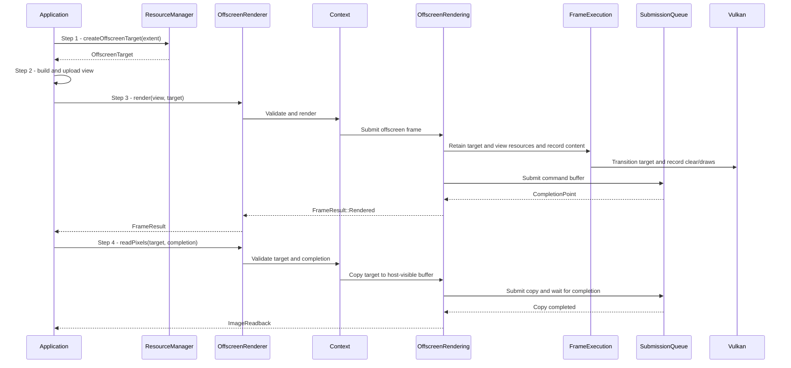

# Render a view to an image

## Goal and boundary

An application renders a `RenderView` into a Context-owned `OffscreenTarget` with
`OffscreenRenderer::render()`, then optionally calls `readPixels()` to obtain RGBA
bytes. The render call submits GPU work without presenting a window frame. Reading
pixels is a separate operation that waits for its copy to finish.

**The application** supplies the view, chooses a target per render, and keeps the
owning `Context` alive. **Panda** validates ownership and view resources, retains
them through GPU completion, and defines the readback layout. A target can be used
with either a headless or windowed Context.

## Main flow

1. **Create the target.** The application calls
   `Context::getResourceManager().createOffscreenTarget()` with a nonzero extent.
   The current target format is RGBA8 sRGB.
2. **Build and upload the view.** The application supplies camera, lights and mesh
   draws. Required mesh and texture data must be uploaded; see
   [UC Upload a complete mesh payload into a batch](upload-mesh-payload.md) and
   [UC Upload texture contents or regions](upload-texture.md).
3. **Submit the render.** The application calls
   `Context::getOffscreenRenderer().render(view, target)`. Panda validates the view
   and target, records the built-in rendering path into the target, retains the
   target and view resources, then submits the command buffer on the Context queue.
   Success returns `FrameResult::Status::Rendered` and a `CompletionPoint`; it does
   not present a frame or wait for rendering to finish.
4. **Request pixels.** When CPU pixels are needed, the application calls
   `readPixels(target, completion)` with a point covering that target's latest
   render. Panda validates the target and point, submits an image-to-buffer copy,
   waits for that copy, and returns tightly packed `ImageReadback` bytes.

## Notes

**Output contract.** Pixels are top-to-bottom rows in RGBA order. RGB channels are
sRGB encoded, alpha is linear UNORM, and rows have no extra padding. Image-file
encoding is a separate planned `Panda::Tools` capability; see
[Image file export](../development/tasks/image-file-export.md).

**GPU work and readback.** Rendering writes a GPU image and does not copy it to host
memory. `readPixels()` performs that copy only when requested, then waits so the
returned vector is ready for CPU use. This distinction keeps ordinary rendering
asynchronous.

**Target reuse.** Each render names its target, so one renderer can target different
images across calls. The supplied completion must cover the latest render of the
chosen target; submitted work retains the target until it is safe to release. See
the [resource lifetime contract](../design/contracts/resources.md#frame-and-window-state).

**Window capture.** A windowed Context can use
`WindowRenderer::renderWithCapture(view, target)` to render once, present the same
output and copy it into a target. See [UC Render and present an application
view](render-view.md).

## Variants and errors

| Condition | Result and next action |
| --- | --- |
| Target extent is zero | Return `InvalidArgument`; create a nonzero target. |
| Device does not support the fixed RGBA8 sRGB target usage | Return `Unsupported`; use a compatible device. |
| Target or view resource belongs to another Context | Return `InvalidArgument` before submission; create or upload it on the owning Context. |
| Target has not been rendered, or completion is stale/foreign | `readPixels()` returns `InvalidArgument`; render to this target and pass a point that covers its latest render. |
| GPU submission, allocation or readback wait fails | Return the backend error; no pixels are returned. |

## Related information

- [Rendering contract](../design/contracts/rendering.md#offscreen-output) defines
  the shared rendering and image boundary.
- [Frame and window state](../design/contracts/resources.md#frame-and-window-state)
  defines Context-scoped completion and resource retention.
- [UC Observe or wait for submitted GPU work](observe-completion.md) explains the
  completion point returned by rendering.
- [Offscreen rendering and image readback](../development/tasks/offscreen-rendering.md)
  records the implementation scope and evidence.
