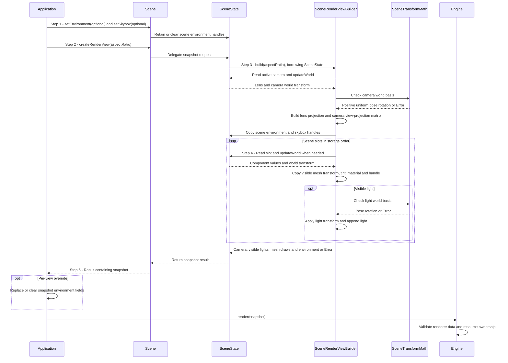

# Prepare a render view from scene objects

## Goal and boundary

An application asks optional `Panda::Scene` to prepare a `RenderView` containing its
visible meshes, active camera, directional, point or spot lights and optional
scene-wide environment lighting and skybox. **Panda::Scene** starts empty, owns
runtime identities, transforms and component values, and retains associated mesh,
material-texture, environment and skybox handles. **The application** creates
entities, attaches camera/light components, creates/uploads GPU assets, selects the
camera, updates the scene and owns the frame loop. This flow ends with a complete snapshot
or an `Error`; rendering follows
[UC Render and present an application view](render-view.md).

The [scene demo](../../examples/scene_demo/README.md) shows this path.
The [simple scene example](../../examples/simple_scene/README.md) shows direct
renderer use without Scene. Persistence remains in the
[scene persistence task](../development/tasks/scene-persistence.md).

## Preconditions

1. The application owns a Scene. Its CPU state is independent of any Engine. If it
   retains uploaded meshes, material maps, environment maps or a skybox, each
   originating Engine remains alive until the Scene and its snapshots release those
   handles.
2. The application has created a camera entity, attached a perspective or
   orthographic lens, selected it, and optionally created light entities. It has
   attached uploaded meshes to renderable objects. Mesh upload completes before rendering.

## Main flow

1. **Set scene environment.** After uploading optional environment lighting and a
   skybox, the application calls `Scene::setEnvironment()` and `Scene::setSkybox()`.
   Either can be cleared independently by passing `std::nullopt`. Renderer
   compatibility and Engine ownership are checked when a snapshot is submitted.
2. **Request a snapshot.** The application calls `Scene::createRenderView()` with the
   current framebuffer aspect ratio. Scene delegates the CPU preparation to `SceneState`.
3. **Prepare the camera.** `SceneState::createRenderView()` delegates to a short-lived
   `SceneRenderViewBuilder` borrowing the state. The builder requires an active
   camera, updates its dirty world transform and builds the lens projection.
   `SceneTransformMath` checks that the camera pose has positive uniform scale and
   no shear, then supplies its rotation for the view-projection matrix; the lens
   ignores uniform scale.
4. **Collect visible objects.** The builder visits scene slots in order, updates
   world caches only for alive, visible objects with meshes or lights, and copies
   visible mesh transforms, tints, material values and mesh handles. `SceneTransformMath`
   validates each light's world basis. The builder uses world translation for point
   and spot positions, and transforms local -Z into the direction of directional and
   spot lights. Visibility applies to each object independently.
5. **Publish the snapshot.** Scene returns a value independent of subsequent scene
   edits, including copies of its environment and skybox handles. The application
   may override those fields for this view, then passes it to
   `WindowRenderer::render()` in its frame loop. Engine performs renderer data and
   resource-ownership validation before submission.

## Notes

**Transform authority.** Local TRS remains authoritative. Parent changes invalidate
descendant caches; querying the view updates dirty ancestors before their children.
Mesh matrices preserve derived shear. Camera and light poses reject it because
their world basis must describe an orthonormal orientation. Point lights emit from
world translation; entity scale does not change their range or color.

**Snapshot lifetime.** A snapshot contains copies of matrices, material and light/camera
values plus retained mesh, material-texture, environment and skybox handles. Deleting
an object releases its Scene-owned references without invalidating an already prepared
snapshot. Each originating Engine must outlive retained GPU handles in both Scene and
snapshots. The renderer retains submitted resource uses through GPU completion.

**Builder lifetime.** `SceneRenderViewBuilder` borrows SceneState only while building
one snapshot. SceneState remains the sole owner of entity identity, hierarchy,
components and world caches; the builder does not create or delete entities.

**Current light boundary.** Scene preserves visible light variants in scene order in
`RenderView::lights`. Point and spot lights contribute direct illumination with
finite-range attenuation; directional and spot directions follow the entity's local
-Z axis. Each light can opt into shadows with `ShadowSettings`; unset settings leave
that light unshadowed. Directional shadows use their orthographic coverage, while
point and spot shadows use their range and the spot's cone. With no visible lights,
the renderer's ambient term still applies.
Deleting the active camera clears selection instead of choosing another object.

## Variants and errors

|                  | Point and condition                                                                | Response                 | Resulting state and next action                            |
|------------------|------------------------------------------------------------------------------------|--------------------------|------------------------------------------------------------|
| **Error&nbsp;1** | Step 3: no selected camera, invalid lens/aspect, reflected/nonuniform/sheared pose | Return `InvalidArgument` | No snapshot is published; select or correct the camera.    |
| **Error&nbsp;2** | Step 4: invalid light pose or non-finite derived world transform                      | Return `InvalidArgument` | Logical scene state is unchanged; correct the object data. |

## Outcomes

**Success.** The application receives prepared renderer input, with no GPU work yet
submitted. Scene edits affect the next snapshot. Renderer-specific validation, such
as rejecting a mesh from another Engine, occurs in `WindowRenderer::render()`.

**Failure.** No partial snapshot escapes. Updating derived caches does not change
the authoritative transforms or component values.

## Related information

- [Scene API and transforms](../design/contracts/scene.md#entities-and-transforms) owns hierarchy, TRS validation and
  shear rules.
- [UC Render and present an application view](render-view.md) explains submission and mesh retention.
- [Scene identities and transforms](../development/tasks/scene-transforms.md) tracks remaining work and verification.
- [Scene demo](../../examples/scene_demo/README.md) shows the complete application loop.
