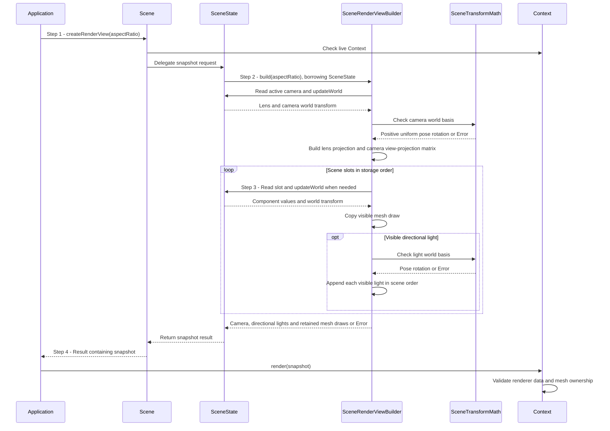

# Prepare a render view from scene objects

## Goal and boundary

An application asks optional `Panda::Scene` to prepare a `RenderView` containing its
visible meshes, active camera and directional lights. **Panda::Scene** starts empty,
owns runtime identities, transforms and component values, and retains associated
mesh handles. **The application** creates entities, attaches camera/light
components, creates/uploads GPU assets, selects the camera, updates the scene and
owns the frame loop. This flow ends with a complete snapshot
or an `Error`; rendering follows
[UC Render and present an application view](render-view.md).

The [scene demo](../../examples/scene_demo/README.md) shows this path.
The [simple scene example](../../examples/simple_scene/README.md) shows direct
renderer use without Scene. Persistence remains in the
[scene persistence task](../development/tasks/scene-persistence.md).

## Preconditions

1. A live Context remains at the same address and outlives Scene and retained meshes.
2. The application has created a camera entity, attached a perspective or
   orthographic lens, selected it, and optionally created light entities. It has
   attached uploaded meshes to renderable objects. Mesh upload completes before rendering.

## Main flow

1. **Request a snapshot.** The application calls `Scene::createRenderView()` with the
   current framebuffer aspect ratio. Scene checks that its Context remains valid
   and delegates to `SceneState`.
2. **Prepare the camera.** `SceneState::createRenderView()` delegates to a short-lived
   `SceneRenderViewBuilder` borrowing the state. The builder requires an active
   camera, updates its dirty world transform and builds the lens projection.
   `SceneTransformMath` checks that the camera pose has positive uniform scale and
   no shear, then supplies its rotation for the view-projection matrix; the lens
   ignores uniform scale.
3. **Collect visible objects.** The builder visits scene slots in order, updates
   world caches only for alive, visible objects with meshes or lights, and copies
   visible mesh transforms/tints and their mesh handles. For a light,
   `SceneTransformMath` checks its world basis and supplies its rotation; the
   builder maps local -Z into the lighting direction. Visibility applies to each
   object independently.
4. **Publish the snapshot.** Scene returns a value independent of subsequent scene
   edits. The application passes it to `Context::render()` in its frame loop.
   Context performs renderer data and mesh-ownership validation before submission.

## Notes

**Transform authority.** Local TRS remains authoritative. Parent changes invalidate
descendant caches; querying the view updates dirty ancestors before their children.
Mesh matrices preserve derived shear. Camera and light poses reject it because their
orientation must describe an orthonormal basis.

**Snapshot lifetime.** A snapshot contains copies of matrices and light/camera
values plus retained mesh handles. Deleting an object releases its Scene-owned mesh
reference without invalidating an already prepared snapshot. Context outlives both.
The renderer retains submitted mesh uses through GPU completion.

**Builder lifetime.** `SceneRenderViewBuilder` borrows SceneState only while building
one snapshot. SceneState remains the sole owner of entity identity, hierarchy,
components and world caches; the builder does not create or delete entities.

**Current light boundary.** Scene preserves visible directional lights in its
`RenderView::directionalLights` vector. The first visible light uses the renderer's
existing shadow pass; later visible lights contribute unshadowed direct lighting.
With no visible light, direct intensity is zero and the renderer's ambient term still
applies.
Deleting the active camera clears selection instead of choosing another object.

## Variants and errors

|                  | Point and condition                                                                | Response                 | Resulting state and next action                            |
|------------------|------------------------------------------------------------------------------------|--------------------------|------------------------------------------------------------|
| **Error&nbsp;1** | Step 2: no selected camera, invalid lens/aspect, reflected/nonuniform/sheared pose | Return `InvalidArgument` | No snapshot is published; select or correct the camera.    |
| **Error&nbsp;2** | Step 3: invalid light pose or non-finite derived world transform                   | Return `InvalidArgument` | Logical scene state is unchanged; correct the object data. |

## Outcomes

**Success.** The application receives prepared renderer input, with no GPU work yet
submitted. Scene edits affect the next snapshot. Renderer-specific validation, such
as rejecting a mesh from another Context, occurs in `Context::render()`.

**Failure.** No partial snapshot escapes. Updating derived caches does not change
the authoritative transforms or component values.

## Related information

- [Scene API and transforms](../design/contracts/scene.md#entities-and-transforms) owns hierarchy, TRS validation and
  shear rules.
- [UC Render and present an application view](render-view.md) explains submission and mesh retention.
- [Scene identities and transforms](../development/tasks/scene-transforms.md) tracks remaining work and verification.
- [Scene demo](../../examples/scene_demo/README.md) shows the complete application loop.
