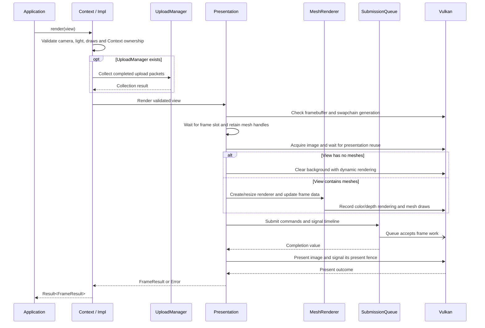

# Render and present an application view

## Goal and boundary

An application passes camera, lighting and mesh draw data to `Context::render(view)`.
Panda renders and presents that view without requiring a scene or entity system. An
empty `RenderView::meshes` list is a valid view that presents only the background.
This flow ends with a `FrameResult` or an `Error`.

**The application** owns scene data, transforms and the lifetime of its `Context`.
**Panda** validates the view, records the built-in mesh rendering path, retains mesh
handles through GPU use, and owns frame-slot and swapchain synchronization. A returned
`CompletionPoint` identifies submitted GPU work; it does not mean the image has been
displayed.

## Preconditions

1. A live windowed `Context` exists. Calls to it are serialized on its execution thread.
2. Every mesh draw refers to a valid mesh from that Context, uses the standard vertex
   format and has been uploaded before rendering.
3. Camera, light, transform and tint values are finite and representable by the built-in
   renderer. A zero-sized framebuffer is allowed and returns `Suspended`.

## Main flow

1. **Build the view.** The application supplies a view-projection matrix, camera
   position, one directional light and zero or more standard-mesh draws. Mesh handles
   are ordinary values; Panda does not create entities or own application transforms.
2. **Validate and collect uploads.** `Context::Impl::render()` checks matrices, light
   and tint values, then verifies each mesh's Context and vertex stride. It collects
   completed upload packets before delegating to `Presentation`.
3. **Prepare the window frame.** `Presentation::prepareWindowFrame()` checks the
   framebuffer extent and swapchain generation. A zero extent returns `Suspended`
   without acquiring an image. See [UC Suspend presentation and recreate the
   swapchain](recreate-swapchain.md).
4. **Retain mesh handles and acquire.** `Presentation` waits for the selected frame
   slot's prior GPU completion, then retains the view's mesh handles in that slot. It
   checks submission capacity, acquires an image and waits for that image's pending
   presentation fence before reuse.
5. **Record the view.** An empty mesh list clears the acquired image to the configured
   background. Otherwise, `Presentation` creates or resizes the internal `MeshRenderer`,
   updates the frame uniform buffer, and records dynamic rendering with color and depth
   attachments. It issues one indexed or non-indexed draw for each `MeshDraw`, using the
   standard vertex layout, the built-in lit material, model/tint push constants and the
   supplied directional light.
6. **Submit GPU work.** `SubmissionQueue` submits the command buffer, waiting on the
   acquire semaphore and signaling the image's render-finished semaphore plus the
   Context timeline. Successful submission commits its timeline value, stores it on
   the frame slot and advances the slot. Mesh handles remain retained until that slot
   is reused after completion. See [UC Commit work to the Context submission
   timeline](commit-context-submission.md).
7. **Queue presentation.** `Presentation::presentFrame()` queues the image with its
   per-image presentation fence. Normal presentation returns `Presented`; a
   suboptimal/out-of-date result returns `RecreatePending` with the accepted submission's
   completion point. Other failures follow [UC Recover from a presentation failure
   after GPU submission](recover-presentation-failure.md).

## Notes

**No scene requirement.** Applications can prepare `RenderView` data from their own
architecture. An optional scene library may prepare the same render data, but Core
does not depend on that library.

**Camera construction.** `panda::tools::createPerspectiveCamera()` combines the
checked perspective projection with right-handed look-at vectors and returns a
`RenderCamera` for the view.

**Current shading model.** The first built-in mesh shader uses vertex color multiplied
by draw tint as linear base color. It evaluates one directional light with a
Cook-Torrance microfacet specular term: GGX normal distribution, Schlick-GGX geometry
and Schlick Fresnel with dielectric F0 0.04. Lambert diffuse is combined with that
specular term. Metallic is fixed at 0 and roughness at 1; a constant ambient term
contributes 0.06 times base color. The shader applies the ACES fitted tone curve and
outputs sRGB, using hardware conversion for sRGB swapchain formats or shader encoding
for UNORM formats. This initial path has no material textures, material parameter
overrides or shadow lookup; see the [first rendering task](../development/tasks/first-scene.md)
for the remaining scope.

**Slot and image lifetimes differ.** Panda has two reusable frame slots while the
swapchain supplies its own image count. Command buffers and retained mesh handles
belong to slots; render-finished semaphores and presentation fences belong to images.

**Completion meanings.** The timeline point covers submitted GPU work. The per-image
present fence separately tracks presentation-resource retirement; it does not promise
that display has finished. See the
[presentation-fence reference](https://docs.vulkan.org/refpages/latest/refpages/source/VkSwapchainPresentFenceInfoKHR.html).

**Pre-submit failures.** After acquire succeeds, a recording or submit failure must
consume the acquire semaphore and retire the image. See [UC Retire an acquired image
after frame work fails](retire-acquired-image.md). A frame error does not imply that
already submitted work was rolled back.

## Variants and errors

| Condition | Result and next action |
| --- | --- |
| Framebuffer width or height is zero | Return `Suspended` without acquiring an image; process events and retry after restoration. |
| Acquire returns timeout or not-ready | Return `Skipped` without a completion point. |
| Acquire reports out-of-date | Return `RecreatePending` without a completion point; the next call attempts recreation. |
| Acquire or present is suboptimal, or present reports out-of-date | Return `RecreatePending`; keep the accepted submission's completion point. |
| Invalid view data, foreign mesh, or nonstandard vertex stride | Return `InvalidArgument` before acquiring an image. |
| Context has no window presentation service | Return `Unsupported`. |
| Recording, submission or cleanup fails after acquire | Return the relevant error; retire the acquired image. Failed retirement faults presentation. |
| Surface or device is lost | Return the Vulkan error and fault presentation; Context teardown still attempts its drain. |

## Related information

- [Rendering contract](../design/contracts/rendering.md) defines the renderer boundary
  and its supported inputs.
- [Resources and frames](../design/contracts/resources.md#frame-and-window-state)
  defines frame results, recreation and presentation state.
- [UC Collect paired CPU and GPU frame timings](collect-frame-timings.md) describes
  optional timing markers around submitted view work.
- [UC Observe or wait for submitted GPU work](observe-completion.md) explains how an
  application observes a returned `CompletionPoint`.
