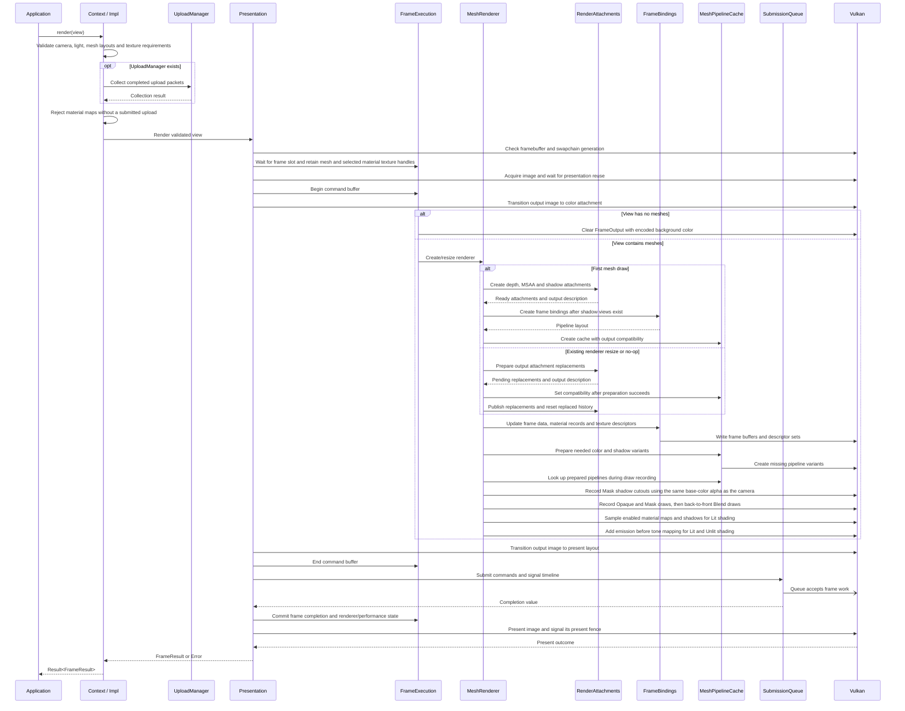

# Render and present an application view

## Goal and boundary

An application passes camera, lighting and mesh draw data to `Context::render(view)`.
Panda renders and presents that view without requiring a scene or entity system. An
empty `RenderView::meshes` list is a valid view that presents only the background.
This flow ends with a `FrameResult` or an `Error`.

**The application** owns scene data, transforms and the lifetime of its `Context`.
**Panda** validates the view, records the built-in mesh rendering path, retains mesh
and selected texture handles through GPU use, and owns frame-slot and swapchain synchronization. A returned
`CompletionPoint` identifies submitted GPU work; it does not mean the image has been displayed.

## Preconditions

1. A live windowed `Context` exists. Calls to it are serialized on its execution thread.
2. Every mesh draw refers to a valid, uploaded mesh from that Context and declares a
   layout compatible with its material. All draws require Position; Lit also requires
   Normal. Color is optional and defaults to white. A base-color map is optional; if
   set, it must be a sampled RGBA8 sRGB texture from the same Context. Lit
   metallic-roughness, emissive, normal and occlusion maps are also optional; they
   require sampled RGBA8 UNORM, RGBA8 sRGB, RGBA8 UNORM and RGBA8 UNORM textures
   respectively. All maps must be from the same Context and need a submitted upload.
   Base-color, metallic-roughness, emissive and occlusion maps require TexCoord0; a
   normal map is ignored with a warning if TexCoord0 or Tangent is missing.
3. Camera, light, transform, tint and material values are finite and valid for the
   built-in renderer. A zero-sized framebuffer is allowed and returns `Suspended`.

## Main flow

1. **Build the view.** The application supplies a view-projection matrix, camera
   position, one directional light and zero or more mesh draws with per-mesh materials.
   Mesh handles are ordinary values; Panda does not create entities or own application
   transforms.
   For position, rotation and scale, `panda::createModelMatrix()` builds the full
   object-to-world matrix; applications may also supply a matrix directly.
2. **Validate and collect uploads.** `Context::Impl::render()` checks matrices, light,
   tint, material alpha mode, cutoff, and finite normal-map scale and occlusion
   strength, then verifies each mesh's Context and required attributes. If a base-color,
   Lit metallic-roughness, emissive, Lit normal or Lit occlusion map is set, it checks
   the texture's Context, sampled usage and required format. Base-color,
   metallic-roughness, emissive and occlusion maps also require TexCoord0; the normal
   map falls back with a warning when UVs or tangents are missing. It polls and
   reclaims completed upload packets, then rejects a texture whose upload was never
   submitted. Rendering remains queued
   after any in-flight upload on the Context submission queue.
3. **Prepare the window frame.** `Presentation::prepareWindowFrame()` checks the
   framebuffer extent and swapchain generation. A zero extent returns `Suspended`
   without acquiring an image. See [UC Suspend presentation and recreate the
   swapchain](recreate-swapchain.md).
4. **Retain resources and acquire.** `Presentation` asks `FrameExecution::prepareSlot()`
   to wait for the selected slot's prior GPU completion, then retain the view's mesh
   and selected material texture handles in that slot. It checks submission capacity,
   acquires an image with its slot-owned semaphore and waits for that image's pending
   presentation fence before reuse.
5. **Record the view.** `Presentation` begins the command buffer and transitions the
   acquired image to color-attachment layout. It passes `FrameExecution` a borrowed
   `FrameOutput` containing that image view, extent and color format. An empty mesh
   list clears the output to the configured background. Otherwise, `FrameExecution`
   creates or resizes the internal `MeshRenderer`.
   On first creation, it builds `RenderAttachments` before `FrameBindings` and
   `MeshPipelineCache`. On a resize, `RenderAttachments` prepares output-sized depth
   and optional MSAA replacements; after preparation succeeds, the renderer updates
   pipeline compatibility and publishes them. The renderer then updates frame data,
   per-draw material records and texture descriptors through `FrameBindings` before
   recording the directional shadow depth pass.
   `MeshPipelineCache` prepares missing color and shadow variants before recording;
   draw recording then looks up those prepared pipelines without creating them. A base-color sample multiplies material and
   draw tint and optional vertex color; a metallic-roughness sample scales Lit
   material values with its blue and green channels respectively. The emissive
   sample multiplies the linear emissive factor and is added before tone mapping
   for Lit and Unlit draws. The occlusion map's red channel scales only the Lit
   ambient term by `mix(1, sample, occlusionStrength)`; it leaves direct light and
   shadows unchanged. An absent map contributes white. Opaque draws
   cast a full silhouette. Mask draws multiply texture, material, draw and vertex alpha
   and apply the material cutoff in both shadow and camera passes. The camera pass
   selects pipelines from each material model, alpha mode, consumed vertex attributes,
   face mode and transform handedness while sampling the shadow map for Lit draws.
   `FrameExecution` records content and its timing markers; it does not acquire or
   present images, or transition the output image. `Presentation` records the final
   transition to present layout and ends the command buffer.
6. **Submit GPU work.** `SubmissionQueue` submits the command buffer, waiting on the
   acquire semaphore and signaling the image's render-finished semaphore plus the
   Context timeline. Only after submission succeeds does `FrameExecution` store the
   completion value and commit renderer and performance state. `Presentation` then
   marks the image initialized and advances its slot. Mesh and texture handles remain
   retained in the execution slot until reuse after completion. See
   [UC Commit work to the Context submission timeline](commit-context-submission.md).
7. **Queue presentation.** `Presentation::presentFrame()` queues the image with its
   per-image presentation fence. Normal presentation returns `Presented`; a
   suboptimal/out-of-date result returns `RecreatePending` with the accepted submission's
   completion point. Other failures follow [UC Recover from a presentation failure
   after GPU submission](recover-presentation-failure.md).

## Notes

**No scene requirement.** Applications can prepare `RenderView` data from their own
architecture. An optional scene library may prepare the same render data, but Core
does not depend on that library.

**Camera construction.** `panda::tools::createPerspectiveCamera()` combines the
checked perspective projection with right-handed look-at vectors and returns a
`RenderCamera` for the view.

**Current shading model.** Built-in materials multiply linear `baseColor`, an
optional sRGB base-color map, draw tint and optional vertex color (white when absent).
Lit materials can also sample a linear UNORM metallic-roughness map; blue scales
metallic and green scales roughness. Both material models can use an sRGB emissive
map, whose RGB multiplies the linear emissive factor; alpha is ignored. Emission is
added before tone mapping and changes only the object's color: it does not light
other objects or create a bloom halo. Base-color, metallic-roughness and emissive maps
require TexCoord0. A Lit normal map uses TexCoord0 and Tangent; without either attribute
it is ignored with a warning, leaving the interpolated mesh normal in use. Normal-map
scale defaults to 1, multiplies tangent-space X and Y, and accepts any finite value.
Lit materials can use a linear UNORM occlusion map whose red channel scales only the
constant ambient contribution; `occlusionStrength` blends from no effect (0) to the
full map (1). It does not dim direct light or shadows. Lit materials evaluate one directional
light with a Cook-Torrance microfacet specular term: GGX normal distribution,
Schlick-GGX geometry and Schlick Fresnel with dielectric F0 0.04. Lambert diffuse is
combined with that specular term. Each Lit material supplies metallic and roughness,
clamped to the supported range. Unlit materials skip light evaluation and shadow
lookup while shading, but still cast shadows in the current depth pass.
`AlphaMode::Opaque` renders the whole surface without alpha blending.
`AlphaMode::Mask` turns alpha into a binary cutout: values below `alphaCutoff` are
discarded, and the rest render fully opaque. The same cutoff controls the shadow
silhouette. The material's `RenderFace` selects front sides, back sides or both; transforms with
a negative determinant reverse pipeline winding in both passes. Lit shading
orients back-facing normals consistently when rendering `Back` or `Both`. A
constant ambient term contributes
0.06 times base color to Lit materials. The shader applies the ACES fitted tone curve and
outputs sRGB, using hardware conversion for sRGB swapchain formats or shader encoding
for UNORM formats. Direct directional light is shadowed with one 2048² depth map per
frame slot and 3x3 PCF; ambient light remains unshadowed. The map uses a 30 m
orthographic view centered 15 m ahead of the camera and a 0.1–80 m light-depth range.
Points outside that fixed camera-centered region receive no shadow. Multiple lights,
spot/point shadows and improved shadow coverage
and filtering remain work in
[Materials, lights and shadows](../development/tasks/materials-and-shadows.md). The
current 3x3 PCF has visible edge aliasing; the first-scene task records that limit and
the current visual result. The first mesh draw selects the highest common color/depth
attachment sample count supported by the active formats and device limits (4x, then
2x, then 1x); `FrameResult::effectiveSampleCount` reports it.

`AlphaMode::Blend` uses the combined texture, material, draw and optional vertex alpha
for straight-alpha compositing. It runs after Opaque and Mask with depth testing enabled
and depth writes disabled; mesh origins are sorted back-to-front. Blended meshes do
not cast shadows. Intersecting transparent meshes can still sort incorrectly.

**Slot and image lifetimes differ.** `FrameExecution` owns two reusable execution
slots, including command buffers and retained mesh and texture handles.
`Presentation` owns their acquire semaphores and the independently sized set of
swapchain images, render-finished semaphores and presentation fences.

**Output boundary.** `FrameOutput` is borrowed for one recording operation.
`FrameExecution` uses its image view, extent and format to record clear or mesh
content; `Presentation` alone owns the output-layout transitions and presentation.

**Attachment publication.** `RenderAttachments` owns per-slot color, depth and shadow
images with their committed layout history. A failed replacement leaves the renderer's
current attachments and pipeline compatibility unchanged. Shadow images keep their
fixed extent across window resize, so `FrameBindings` can keep using the same shadow views.

**Completion meanings.** The timeline point covers submitted GPU work. The per-image
present fence separately tracks presentation-resource retirement; it does not promise
that display has finished. See the
[presentation-fence reference](https://docs.vulkan.org/refpages/latest/refpages/source/VkSwapchainPresentFenceInfoKHR.html).

**Pre-submit failures.** After acquire succeeds, a recording or submit failure must
consume the acquire semaphore and retire the image. `FrameExecution` discards the
unsubmitted view handles after `Presentation` performs that recovery. See
[UC Retire an acquired image after frame work fails](retire-acquired-image.md).
A frame error does not imply that already submitted work was rolled back.

## Variants and errors

| Condition                                                        | Result and next action                                                                       |
|------------------------------------------------------------------|----------------------------------------------------------------------------------------------|
| Framebuffer width or height is zero                              | Return `Suspended` without acquiring an image; process events and retry after restoration.   |
| Acquire returns timeout or not-ready                             | Return `Skipped` without a completion point.                                                 |
| Acquire reports out-of-date                                      | Return `RecreatePending` without a completion point; the next call attempts recreation.      |
| Acquire or present is suboptimal, or present reports out-of-date | Return `RecreatePending`; keep the accepted submission's completion point.                   |
| Invalid view/material data, foreign mesh/texture, incompatible layout, or invalid material map | Return `InvalidArgument` before acquiring an image. |
| Context has no window presentation service                       | Return `Unsupported`.                                                                        |
| Recording, submission or cleanup fails after acquire             | Return the relevant error; retire the acquired image. Failed retirement faults presentation. |
| Surface or device is lost                                        | Return the Vulkan error and fault presentation; Context teardown still attempts its drain.   |

## Related information

- [Rendering contract](../design/contracts/rendering.md) defines the renderer boundary
  and its supported inputs.
- [Resources and frames](../design/contracts/resources.md#frame-and-window-state)
  defines frame results, recreation and presentation state.
- [UC Upload texture contents or regions](upload-texture.md) explains how material
  maps receive their image data before rendering.
- [UC Collect paired CPU and GPU frame timings](collect-frame-timings.md) describes
  optional timing markers around submitted view work.
- [UC Observe or wait for submitted GPU work](observe-completion.md) explains how an
  application observes a returned `CompletionPoint`.
