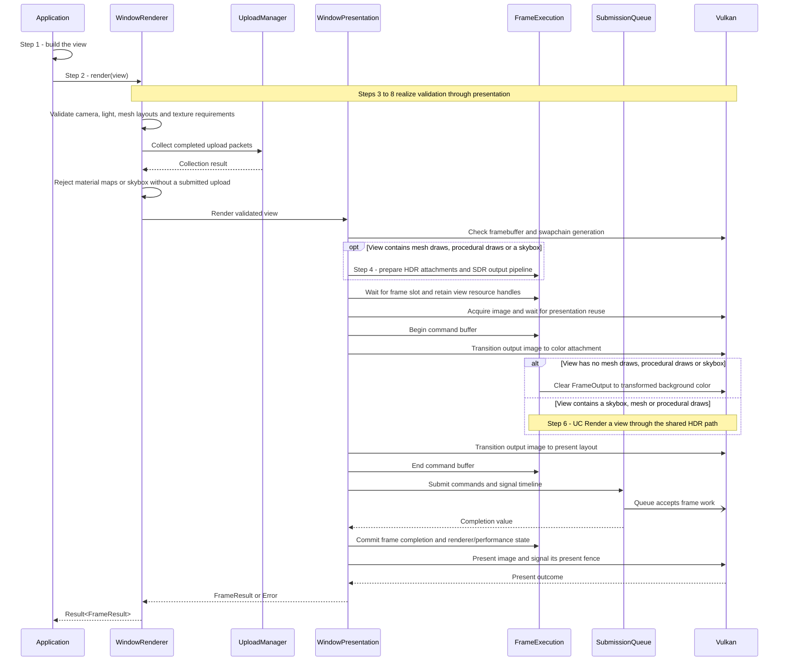

# Render and present an application view

## Goal and boundary

An application passes camera, lighting, an optional skybox, mesh draws and
procedural draws to `WindowRenderer::render(view)`. Panda renders and presents
that view without requiring a scene or entity system. When the view contains no
draws, Panda draws the skybox when present, otherwise it presents the solid
background. This flow ends with a `FrameResult` or an `Error`.

**The application** owns scene data, transforms and the lifetime of its `Engine`. **Panda** validates the view, records
the built-in rendering path, retains mesh and selected texture handles through GPU use, and owns frame-slot and
swapchain synchronization. A returned
`CompletionPoint` identifies submitted GPU work; it does not mean the image has been displayed.

## Preconditions

1. A live Engine was created with `Engine::createWithSurface`; calls to it are
   serialized on its execution thread. `getFeatures().windowRenderingEnabled`
   is true for this Engine.
2. Every mesh draw refers to a valid, uploaded mesh from that Engine and declares a
   layout compatible with its material. All draws require Position; Lit also requires
   Normal. Color is optional and defaults to white. A base-color map is optional; if
   set, it must be a sampled RGBA8 sRGB texture from the same Engine. Lit
   metallic-roughness, emissive, normal and occlusion maps are also optional; they
   require sampled RGBA8 UNORM, RGBA8 sRGB, RGBA8 UNORM and RGBA8 UNORM textures
   respectively. All maps must be from the same Engine and need a submitted upload.
   Base-color, metallic-roughness, emissive and occlusion maps require TexCoord0; a
   normal map is ignored with a warning if TexCoord0 or Tangent is missing.
3. Camera, light, every instance transform and tint, and material values are finite
   and valid for the built-in renderer. Instances in one draw have the same
   determinant sign; custom mesh programs accept one instance per draw. A
   zero-sized framebuffer is allowed and returns `Suspended`.
4. An optional skybox is an uploaded, sampled square linear `Rgba16Float` cubemap
   created by this Engine.
5. Each procedural draw uses a same-Engine `ShaderProgram` created for
   `ShaderVertexInput::Procedural`. Its named application bindings match the
   reflected uniform blocks and read-only storage buffers used by the camera
   stages. Vertex and instance counts fit the buffers indexed by those stages.
   If any light casts shadows, the program supplies explicit shadow stages;
   their application bindings are a layout-compatible subset of the camera
   bindings.

## Main flow

1. **Build the view.** The application supplies a view-projection matrix, camera
   position, zero or more directional, point or spot lights, and zero or more mesh
   draws with per-draw materials. A draw shares its mesh, material, maps and shader
   resources across its `MeshInstance` list; each instance supplies a full
   object-to-world transform and tint. The list defaults to one identity instance,
   while an empty list emits no draw. Each light opts into shadows by supplying
   `ShadowSettings`; an unset resolution selects the default for that light type.
   Directional lights also select their orthographic coverage; spot and point
   shadow views use the light's existing cone and range. Resolution is the width
   and height of each shadow-map face in texels; supported values are 256, 512,
   1024 and 2048, with defaults of 2048 for directional lights, 1024 for spot
   lights and 512 per point-light face. `depthBias` is subtracted from projected
   [0,1] depth before comparison. `normalOffset` moves the receiver along its
   world-space normal in meters. Increasing either can reduce self-shadowing, but
   excessive values detach shadows from their casters.
   `EngineOptions::maxLights` controls the total light budget; zero supports a view
   with no lights.
   `RenderView::environment` optionally supplies preprocessed diffuse and specular
   cubemaps for Lit materials; `RenderView::skybox` independently selects the
   visible background. A view built from `Scene` copies its scene-wide settings
   and groups compatible built-in opaque and masked mesh objects; scene objects
   remain separate. The application may still override view settings before rendering.
   Mesh handles are ordinary values; Panda does not create entities or own application
   transforms.
   A mesh material may select a same-Engine `ShaderProgram` with standard mesh
   vertex input and renderer bindings. See [UC Create a graphics shader program](create-shader-program.md).
   A procedural draw instead supplies its own program, `ShaderResources`, model
   matrix, tint, vertex count and instance count; the vertex shader creates
   geometry from `gl_VertexIndex` and `gl_InstanceIndex`, so no mesh buffer is
   required. A zero vertex or instance count skips the draw. When shadows are
   enabled, the explicit shadow shader also creates geometry from those IDs and
   may read the same named application resources.
   For position, rotation and scale, `panda::createModelMatrix()` builds the full
   object-to-world matrix; applications may also supply a matrix directly.
2. **Request the window render.** After checking
   `Engine::getFeatures().windowRenderingEnabled`, the application calls
   `Engine::getWindowRenderer()` and passes the view to
   `WindowRenderer::render(view)`. A headless Engine has no window renderer and
   the getter fails through `expect`.
3. **Validate and collect uploads.** `WindowRenderer` checks matrices, all
   light variants, optional shadow settings, atlas resolutions/capacity, and the
   configured light budget, each instance's transform and tint, same-draw winding,
   the custom-program single-instance limit, material alpha mode, cutoff, and finite normal-map scale and occlusion
   strength, then verifies each mesh's Engine and required attributes, and checks
   each procedural program, transform and tint. It resolves each procedural draw's
   named shader resources against reflection and validates buffer ownership, usage,
   offset and range. If a base-color,
   Lit metallic-roughness, emissive, Lit normal or Lit occlusion map is set, it checks
   the texture's Engine, sampled usage and required format. Base-color,
   metallic-roughness, emissive and occlusion maps also require TexCoord0; the normal
   map falls back with a warning when UVs or tangents are missing. It polls and
   reclaims completed upload packets, then rejects a material or skybox texture whose
   upload was never submitted. A skybox must be a sampled same-Engine `Rgba16Float`
   cubemap. Rendering remains queued
   after any in-flight upload on the Engine submission queue.
4. **Prepare the window frame.** `WindowPresentation::prepareWindowFrame()` checks the
   framebuffer extent and swapchain generation. A zero extent returns `Suspended`
   without acquiring an image. See [UC Suspend presentation and recreate the
   swapchain](recreate-swapchain.md).
   For mesh or procedural draws, or a skybox, `FrameExecution::prepareOutput()` creates or resizes
   the renderer for the fixed HDR format and requested sample count, then prepares
   the output pipeline for the swapchain format. It waits for both slots before
   replacing attachments. See
   [UC Render a view through the shared HDR path](render-hdr-output.md).
5. **Retain resources and acquire.** `WindowPresentation` asks `FrameExecution::prepareSlot()`
   to wait for the selected slot's prior GPU completion, then retain the view's mesh,
   material texture, environment, skybox and procedural shader resource handles in that slot. It checks submission
   capacity,
   acquires an image with its slot-owned semaphore and waits for that image's pending
   presentation fence before reuse.
6. **Record the view.** `WindowPresentation` begins the command buffer, transitions the
   acquired image to color-attachment layout, and passes `FrameExecution` a borrowed
   `FrameOutput` with the image view, extent and swapchain format. A view with no
   mesh, procedural draw or skybox clears the SDR output to the configured background. Otherwise,
   `FrameExecution` records the shared HDR scene and SDR output pass described by
   [UC Render a view through the shared HDR path](render-hdr-output.md). It updates
   material, light, shadow and built-in instance records through `FrameBindings`;
   `MeshRenderer` renders configured shadow maps before the camera view. Each
   nonempty built-in mesh draw uses one instanced draw in the camera pass and each
   applicable shadow view, even when the list has one item. `MeshPipelineCache`
   prepares the selected camera program against the mesh's reflected inputs and
   takes instance attribute locations from SPIR-V reflection. Custom mesh programs
   keep their push-constant path. `ApplicationShaderBindings`
   resolves application resource names, prepares uniform, storage and sampled-image
   descriptors, and retains their resources in the frame slot. The draw binds those descriptors
   for the camera pass. Procedural draws issue `vkCmdDraw(vertexCount,
    instanceCount, 0, 0)` without binding mesh vertex buffers. They follow the
   opaque mesh camera draws; their resources remain alive through GPU completion.
   Custom mesh draws use their `StandardMesh` or explicit shadow variant.
   `FrameExecution` records content
   and timing markers but does not transition or present the output image.
   `WindowPresentation` records the final transition to present layout and ends the
   command buffer.
7. **Submit GPU work.** `SubmissionQueue` submits the command buffer, waiting on the
   acquire semaphore and signaling the image's render-finished semaphore plus the
   Engine timeline. Only after submission succeeds does `FrameExecution` store the
   completion value and commit renderer and performance state. `WindowPresentation` then
   marks the image initialized and advances its slot. Mesh, texture and procedural
   shader resource handles remain retained in the execution slot until reuse after
   completion. See
   [UC Commit work to the Engine submission timeline](commit-context-submission.md).
8. **Queue presentation.** `WindowPresentation::presentFrame()` queues the image with its
   per-image presentation fence. Accepted presentation without recreation returns
   `Rendered`; a suboptimal/out-of-date result returns `RecreatePending` and may carry
   the accepted submission's completion point. Other failures follow [UC Recover from a presentation failure
   after GPU submission](recover-presentation-failure.md).

`Rendered` means the submission succeeded and the presentation request was accepted;
it does not mean GPU work completed or the image reached the display. Check
`completion.isValid()` to determine whether work was submitted, because
`RecreatePending` can carry a completion point.

## Notes

**No scene requirement.** Applications can prepare `RenderView` data from their own
architecture. An optional scene library may prepare the same render data, but Core
does not depend on that library.

**Capture the same frame.** `WindowRenderer::renderWithCapture(view, target)` uses
the target and acquired swapchain image as SDR outputs for one HDR scene render.
`ToneMappingPass` writes each with the output format's sRGB behavior; no blit
converts between the formats. See
[UC Render a view to an image](render-offscreen-view.md) for the target and readback
contract.

**Camera construction.** `panda::tools::createPerspectiveCamera()` combines the
checked perspective projection with right-handed look-at vectors and returns a
`RenderCamera` for the view.

**Upload environment maps.** Applications provide a precomputed diffuse irradiance
cubemap with one mip and the sharp linear HDR source for specular reflections. Create
the specular cubemap with `TextureMipPolicy::GenerateSpecularEnvironment`, set
`TextureDesc::specularEnvironmentSamplesPerTexel`, then write its six mip-0 faces
through `UploadBatch::write(texture, bytes, region)`. When the sixth face arrives,
Panda generates and stages the full GGX roughness chain. An incomplete set makes
`UploadBatch::submit()` return `InvalidArgument`; the same batch can accept the
remaining faces and be submitted again.

**Current shading model.** Built-in materials multiply linear `baseColor`, an
optional sRGB base-color map, draw tint and optional vertex color (white when absent).
Lit materials can also sample a linear UNORM metallic-roughness map; blue scales
metallic and green scales roughness. Both material models can use an sRGB emissive
map, whose RGB multiplies the linear emissive factor; alpha is ignored. Emission is
added before tone mapping and changes only the object's color: it does not light
other objects or create a bloom halo. Base-color, metallic-roughness and emissive maps
require TexCoord0. A Lit normal map uses TexCoord0 and Tangent; without either attribute
it is ignored with a warning, leaving the interpolated mesh normal in use. Normal-map
scale defaults to 1, multiplies tangent-space X and Y, and accepts any finite value.
Lit materials can use a linear UNORM occlusion map whose red channel scales only the
constant ambient contribution; `occlusionStrength` blends from no effect (0) to the
full map (1). It does not dim direct light or shadows. Lit materials evaluate the
directional, point and spot lights with a Cook-Torrance microfacet specular
term: GGX normal distribution,
Schlick-GGX geometry and Schlick Fresnel with dielectric F0 0.04. Lambert diffuse is
combined with that specular term. Each Lit material supplies metallic and roughness,
clamped to the supported range. Unlit materials skip light evaluation and shadow
lookup while shading, but still cast shadows in the current depth pass.
`AlphaMode::Opaque` renders the whole surface without alpha blending.
`AlphaMode::Mask` turns alpha into a binary cutout: values below `alphaCutoff` are
discarded, and the rest render fully opaque. The same cutoff controls the shadow
silhouette. The material's `RenderFace` selects front sides, back sides or both; transforms with
a negative determinant reverse pipeline winding in both passes. Lit shading
orients back-facing normals consistently when rendering `Back` or `Both`. A
constant ambient term contributes
0.06 times base color to Lit materials. Mesh and skybox shaders keep RGB linear;
the shared HDR path blends and tone-maps scene radiance before writing sRGB output.
A frame slot owns one sampled 2D-array shadow depth image, with
one or more 4096² layers used as atlas pages. It grows to fit the frame's shadow
plan. Each opted-in directional or spot light occupies one guarded tile; each point
light occupies six cube-oriented tiles. Defaults are 2048 with 30 m orthographic coverage for directional,
1024 for spot, and 512 per point face. The shader applies 3x3 PCF and clamps taps to
the selected tile; ambient light remains unshadowed. Directional shadows use a uniform
texel density across their coverage, while point-light density changes with distance.
The required captures still need to tune directional coverage, bias and filtering in
[Materials, lights and shadows](../development/tasks/materials-and-shadows.md).
The first mesh draw selects the highest common color/depth
attachment sample count supported by the active formats and device limits (4x, then
2x, then 1x); `FrameResult::effectiveSampleCount` reports `SampleCount::Four`,
`SampleCount::Two` or `SampleCount::One` using Panda's public sample-count enum.

`AlphaMode::Blend` uses the combined texture, material, draw and optional vertex alpha
for straight-alpha compositing. It runs after Opaque and Mask with depth testing enabled
and depth writes disabled; mesh origins are sorted back-to-front. Blended meshes do
not cast shadows. Intersecting transparent meshes can still sort incorrectly. Blending
uses linear HDR radiance before the shared final tone-mapping pass; see
[UC Render a view through the shared HDR path](render-hdr-output.md).

**Slot and image lifetimes differ.** `FrameExecution` owns two reusable execution
slots, including command buffers and retained mesh and texture handles.
`WindowPresentation` owns their acquire semaphores and the independently sized set of
swapchain images, render-finished semaphores and presentation fences.

**Output boundary.** `FrameOutput` is borrowed for one recording operation.
`FrameExecution` uses its image view, extent and SDR format to record a transformed
clear or the shared HDR path's final output; `WindowPresentation` alone owns the
output-layout transitions and presentation.

**Attachment publication.** `RenderAttachments` owns per-slot color, depth and shadow
images, including the single-sample HDR resolve image and optional multisample color
image, with their committed layout history. A failed replacement leaves the renderer's
current attachments and pipeline compatibility available. A submitted frame reports its
effective sample count. Shadow images keep their
fixed extent across window resize, so `FrameBindings` can keep using the same shadow views.

**Completion meanings.** The timeline point covers submitted GPU work. The per-image
present fence separately tracks presentation-resource retirement; it does not promise
that display has finished. See the
[presentation-fence reference](https://docs.vulkan.org/refpages/latest/refpages/source/VkSwapchainPresentFenceInfoKHR.html).

**Pre-submit failures.** After acquire succeeds, a recording or submit failure must
consume the acquire semaphore and retire the image. `FrameExecution` discards the
unsubmitted view handles after `WindowPresentation` performs that recovery. See
[UC Retire an acquired image after frame work fails](retire-acquired-image.md).
A frame error does not imply that already submitted work was rolled back.

## Variants and errors

| Condition                                                                                                      | Result and next action                                                                                                  |
|----------------------------------------------------------------------------------------------------------------|-------------------------------------------------------------------------------------------------------------------------|
| Framebuffer width or height is zero                                                                            | Return `Suspended` without acquiring an image; process events and retry after restoration.                              |
| Acquire returns timeout or not-ready                                                                           | Return `Skipped` without a completion point.                                                                            |
| Acquire reports out-of-date                                                                                    | Return `RecreatePending` without a completion point; the next call attempts recreation.                                 |
| Acquire or present is suboptimal, or present reports out-of-date                                               | Return `RecreatePending`; keep the accepted submission's completion point.                                              |
| Invalid view/material data, foreign mesh/texture, incompatible layout, invalid material map, or invalid skybox | Return `InvalidArgument` before acquiring an image.                                                                     |
| A custom mesh or procedural draw has no shadow variant while a light casts shadows                             | Return `InvalidArgument`; use `StandardMesh` for undeformed mesh geometry or provide explicit stages.                   |
| Allocation fails while applying MSAA                                                                           | Return the allocation error before acquiring an image. A subsequent compatible frame can reuse the prior configuration. |
| Recording, submission or cleanup fails after acquire                                                           | Return the relevant error; retire the acquired image. Failed retirement faults presentation.                            |
| Surface or device is lost                                                                                      | Return the Vulkan error and fault presentation; Engine teardown still attempts its drain.                               |

## Related information

- [Rendering contract](../design/contracts/rendering.md) defines the renderer boundary
  and its supported inputs.
- [UC Render a view through the shared HDR path](render-hdr-output.md) explains
  linear blending, HDR resolve and the final SDR output.
- [Resources and frames](../design/contracts/resources.md#frame-and-window-state)
  defines frame results, recreation and presentation state.
- [UC Upload texture contents or regions](upload-texture.md) explains how material
  maps receive their image data before rendering.
- [UC Collect paired CPU and GPU frame timings](collect-frame-timings.md) describes
  optional timing markers around submitted view work.
- [UC Observe or wait for submitted GPU work](observe-completion.md) explains how an
  application observes a returned `CompletionPoint`.
