# Retire an acquired image after frame work fails

## Goal and boundary

If a swapchain image was acquired but normal frame submission does not happen,
Panda must consume the image's binary acquire semaphore and return the unused
image through swapchain maintenance. This UC starts after successful image
acquisition and ends with cleanup success or a faulted presentation state.

## Main flow

1. **Start cleanup.** A command-recording failure, or a present-fence wait/reset
   failure for the acquired image, calls `Presentation::abortAcquire()`.
2. **Consume acquire and commit retirement.** An empty `SubmissionQueue` submission
   waits on the slot's acquire semaphore and signals the Context timeline. On
   queue acceptance, `Presentation` stores the image index as pending recovery
   and records the returned value as the slot's last completion.
   [UC Commit work to the Context submission timeline](commit-context-submission.md)
   defines when that value is committed.
3. **Wait for the retirement submission.** `Presentation::waitCompletion()` waits
   for that committed value before release. If the wait times out, the pending
   recovery remains for `drain()`.
4. **Release the unused image.** `Presentation::releaseImage()` calls the enabled
   KHR or EXT `vkReleaseSwapchainImages` entry point for the acquired index and
   clears pending recovery only after Vulkan confirms release.

```mermaid
sequenceDiagram
    participant P as Presentation
    participant Q as SubmissionQueue
    participant V as Vulkan
    Note over P: Image acquired and normal frame submission did not happen
    P->>P: Step 2 - retain image index for recovery
    P->>Q: Step 2 - empty submit waits on acquire semaphore
    Note over P,Q: Step 2 - UC Commit work to the Context submission timeline
    Q->>V: vkQueueSubmit2(signals Context timeline)
    V-->>Q: Accepted and committed value
    Q-->>P: Retirement value
    P->>Q: Step 3 - wait for retirement value
    Q->>V: Host waits for the committed retirement value
    V-->>Q: GPU signals after completing retirement work
    P->>V: Step 4 - release acquired image index
    V-->>P: Release result
```

## Notes

**One binary wait.** The acquire semaphore is consumed either by normal frame
submission or by this empty cleanup submission. A failed cleanup submission has
not committed that wait; Panda faults presentation and records that no acquired
image retirement was committed. `Presentation::drain()` then refuses to claim
safe cleanup.

**Retained recovery.** Once Step 2 commits, `Presentation` keeps the acquired
index while the frame slot retains its completion value until Step 4 succeeds. If
Step 3 times out or fails, `drain()` waits for the committed work and then performs
Step 4 before it can report success. This preserves the
[resource contract](../design/contracts/resources.md#frame-and-window-state)
across a retry.

**Unconfirmed release.** If Step 4 returns an error, Vulkan has not confirmed
whether the acquisition was released. `Presentation` faults and `drain()` returns
an error instead of repeating the release or claiming that the generation is safe
to destroy.

## Variants and errors

|  | Point and condition | Response | Resulting state and next action |
| --- | --- | --- | --- |
| **Error&nbsp;1** | Step 1: command recording or image present-fence handling reports an error | Attempt empty acquire-retirement submission | On full cleanup success, return the original error; normal rendering may continue only if presentation remains usable |
| **Error&nbsp;2** | Step 2: empty submission is rejected | Return the submission error and set `_acquireRetirementFailed` | Acquire wait was not committed; presentation is faulted and `drain()` refuses to claim safe retirement |
| **Error&nbsp;3** | Step 3: committed retirement wait times out or fails | Return the wait error and fault presentation | Pending recovery remains; a later drain retries the wait and releases the image if the device remains usable |
| **Error&nbsp;4** | Step 4: maintenance release fails | Return the release error and fault presentation | The release result is unconfirmed; a later drain also fails and does not issue a second release |

## Related information

- [UC Render and present an application view](render-view.md) identifies
  which pre-submit failures enter this UC.
- [UC Drain frame and presentation use](drain-presentation.md) explains shutdown and
  generation waits after a committed cleanup submission.
- The [unused-image release specification](https://docs.vulkan.org/refpages/latest/refpages/source/VkReleaseSwapchainImagesInfoKHR.html)
  requires that all uses of the released image have completed.
