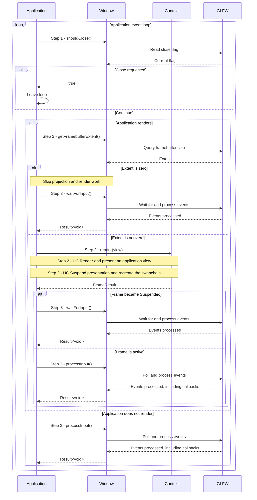

# Run a window event loop

## Goal and boundary

An application keeps its native window responsive while it does application work,
waits efficiently when presentation is suspended, and leaves the loop after a
close request. The flow starts with a live `panda::tools::Window` and ends when
the application loop exits. **The application** owns the loop and decides how to
handle input and errors; `Window` only processes GLFW events and reports window
state. If the application renders, a windowed `Context` borrows the `Window` for
its lifetime.

This scenario follows the optional Panda GLFW wrapper. A custom
`WindowSurface` provides the Vulkan surface boundary; the application still owns
its event handling. [UC Create a Context](create-context.md) explains how that
provider is borrowed.

## Preconditions

1. **Live window.** Keep the `Window` alive while processing its events. If a
   windowed `Context` exists, destroy it before the `Window`.
2. **Thread and callback context.** Call window operations on the GLFW-owning
   main thread, outside GLFW callbacks. `waitForInput()` also requires a live
   Panda window and can block indefinitely.

## Main flow

1. **Check for a close request.** At the top of each iteration, the application
   calls `Window::shouldClose()`. If it returns `true`, the application leaves
   the loop; otherwise it continues. The flag is observed after GLFW events are
   processed, so a close event handled in Step 3 is checked on the next
   iteration.
2. **Check the render extent.** Before projection or frame work, an application
   with a windowed `Context` reads `Window::getFramebufferExtent()`. If either
   dimension is zero, it skips `Context::render(view)`. Otherwise it renders;
   `Context::render(view)` still returns `FrameResult::Status::Suspended` if the
   extent becomes zero between the query and image acquisition. [UC Render and
   present an application view](render-view.md) describes other outcomes; [UC
   Suspend presentation and recreate the swapchain](recreate-swapchain.md)
   explains the extent and generation path.
3. **Wait or poll for events.** If the extent was zero or the frame was
   suspended, the application calls `Window::waitForInput()` and blocks until
   GLFW has an event to process. Otherwise, it calls `Window::processInput()` to
   poll without blocking. Both operations process events for all GLFW windows
   and run callbacks before returning. A non-rendering application can choose
   either operation according to its own idle policy.

## Notes

**A close request is not destruction.** `Window::shouldClose()` reads GLFW's
close flag. It does not destroy the native window or choose how the application
responds. Leaving the loop lets normal ownership cleanup run; a windowed
`Context` must still be released before its borrowed `Window`.

**Window changes are requests.** `Window::setSize()` requests content dimensions
in screen coordinates, and `Window::setMinimized()` requests iconification or
restoration. The platform may apply either change later. After processing events,
query the current state instead of assuming a request has taken effect:
`getSize()` reports content dimensions, while `getFramebufferExtent()` reports
pixels. `isMinimized()` is true when the window is iconified or either framebuffer
dimension is zero; a query error is returned separately from `true`.

**Suspension avoids a busy loop.** A suspended frame has no completion point and
does not consume a frame slot. Waiting lets the application sleep until a window
event arrives. The next frame call reads the current extent and recreates the
swapchain if required; see [UC Suspend presentation and recreate the swapchain](recreate-swapchain.md).

## Variants and errors

|  | Point and condition | Response | Resulting state and next action |
| --- | --- | --- | --- |
| **Variant&nbsp;1** | Step 1: `shouldClose()` returns `true` after an event was processed | The application leaves the loop | The `Window` remains alive until its owner releases it; a close request alone does not destroy it |
| **Variant&nbsp;2** | Step 2: the queried extent is zero, or `Context::render(view)` returns `Suspended` after a concurrent resize | Skip frame work and use `waitForInput()` in Step 3 | After an event wakes the wait, the next iteration checks close state and rechecks the extent before frame work; see [UC Suspend presentation and recreate the swapchain](recreate-swapchain.md) |
| **Error&nbsp;1** | Step 2: `Context::render(view)` returns an error | Propagate or handle the frame error as described by the [UC Render and present an application view](render-view.md) | No `FrameResult` is available for this iteration; the error's recovery rules determine whether the loop can continue |
| **Error&nbsp;2** | Step 3: `processInput()` or `waitForInput()` reports a GLFW event error | Return or handle the `Error`; these operations report failures through `Result<void>` | Do not infer that a requested window change has taken effect; query current state before continuing |
| **Error&nbsp;3** | A size/minimized query or request reports an error; `setSize()` also rejects zero or dimensions above `INT_MAX` | Handle the returned error; invalid size returns `InvalidArgument` before a GLFW call | A failed query is distinct from a minimized result; resolve the cause before relying on observed state |
| **Error&nbsp;4** | A window operation uses a moved-from `Window`, runs on the wrong thread or inside a callback, or `waitForInput()` has no live Panda window | Panda treats this as a fatal lifetime-contract violation, not a recoverable `Result` | Keep operations on the owning thread, outside callbacks, with a live window; the process cannot recover in place |

## Outcomes

**Continue.** Events have been processed, and the application starts another
iteration to check for a close request and observe current window state.

**Close requested.** The application exits its loop. Its owners remain live until
the application releases them; a windowed `Context` must be destroyed before its
borrowed `Window`.

**Presentation suspended.** No frame work is submitted. The application waits for
an event and retries after the platform changes the window state.

## Related information

- [UC Create and release a native window](create-window.md) explains `Window`
  construction, shared GLFW ownership and release order.
- [UC Render and present an application view](render-view.md) explains
  frame statuses and the active presentation path.
- [UC Suspend presentation and recreate the swapchain](recreate-swapchain.md)
  explains zero extents, resize detection and restoration.
- [UC Shut down a Context safely](shutdown-context.md) explains resource release
  and GPU draining when the application destroys its Context.
- [Window wrapper](../design/package-and-toolchain.md#window-wrapper) defines the
  wrapper's thread and GLFW ownership requirements.
- [Vulkan window example](../../examples/simple_scene/README.md) documents the
  runnable loop and its shutdown behavior.
