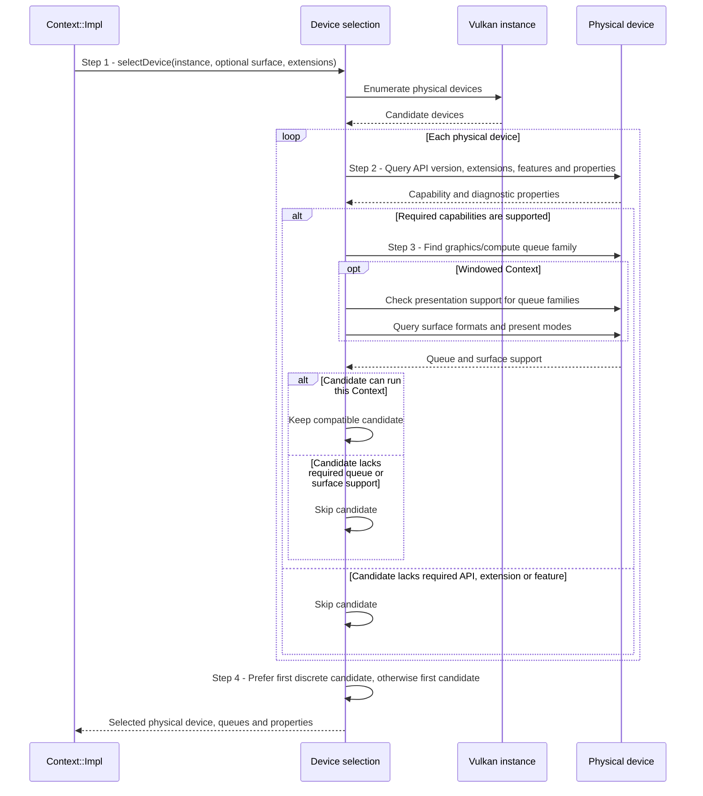

# Select a compatible Vulkan device

## Goal and boundary

During Context creation, Panda must choose a physical device that can run the
Context's ordered graphics/compute work and, when a surface is present, present to
that surface. This UC ends with one compatible physical device,
its queue-family indices, selected swapchain-maintenance variant and diagnostic
properties, or an error. Creating the logical device is the next step in
[UC Create a Context](create-context.md).

`selectDevice()` runs synchronously as part of `Context::create()` or
`Context::createWithSurface()`.

This is implemented behavior for both headless and windowed Contexts. The selection
uses capabilities queried from each physical device; it does not promise the
highest-performing adapter. It prefers the first compatible discrete GPU and then
falls back to the first compatible device in Vulkan enumeration order.

## Preconditions

1. **Instance.** A live Vulkan instance is available.
2. **Windowed path.** When selecting for a windowed Context, Context setup has
   created a live owned `VkSurfaceKHR` and resolved the instance-extension set
   passed to selection.

## Main flow

1. **Enumerate physical devices.** `Context::Impl` passes `selectDevice()`
   the live instance, optional surface and resolved `InstanceExtensions`, then the
   selection asks the Vulkan instance for its physical devices. For a windowed
   Context, setup resolves and enables `VK_KHR_surface`, the provider's platform
   surface extension, `VK_KHR_get_surface_capabilities2` and the available KHR or
   EXT surface-maintenance1 instance extension(s); at least one maintenance variant
   is required before selection begins.
2. **Filter device capabilities.** Panda requires a device API version of at
   least 1.3 and queries support for timeline semaphores, dynamic rendering and
   synchronization2. A windowed candidate must also support
   `VK_KHR_swapchain`, a compatible KHR or EXT `swapchain_maintenance1` variant,
   and its maintenance feature bit.
3. **Check queues and surface support.** Every selected work queue family must
   support both graphics and compute. Headless selection takes the first such
   family. Windowed selection prefers one family that also supports presentation;
   if none does, it uses the first graphics/compute family and first present family
   as a pair. The windowed candidate must also expose at least one surface format
   and present mode.
4. **Choose and report one candidate.** Among compatible candidates, Panda
   chooses the first discrete GPU if present, otherwise the first candidate. It
   returns driver/device details, queue families, timestamp properties and the
   selected maintenance variant to `Context::Impl`.

## Notes

**Window and headless requirements differ.** Both paths require a Vulkan 1.3
physical device, the three core feature bits, and a graphics/compute queue family.
Only the windowed path checks surface presentation, formats, present modes,
`VK_KHR_swapchain` and swapchain maintenance1. The KHR maintenance variant is
preferred when both KHR and EXT variants are available.

**Queue choice.** Panda prefers a single family for graphics, compute and
presentation. If the surface requires a separate present family, both indices are
returned and the logical device requests both queues. This makes surface
compatibility part of device selection rather than a later frame-time surprise.

**Adapter inspection errors.** A device that simply lacks a capability is skipped.
An inspection error is logged and that adapter is skipped for most error
categories, allowing another candidate to qualify. `SurfaceLost` and
`InvalidArgument` are fatal to the whole selection because they describe the
window/surface request rather than one adapter.

## Variants and errors

|  | Point and condition | Response | Resulting state and next action |
| --- | --- | --- | --- |
| **Error&nbsp;1** | Step 1: physical-device enumeration fails | Propagate the instance-level Vulkan error | No candidate is inspected; Context creation fails with no logical device |
| **Variant&nbsp;1** | Steps 2–3: device lacks a required capability, queue, extension or usable surface format/present mode | Skip that device without treating the capability mismatch as an API error | Other devices remain eligible; if none qualify, continue to Error 4 or Error 5 |
| **Error&nbsp;2** | Steps 2–3: device inspection returns `SurfaceLost` or `InvalidArgument` | Stop selection and propagate the error | Context creation fails; surface repair or correcting the request is required before retry |
| **Error&nbsp;3** | Steps 2–3: another adapter inspection error occurs, and a later device is usable | Log and skip the failing adapter; return the compatible device | Context creation may proceed with the later device |
| **Error&nbsp;4** | Steps 2–3: no candidate qualifies, and at least one adapter inspection failed | Return the first recorded inspection error after all candidates are checked | Context creation fails with that error; resolve the backend/device issue before retry |
| **Error&nbsp;5** | Steps 2–3: no candidate qualifies and no inspection error occurred | Return `Unsupported` with a headless- or windowed-capability message | No logical device is created; use a compatible device/runtime or headless path |

`DeviceLost`, `Timeout`, `ResourceExhausted`, `BackendFailure` and other
nonfatal-to-selection inspection errors follow the skip-and-remember path. If a
later adapter qualifies, the first remembered error does not prevent its use.

## Outcomes

On success, `Context::Impl` receives one candidate whose required features were
queried and whose work/presentation queues meet the selected path. The following
logical-device creation step enables the queried features and creates the returned
queues.

On failure, no physical-device candidate is published to the public API and the
Context creation flow returns an error. Selection does not silently fall back to an
older presentation protocol when a windowed device lacks maintenance1 support.

## Related information

- [UC Create a Context](create-context.md) uses this result to create the logical
  device and Context services.
- The Vulkan specification's [device and queue chapter](https://docs.vulkan.org/spec/latest/chapters/devsandqueues.html)
  explains physical-device queries, queue families and logical-device creation.
- The Vulkan specification's [feature chapter](https://docs.vulkan.org/spec/latest/chapters/features.html)
  explains querying and enabling feature bits.
- The Vulkan specification's [window-system integration chapter](https://docs.vulkan.org/spec/latest/chapters/VK_KHR_surface/wsi.html)
  defines surface presentation support and capabilities.
