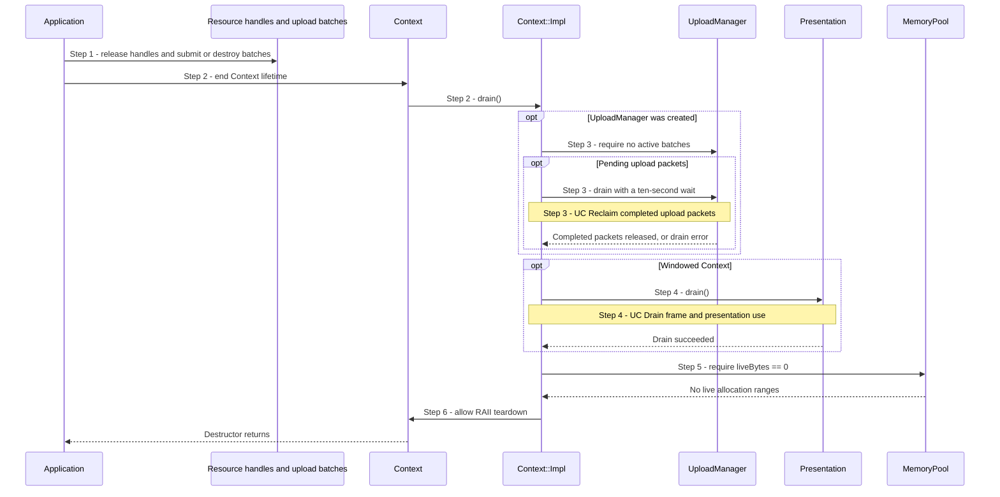

# Shut down a Context safely

## Goal and boundary

An application ends the lifetime of a live `Context`. **The application** first
releases its `Buffer`, `Texture` and `Mesh` handles and destroys every
unsubmitted `UploadBatch`. **Panda** then drains its submitted upload packets
and, for a windowed Context, frame and presentation use. If those checks pass,
the Context's RAII owners tear down its device services and native objects.

The flow starts at `Context::~Context()` and ends with normal teardown or a fatal
diagnostic. The destructor is `noexcept`; it cannot return a recoverable drain
error or promise general recovery from device loss.

## Preconditions

1. **Caller-owned state is released.** Every public resource-handle copy and
   unsubmitted batch is gone before the Context is destroyed. The borrowed
   `WindowSurface` and its native window remain alive through teardown.
2. **Serialized use.** No Context operation is in progress while its owner is
   destroyed.

## Main flow

1. **Release application owners.** The application releases its resource handles
   and either submits or destroys each upload batch while the Context is still
   alive. A submitted packet can continue to retain staging and destination
   resources after the application releases its handles.
2. **Begin destruction.** The `Context` object leaves scope or is reset.
   `Context::~Context()` calls `Context::Impl::drain()` before its implementation
   can release the device services.
3. **Drain submitted uploads.** If the lazy `UploadManager` exists,
   `Context::Impl::drain()` first requires that no unsubmitted batches remain,
   then waits up to ten seconds for pending uploads.
   [UC Reclaim completed upload packets](reclaim-completed-uploads.md) explains
   when the retained owners can be released.
4. **Drain presentation.** If this is a windowed Context,
   `Presentation::drain()` settles submitted frame and presentation use.
   [UC Drain frame and presentation use](drain-presentation.md) explains the
   required completion checks.
5. **Check resource owners.** The memory pool must report `liveBytes == 0`.
   This means all resource allocation owners are gone after internal upload
   packets have released their references. [UC Return a resource memory range](release-memory-range.md)
   explains how final owners return their ranges.
6. **Release Context services.** After `drain()` returns, normal RAII destruction
   releases the Context-owned presentation, upload, queue, pool, device and
   instance services. The application still owns its `WindowSurface`.

## Notes

**Caller and internal owners are different.** A copied handle still owns the
same resource state. A submitted `UploadCommand` is another owner of its
destination and staging resources until completion. Releasing the application's
copy alone does not make its memory range free. [UC Reclaim completed upload packets](reclaim-completed-uploads.md)
shows when the internal owner is released.

**The waits are targeted.** Upload draining waits for its last committed upload
value. Presentation draining separately checks queue completion, image recovery
and present fences. These waits protect tracked uses; teardown does not use a
routine device-wide idle.

**The GPU completes the timeline value.** An earlier call to
`SubmissionQueue::submit()` has already accepted the work and committed its
signal value. The destructor path calls `SubmissionQueue::waitValue()` on the
calling thread; that wait returns immediately if completion is already known.
Otherwise the GPU queue signals the timeline after completing the submitted
work. Destruction does not submit more work or require another `Context` call.

**The pool may have no live ranges and still own memory.** `liveBytes == 0` allows
the pool's cached empty ordinary blocks to remain until the pool itself is
destroyed. Dedicated blocks are released when their allocation range is
returned. See the [UC Return a resource memory range](release-memory-range.md).

## Variants and errors

|  | Point and condition | Response | Resulting state and next action |
| --- | --- | --- | --- |
| **Variant&nbsp;1** | Step 3: upload service was never created or has no pending packets | Skip the corresponding wait | Continue to presentation drain or the resource-owner check |
| **Variant&nbsp;2** | Step 4: headless Context has no presentation service | Skip presentation drain | Continue to the resource-owner check |
| **Error&nbsp;1** | Step 3: an unsubmitted batch is still alive | Fatal lifetime diagnostic before upload waiting | Context destruction cannot return; destroy or submit batches before Context |
| **Error&nbsp;2** | Step 3: the upload completion wait times out or fails, including device loss | `expect` emits a fatal diagnostic | Pending owners are not treated as completed; teardown stops |
| **Error&nbsp;3** | Step 4: a timeline or present-fence wait times out/fails, or acquired-image recovery is unsafe (including device loss) | `expect` emits a fatal diagnostic | Presentation resources are not claimed safe; teardown stops. See the [UC Drain frame and presentation use](drain-presentation.md) |
| **Error&nbsp;4** | Step 5: `liveBytes` is nonzero after internal drains | Fatal lifetime diagnostic naming live resource owners | Release every external handle before destroying Context; no recoverable Context remains |

## Outcomes

**Normal teardown.** Upload and presentation uses are confirmed complete, no
external resource allocation owners remain, and Context's RAII owners release
their native state. The pool may still own empty cached blocks until this step.

**Fatal teardown.** A live batch, unresolved GPU/presentation use or live
resource allocation violates the shutdown boundary. Since the destructor cannot
return an `Error`, Panda stops with a fatal diagnostic instead of claiming that
unsafe resources were released. This is not a general device-loss recovery path.

## Related information

- [Ownership](../design/contracts/resources.md#ownership) defines which owners
  must outlive Context and the caller's release responsibility.
- [Frame contexts and retirement](../design/contracts/resources.md#frame-contexts-and-retirement)
  defines when retained resource uses may be released.
- [Allocation, uploads and descriptors](../design/contracts/resources.md#allocation-uploads-and-descriptors)
  defines upload retention and pool ownership.
- [UC Reclaim completed upload packets](reclaim-completed-uploads.md),
  [UC Drain frame and presentation use](drain-presentation.md) and
  [UC Return a resource memory range](release-memory-range.md) explain the three
  resource-release boundaries used here.
- [Allocation, uploads and resource lifetimes](../development/tasks/resource-lifetimes.md)
  and [Vulkan context and window lifecycle](../development/tasks/vulkan-context.md)
  record the implemented lifetime and teardown scope.
