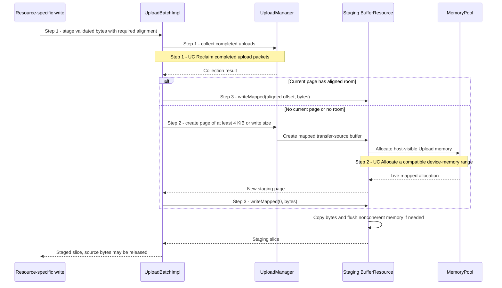

# Snapshot caller bytes into batch-owned staging

## Goal and boundary

This UC documents how an already validated resource write is copied into a
mapped staging page owned by an `UploadBatch`. It starts when a resource-specific
write has checked its destination and determined the source-slice alignment; it
ends when staging returns a slice that the caller can append to its upload
operation. It does not validate a buffer, texture or mesh, record GPU commands,
or submit work. [UC Upload bytes into a buffer](upload-buffer.md) and
[UC Upload texture contents or regions](upload-texture.md) use this operation.

## Preconditions

1. **Live batch.** The batch borrows a live Context, and its operations are
   serialized on the Context execution thread.
2. **Validated write.** The caller has validated the destination and source
   layout and supplies nonempty bytes with a nonzero staging alignment.

## Main flow

1. **Collect completed uploads.** `UploadBatchImpl::stage()` calls
   `UploadManager::collect()`; [UC Reclaim completed upload packets](reclaim-completed-uploads.md)
   explains the completion check and packet release.
2. **Find or create a page.** The batch reuses its last staging page when an
   aligned slice fits. Otherwise, `UploadManager` creates a mapped transfer-source
   `BufferResource` with `BufferMemory::Upload`, sized for at least the write and
   a 4 KiB minimum page. The Context's `MemoryPool` supplies its host-visible
   memory; [UC Allocate a compatible device-memory range](allocate-memory-range.md)
   covers compatible range selection.
3. **Copy and flush the source.** `BufferResource::writeMapped()` copies the
   caller's bytes into the chosen slice and flushes it when the memory is
   noncoherent. Only after this succeeds does `stage()` return a staging slice;
   the resource-specific caller can then append its operation to the batch.

## Notes

**Alignment and cache isolation.** The caller supplies the alignment required by
its copy. Buffer and mesh byte uploads use no extra slice alignment; texture
copies align their staging offset to the least common multiple of Vulkan's
four-byte buffer-image requirement and the format's texel-block byte size. In
pooled host-visible noncoherent memory, allocation boundaries are atom-aligned
and atom-sized; dedicated allocations are not subdivided. Before flushing,
`MemoryBlock` validates the range against the exact live allocation and expands
it only within that allocation's reserved range. This prevents one pooled
allocation's flush from reaching its neighbor; the range arithmetic is described
in [UC Allocate a compatible device-memory range](allocate-memory-range.md).

**Snapshot ownership.** After staging succeeds, the batch owns the page and the
queued operation retains its source slice. The application may change or release
its source bytes after `write()` returns. On successful submission, Context's
pending packet retains the page until completion; see
[UC Reclaim completed upload packets](reclaim-completed-uploads.md). Unsubmitted
batch destruction releases its pages without GPU work.

**Failure boundary.** A failed stage returns no slice, so the caller does not
append the current resource write. Earlier accepted operations remain in the
batch. This does not promise to restore staging-page cursor or cache state, undo
every allocation, or restore bytes already touched while attempting the failed
stage.

## Variants and errors

|  | Point and condition | Response | Resulting state and next action |
| --- | --- | --- | --- |
| **Error&nbsp;1** | Step 1: source bytes are empty or the requested alignment is zero | Return `InvalidArgument` before selecting a page | No slice is returned and the caller queues no operation; provide a valid write |
| **Error&nbsp;2** | Steps 1–3: completion collection, page allocation, mapped access or cache flush fails | Propagate the error without returning a staging slice | The current write is not appended; earlier accepted writes remain and may be retried when the error permits |

## Outcomes

**Success.** The caller receives a staging slice containing a snapshot of its
source bytes. It can append the resource-specific operation and release the
source span.

**Failure.** The current write has no staging slice and is not queued. Earlier
batch writes remain owned; staging and cache effects from the attempt are not
promised to roll back.

## Related information

- [UC Upload bytes into a buffer](upload-buffer.md) and
  [UC Upload texture contents or regions](upload-texture.md) show resource-specific
  writes that use this operation.
- [UC Reclaim completed upload packets](reclaim-completed-uploads.md) explains the
  collection triggered before reusing or growing staging.
- [UC Allocate a compatible device-memory range](allocate-memory-range.md) explains
  host-visible pool allocations and their range ownership.
- [Allocation, uploads and resource lifetimes](../development/tasks/resource-lifetimes.md)
  records the implemented staging and cache-flush behavior.
- [`vkFlushMappedMemoryRanges`](https://docs.vulkan.org/refpages/latest/refpages/source/vkFlushMappedMemoryRanges.html)
  specifies availability of host writes from noncoherent mapped memory.
