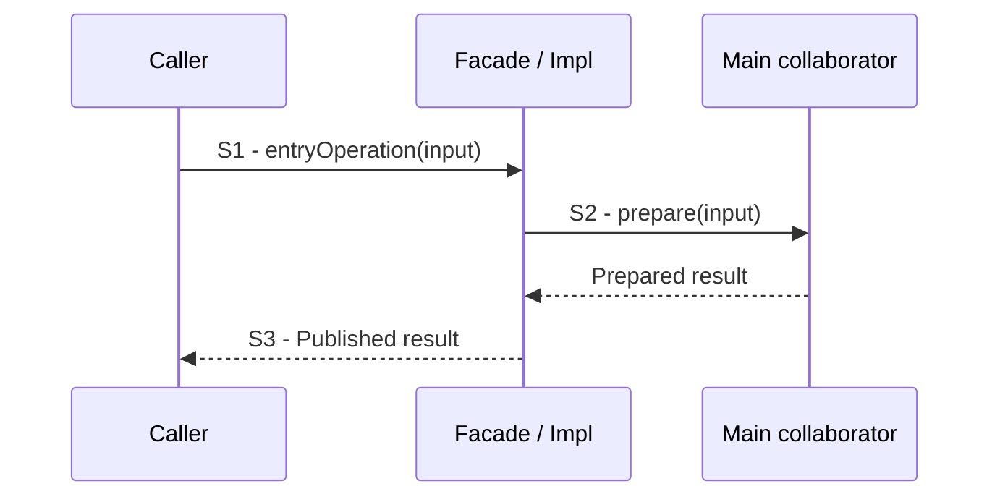

# Scenario template

Copy the skeleton below into a descriptively named page and replace its instructions.
Follow the [conventions](../development/functional-documentation.md) and compare
the [worked example](create-buffer.md). The diagram's participants and calls are
placeholders, not Panda API. Adapt step counts to the code. Optional state, decision
or ownership diagrams belong beside the behavior they explain.
Keep diagram notation guidance in the conventions. Do not add explanations of
arrows, `opt` blocks, visible calls or omitted helpers below a finished diagram.

````markdown
# Verb and goal

## Goal and boundary

Explain the caller's goal, trigger, start/end points and responsibility boundary.
State implemented or planned scope; link the relevant task and shared contracts.
Bold the responsible parties, such as **Panda** and **The application**, where
assigning responsibilities. Put exact code symbols in `monospace`.

## Preconditions

State execution thread/phase, lifetime and capability requirements. Distinguish
caller obligations from invalid input checked by the operation.

## Main flow

1. **S1 - Request.** Identify the entry operation and its input.
2. **S2 - Prepare.** Identify affected data/resources, their owner, the operation's
   effect and why this step is needed. Do not rely on the method name to explain it.
3. **S3 - Publish.** Explain the observable result and publication point.



## Reading notes

**Ownership.** Explain who owns or borrows important objects and what must outlive them.

**Publication guarantee.** Identify the *publication point* and what must succeed
before the result becomes visible. Adapt note labels to the actual invariant or
non-obvious decision. Refer to a subflow with an ordinary link and summarize its
required outcome here. Explain facts the diagram does not already communicate.
Use emphasis sparingly; do not bold whole explanations.

## Variants and failures

| ID | Point and condition | Response | Resulting state and next action |
| --- | --- | --- | --- |
| **E1** | S2: preparation fails | Explain returned error and cleanup; link a substantial failure sequence | State what remains valid and whether retry is allowed |

### E1 - Preparation cleanup

Include only for substantial handling. State completed steps, existing resources
and submitted work. Add a separate Mermaid sequence from divergence through cleanup
to the result. Remove this section for a simple return.

## Outcomes

State success guarantees and remaining caller obligations. For GPU operations,
distinguish submission from completion. Summarize failure guarantees without
promising rollback beyond the implementation.

## Related information

Link owning contract sections, related flows and specific upstream documentation
that explains the mechanism, such as Vulkan memory binding or CUDA synchronization.
Briefly state what each reference explains. Keep test lists and execution evidence
in development documentation rather than this scenario.
````
