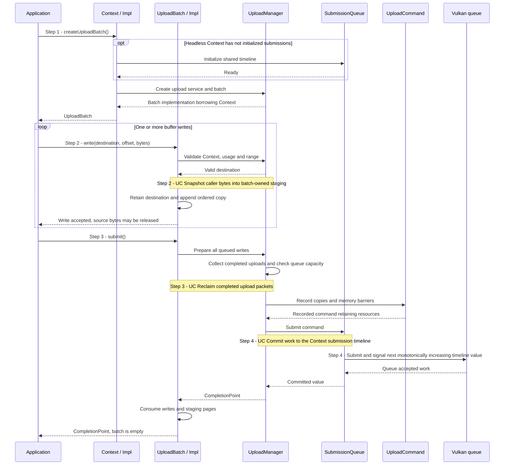

# Upload bytes into a buffer

## Goal and boundary

An application copies a nonempty byte range into an existing buffer by creating
an `UploadBatch`, calling `UploadBatch::write(Buffer, offset, bytes)`, then
submitting the batch. This implemented flow ends when the Context's queue accepts
the copies and returns a `CompletionPoint`; that point does **not** mean the GPU
has finished them.

**Panda** validates the destination, snapshots the caller's bytes into staging,
records ordered copies and retains their resources through completion. **The
application** creates and owns the destination, chooses the ranges and observes
completion when it needs to know that the work has finished. This scenario covers
buffer-only writes; texture and mesh writes add layout and atomicity rules.

## Preconditions

1. **Context.** Use a live `Context` and serialize its operations on the Context
   execution thread.

## Main flow

1. **Create a batch.** The application calls `Context::createUploadBatch()`.
   Context lazily creates its upload manager and, when needed, the shared queue
   timeline. The returned move-only batch borrows Context, submits no work and
   performs no completion wait.
2. **Validate and stage each write.** `UploadBatch::write()` checks the buffer
   and range. The batch appends the copy operation after staging succeeds, in
   call order. The caller may release the source bytes after `write()` returns.
3. **Prepare the upload.** `UploadBatch::submit()` asks `UploadManager` to
   collect completed packets, check queue capacity and record the batch's copies
   and memory barriers in an `UploadCommand`.
   [UC Reclaim completed upload packets](reclaim-completed-uploads.md) explains
   the collection; the command retains its staging pages and destinations.
4. **Submit and publish completion.** `SubmissionQueue` submits the command
   on the Context's graphics/compute queue. Only after Vulkan accepts it does the
   queue commit the timeline value and return a `CompletionPoint`. Success
   consumes the public `UploadBatch`; Context retains the packet until a later
   collection observes GPU completion. [UC Commit work to the Context submission timeline](commit-context-submission.md)
   explains the queue-acceptance boundary.

The shared byte-staging path is documented in
[UC Snapshot caller bytes into batch-owned staging](snapshot-upload-staging.md).

## Notes

**Snapshot and ordering.** A buffer write copies exactly the requested bytes;
buffer offsets and lengths have no artificial four-byte alignment requirement.
Each copy is appended only after validation and staging succeed. Overlapping
writes in one batch therefore apply in insertion order. The shared
[upload contract](../design/contracts/resources.md#allocation-uploads-and-descriptors)
defines the copy barriers and visibility to later queue consumers.

**Ownership.** Before submission, the batch owns its staging pages and retains
each destination while borrowing Context. Destroying it before submit cancels
the queued writes and releases those owners without submitting this batch's work.
Their ranges are returned when the resources lose their final owner; see
[UC Return a resource memory range](release-memory-range.md).
After successful submission, Context's pending packet retains the command, pages
and destinations until collection observes completion. Releasing the
application's `Buffer` handle does not release a destination still retained by
that packet.

**Completion.** The returned point identifies committed work on the Context's
shared timeline. It is a copyable token and does not retain Context or resources;
the issuing Context must remain alive while the application observes it. Use
`Context::poll()` or `Context::wait()` to observe GPU completion when needed;
[UC Observe or wait for submitted GPU work](observe-completion.md) explains
their results and limits.
Submission itself does not block for completion. Uploads use explicit barriers
around the copies, so queue order alone is not treated as a memory dependency.

**Lazy service.** `Context::createUploadBatch()` creates the upload service on
first use. Headless Contexts also initialize their shared submission timeline at
that point; windowed Contexts use the timeline already shared with presentation.

## Variants and errors

|  | Point and condition | Response | Resulting state and next action |
| --- | --- | --- | --- |
| **Error&nbsp;1** | Step 1: Context is moved-from or upload service/timeline initialization fails | Return `InvalidArgument` or the initialization error | No batch or upload work is published; use a live Context or resolve the reported backend/capability problem |
| **Error&nbsp;2** | Step 2: empty bytes, foreign/empty buffer, missing transfer-destination usage or out-of-range write | Return a validation error before appending the write | Earlier writes remain in the batch; correct the request or discard the batch |
| **Error&nbsp;3** | Step 2: completion query, staging allocation, mapped write or cache flush fails | Propagate the error without appending this write | Earlier writes remain available; retry only when the error category permits it |
| **Error&nbsp;4** | Step 3: submit is called with no writes | Return `InvalidArgument` | The batch remains valid; add a write or destroy it |
| **Error&nbsp;5** | Steps 3–4: capacity check, command preparation or queue submission fails | Return the error without a `CompletionPoint` | The batch retains its writes and pages for a permitted retry; device loss does not promise recovery |

## Outcomes

**Success.** The Context queue accepted every copy in the batch and issued a
completion point. The batch handle is consumed, but GPU completion remains
asynchronous. The application can enqueue later Context work in queue order or
poll/wait for the point when it needs an observed completion result.

**Cancellation.** Destroying a batch before successful submission cancels its
writes and releases unsubmitted staging and destination owners. Context must
outlive the batch; destroying Context with a live unsubmitted batch is a fatal
lifetime violation.

## Related information

- [UC Reclaim completed upload packets](reclaim-completed-uploads.md) explains when
  Context releases the owners retained by submitted uploads.
- [UC Snapshot caller bytes into batch-owned staging](snapshot-upload-staging.md)
  explains staging-page reuse, cache flushes and source-byte lifetime.
- [Resource ownership, lifetime and synchronization](../design/contracts/resources.md#ownership)
  and [allocation, uploads and descriptors](../design/contracts/resources.md#allocation-uploads-and-descriptors)
  define the shared resource and upload guarantees.
- [Allocation, uploads and resource lifetimes](../development/tasks/resource-lifetimes.md)
  records the implemented API boundary and accepted task evidence.
- [Vulkan synchronization examples](https://docs.vulkan.org/guide/latest/synchronization_examples.html)
  show how barriers establish dependencies between copies and later resource uses.
- [`vkCmdCopyBuffer`](https://docs.vulkan.org/refpages/latest/refpages/source/vkCmdCopyBuffer.html)
  specifies the Vulkan buffer-copy command used by the recorded upload packet.
