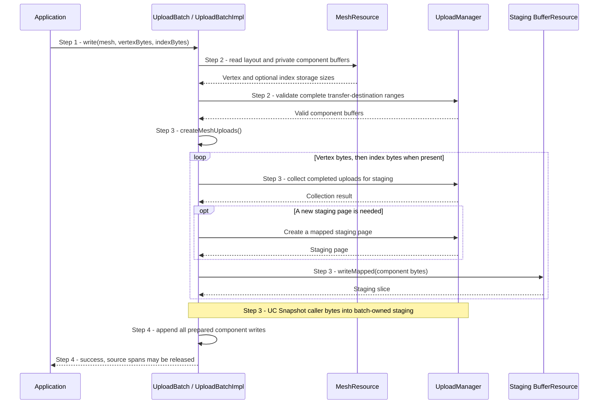
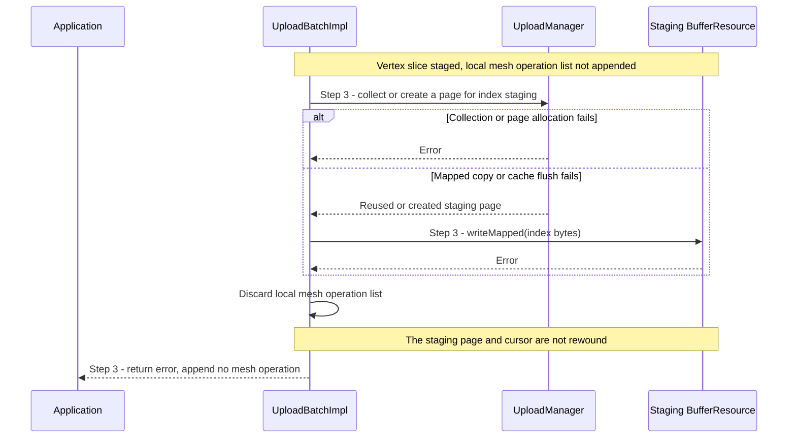

# Upload a complete mesh payload into a batch

## Goal and boundary

An application adds the complete vertex payload and optional index payload of
one existing `Mesh` to an `UploadBatch` with one
`UploadBatch::write(Mesh, vertexBytes, indexBytes)` call. The flow starts at
that call and ends when its component writes have both been appended to the
batch, or the call returns an error. The guarantee is about batch contents: it
does not promise rollback of bytes already copied into staging pages.

**Panda** validates both component buffers, snapshots the supplied bytes and
retains the mesh's destinations. **The application** supplies exactly sized
payloads and later submits the batch. This scenario covers one mesh write;
ordinary staging and batch submission use the shared flows linked below.

## Preconditions

1. **Live batch.** Use a valid `UploadBatch` borrowing a live `Context` and
   serialize its operations on the Context execution thread.

## Main flow

1. **Request the mesh write.** The application calls
   `UploadBatch::write(mesh, vertexBytes, indexBytes)`. The index span defaults
   to empty for a non-indexed mesh.
2. **Validate the complete payload.** `UploadBatchImpl::write()` passes the
   mesh resource to `createMeshUploads()`. The operation checks the mesh handle,
   requires the vertex span to match `Mesh::getVertexSize()`, and requires the
   index span to match `Mesh::getIndexSize()`. It then
   validates the full transfer-destination range of each component buffer.
   [UC Create mesh storage with optional indices](create-mesh.md) explains how
   those sizes and private buffers are created.
3. **Stage each component.** `createMeshUploads()` stages the vertex bytes and,
   when the mesh has indices, stages the index bytes second. Each staging call
   copies and flushes its source slice before returning. The shared
   [UC Snapshot caller bytes into batch-owned staging](snapshot-upload-staging.md)
   explains page reuse, allocation and cache visibility.
4. **Append the prepared writes.** Only after all requested component staging
   succeeds does `UploadBatchImpl::write()` append the local operations to the
   batch. A successful call has queued the full payload but has not submitted
   GPU work; the application may release its source spans.

## Notes

**All-or-none batch append.** `createMeshUploads()` first builds a local list. The
batch receives neither component operation until every requested component has
staged successfully. Earlier unrelated writes already in the batch remain
untouched.

**Staging side effects.** If index staging fails after vertex staging, the
current mesh write contributes no operation to the batch. The vertex bytes may
already occupy a staging page and its cursor or allocation state is not rolled
back; see the failure boundary in
[UC Snapshot caller bytes into batch-owned staging](snapshot-upload-staging.md).
Container allocation failures follow the [shared error policy](../design/contracts/resources.md#errors);
the final batch-capacity allocation also does not rewind staging.

**Not GPU atomicity.** A successful call prepares writes in the batch; it does
not submit them or publish a GPU completion point. Later submission and
completion follow [UC Upload bytes into a buffer](upload-buffer.md) and
[UC Commit work to the Context submission timeline](commit-context-submission.md).

## Variants and errors

|  | Point and condition | Response | Resulting state and next action |
| --- | --- | --- | --- |
| **Variant&nbsp;1** | Step 2: the mesh has no index buffer | Validate and stage only vertex bytes; the index span must be empty | One buffer write is appended after vertex staging succeeds |
| **Error&nbsp;1** | Step 1: the batch handle is empty or already submitted | Return `InvalidArgument` | No write is added; create a new batch before retrying |
| **Error&nbsp;2** | Step 2: the mesh is empty/from another Context, either payload size is not exact, or a component buffer is invalid | Return `InvalidArgument` before staging | The batch is unchanged; correct the mesh or byte spans |
| **Error&nbsp;3** | Step 3: vertex collection, staging-page allocation, mapped copy or cache flush fails | Return the error without appending a mesh operation | Earlier batch writes remain; retry only when the error category permits it. Staging state from this attempt may remain |
| **Error&nbsp;4** | Step 3: index staging fails after vertex staging succeeds | Return the error without appending either mesh operation; see [failure after vertex staging](#error-4---failure-after-vertex-staging) | Earlier batch writes remain; retry only when the error category permits it. Vertex staging state may remain |
| **Error&nbsp;5** | Step 4: the prepared operation count exceeds the batch's maximum capacity | Return `ResourceExhausted` before appending them | Earlier batch writes remain; use another batch |

### Error 4 - Failure after vertex staging

**Entry state.** The payload and both component buffers passed validation.
Vertex bytes have been copied to a staging slice and its local upload operation
exists, but neither mesh operation has been appended to the batch. Earlier
unrelated batch writes remain queued.

The successful vertex staging can leave bytes and advanced staging state in the
batch even though the local operation list is discarded. The batch remains
usable when the returned error permits retry; [UC Snapshot caller bytes into
batch-owned staging](snapshot-upload-staging.md) describes this failure boundary.

## Outcomes

**Success.** The batch owns both component operations for an indexed mesh, or
the vertex operation for a non-indexed mesh. The caller may release its source
spans and continue adding writes or submit the batch.

**Failure.** No component operation from this mesh call is appended. Previously
queued batch writes remain available; staging pages, copied bytes and cursor
state are not guaranteed to return to their pre-call values.

## Related information

- [UC Create mesh storage with optional indices](create-mesh.md) defines mesh
  payload sizes and the vertex/index storage ownership.
- [UC Snapshot caller bytes into batch-owned staging](snapshot-upload-staging.md)
  explains the shared source-copy and cache-flush path.
- [UC Upload bytes into a buffer](upload-buffer.md) explains later batch
  submission, queue acceptance and destination retention through completion.
- [Allocation, uploads and descriptors](../design/contracts/resources.md#allocation-uploads-and-descriptors)
  owns the exact-size and no-partial-queueing guarantees.
- [Allocation, uploads and resource lifetimes](../development/tasks/resource-lifetimes.md)
  records the implemented mesh-upload scope.
