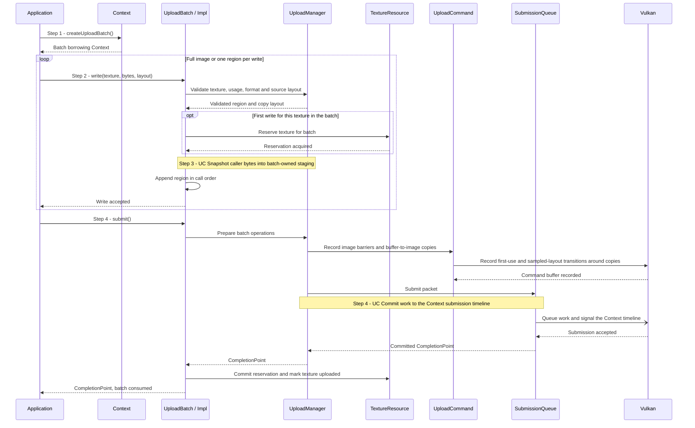
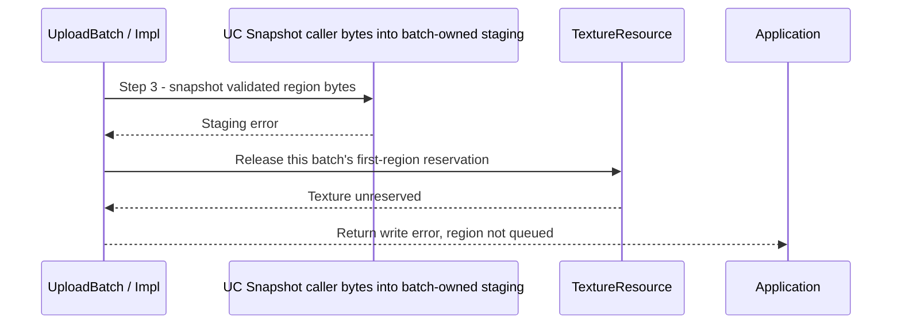

# Upload texture contents or regions

## Goal and boundary

An application initializes a newly created `Texture` by copying a full image or
one or more rectangles into it through an `UploadBatch`. The flow starts with a
live `Context` and a texture created by that Context; it ends when the queue
accepts the copies, the unsubmitted batch is cancelled, or an operation returns
an error. Queue acceptance returns a `CompletionPoint`. The flow covers uploads
to Panda's single-mip, single-layer 2D textures, not texture creation or later
editing.

**Panda** validates the image-copy description, reserves the texture for one
batch, snapshots source bytes, records the required image layouts and retains
resources through completion. **The application** supplies the bytes and region
layout, submits the batch and observes completion when needed. Buffer and texture
uploads use the same byte-staging operation; buffer-specific ordering and
ownership are described in [UC Upload bytes into a buffer](upload-buffer.md).

## Preconditions

1. **Context and texture.** The `Context` is live, the `Texture` belongs to it,
   and its operations are serialized on the Context execution thread.
2. **Texture is available for initialization.** It has not already been
   submitted for upload and is not reserved by another unsubmitted batch.

## Main flow

1. **Create a batch.** The application calls `Context::createUploadBatch()`.
   The batch borrows the Context and owns no GPU work until submission; batch
   creation and the shared submission queue are covered by
   [UC Upload bytes into a buffer](upload-buffer.md).
2. **Validate and reserve the texture.** For a full upload, the application calls
   `UploadBatch::write(texture, bytes, rowPitchBytes)`; for a partial upload, it
   supplies a `TextureUploadRegion`. `UploadManager` checks the Context, usage,
   format, region and source layout. The first valid write reserves the texture
   for this batch before staging begins. Further regions for that texture may be
   added to the same batch.
3. **Stage each region.** Snapshot bytes and append the region only after staging
   succeeds; writes remain in call order.
4. **Record and submit the copies.** `UploadManager` builds one `UploadCommand`.
   It transitions each image from `UNDEFINED` to `TRANSFER_DST_OPTIMAL` before
   its first region copy, records the copies, and transitions it to
   `SHADER_READ_ONLY_OPTIMAL` after the batch's copies. `SubmissionQueue` submits
   the command using the shared Context timeline; only an accepted queue submit
   commits the texture reservation and returns a `CompletionPoint`. See the
   [UC Commit work to the Context submission timeline](commit-context-submission.md).

The shared byte-staging path is documented in
[UC Snapshot caller bytes into batch-owned staging](snapshot-upload-staging.md).

## Notes

**Full-image and region layouts.** The full-image overload uses the texture's
entire extent at offset zero. `TextureUploadRegion::offset` and `extent` are in
texels. `rowPitchBytes` is the byte stride between source block rows; zero means
tightly packed rows. A nonzero pitch must fit the copied row and be a multiple
of the format's texel-block byte size, and the source span must contain all
copied rows. For block-compressed formats, offsets and non-edge extents must
align to the format block; an extent may end at the corresponding image edge.

**Supported images.** Uploads require both transfer-destination and sampled
usage. Supported formats are single-plane 2D color formats, including
block-compressed formats; depth/stencil and multi-plane formats are rejected.
The format's optimal-tiling transfer and sampled support is checked when the
texture is created.

**Reservation and immutability.** One unsubmitted batch reserves a texture and
may add multiple regions. Destroying that batch before submission releases the
reservation. After a successful queue submit, the texture is marked uploaded and
cannot be written again; publish a replacement texture to edit sampled contents.
If a later region's staging fails, earlier accepted regions and their reservation
remain in the batch.

**Layout and contents.** The image is new and begins in `UNDEFINED`. The first
region transitions the whole texture to transfer-destination layout; after all
batch copies, Panda makes transfer writes visible and transitions the image to
shader-read layout. Texels outside the uploaded regions remain undefined. A
successful submit means the queue accepted these commands, not that the GPU has
finished them. Context retains the command, staging pages and destination until
completion; see [UC Reclaim completed upload packets](reclaim-completed-uploads.md) and
[UC Observe or wait for submitted GPU work](observe-completion.md).

## Variants and errors

|  | Point and condition | Response | Resulting state and next action |
| --- | --- | --- | --- |
| **Variant&nbsp;1** | Before Step 4: the application destroys the unsubmitted batch | Cancel its queued writes and release staging pages and texture reservations without submitting GPU work | The texture can be reserved by a later batch; see [UC Snapshot caller bytes into batch-owned staging](snapshot-upload-staging.md) for page ownership |
| **Error&nbsp;1** | Step 2: the texture is empty or foreign, usage lacks transfer-destination or sampled, the format is unsupported, or the region/pitch/source size is invalid | Return `InvalidArgument` or `Unsupported` before reserving the texture or staging this region | Earlier batch operations remain; correct the request and retry |
| **Error&nbsp;2** | Step 2: another batch already reserved the texture, or a prior submission marked it uploaded | Reject the write | No region is appended; cancel the earlier unsubmitted batch before trying another, or create a replacement texture after upload |
| **Error&nbsp;3** | Step 3: collection, staging allocation, mapped copy or cache flush fails | Return the error and do not append this region; see [first-region staging cleanup](#error-3---first-region-staging-failure) | If this was the first region, release its reservation; if earlier regions were accepted, keep their reservation and writes |
| **Error&nbsp;4** | Step 4: packet preparation or queue submission fails | Return the error without a completion point; the batch retains its queued regions and reservation for a permitted retry | Recoverable failures can be retried with the same batch; device loss does not promise recovery. See [UC Commit work to the Context submission timeline](commit-context-submission.md) |
| **Error&nbsp;5** | Step 4: the batch contains no accepted writes | Return `InvalidArgument` | The batch remains valid; add a valid write or destroy it |

### Error 3 - First-region staging failure

Entry state: validation succeeded and the first region reserved the texture for
this batch, but no operation for that region has been appended.

If a later region fails, the first accepted region still owns the reservation;
the failed later region is omitted while earlier writes remain available for
submission or cancellation.

## Outcomes

**Submitted.** The Context queue accepted the batch and returned a
`CompletionPoint`. The public batch is consumed, the texture is immutable, and
the application may use the point to observe queue completion. The point does
not itself retain the Context or texture.

**Cancelled or failed before submission.** No completion point is issued. An
unsubmitted batch can be destroyed to release its staging pages and reservations;
a failed submission keeps the batch available for a retry permitted by the
returned error.

## Related information

- [UC Create a texture and its default view](create-texture.md) explains texture
  creation, its default view and undefined initial contents.
- [UC Upload bytes into a buffer](upload-buffer.md) shows the shared batch and
  submission path; [UC Snapshot caller bytes into batch-owned staging](snapshot-upload-staging.md)
  documents the common byte-staging operation.
- [UC Commit work to the Context submission timeline](commit-context-submission.md)
  explains queue acceptance and timeline publication.
- [UC Reclaim completed upload packets](reclaim-completed-uploads.md) explains how
  submitted packets retain and release texture and staging owners.
- [UC Observe or wait for submitted GPU work](observe-completion.md) explains the
  returned completion token.
- [Allocation, uploads and resource lifetimes](../development/tasks/resource-lifetimes.md)
  records the accepted implementation scope and evidence.
- [`vkCmdCopyBufferToImage`](https://docs.vulkan.org/refpages/latest/refpages/source/vkCmdCopyBufferToImage.html)
  specifies the Vulkan command used for each texture region.
- [Vulkan synchronization examples](https://docs.vulkan.org/guide/latest/synchronization_examples.html)
  explain image transfer and shader-read layout dependencies.
