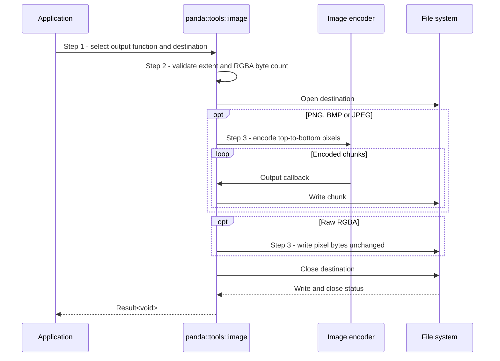

# Write an image file

## Goal and boundary

An application writes a completed `ImageReadback` to raw RGBA, PNG, BMP or JPEG through
`panda::tools::image`. The utility validates and writes host pixels; rendering and GPU
synchronization remain the application's responsibility.

## Main flow

1. **Choose the output.** The application calls `writeRawRgba()`, `writePng()`,
   `writeBmp()` or `writeJpeg()` with a readback and destination path. Only JPEG accepts
   a quality value.
2. **Validate pixels.** `panda::tools::image` checks that the extent is nonzero, fits the
   encoder's integer and row-stride limits, and matches the tightly packed RGBA byte count.
3. **Write the output.** The utility streams encoded chunks, or writes the raw RGBA bytes, and
   returns `Result<void>` after closing the file.

## Notes

**Pixel and alpha handling.** Input rows are top-to-bottom RGBA. Raw RGBA contains
only these bytes; the file has no extent or color-space metadata. PNG preserves the
RGB sRGB bytes and linear UNORM alpha. BMP is uncompressed 24-bit RGB; BMP and JPEG
composite the input over black by decoding RGB to linear color, multiplying by
alpha and encoding the result back to sRGB. JPEG quality is 1 to 100 and defaults
to 90.

**Failure guarantee.** Invalid input is rejected before the destination is opened.
A filesystem write error returns `BackendFailure`; an encoder allocation failure returns
`ResourceExhausted`. A failed write can leave a partial output file.

## Variants and errors

| Condition                                                                  | Result and next action                                                                         |
|----------------------------------------------------------------------------|------------------------------------------------------------------------------------------------|
| Extent is zero, too large for the encoder, or the RGBA byte count is wrong | Return `InvalidArgument` before opening the output; supply a complete tightly packed readback. |
| JPEG quality is outside 1 to 100                                           | Return `InvalidArgument` before opening the output; use a supported quality.                   |
| Output path cannot be opened or a write/close fails                        | Return `BackendFailure`; correct the path or storage issue and write again.                    |
| Encoder cannot allocate its working memory                                 | Return `ResourceExhausted`; retry when memory is available.                                    |

## Related information

- [UC Render a view to an image](render-offscreen-view.md) explains how Core creates
  the completed `ImageReadback` used here.
- [Offscreen output](../design/contracts/rendering.md#offscreen-output) defines
  pixel extent, order, channel layout and color space.
- [Image file export](../development/tasks/image-file-export.md) records the
  implementation scope and acceptance criteria.
- [Offscreen rendering example](../../examples/offscreen_rendering/README.md)
  renders a cube and saves usable PNG, BMP, JPEG and raw RGBA files.
